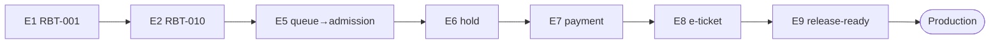

# TASK-ORDER — Ordered Execution Plan (MAIN RUN REFERENCE)

> GENESIS Phase 3 output, alongside `05-TASK-LIST.md`.
> `05-TASK-LIST.md` is the full decomposition (epics / stories / ACs); **this file is the
> run plan** — tasks grouped into dependency-ordered waves the agent executes.
>
> **This is the single source of truth for RUNNING the workflow.** `WORKFLOW.md` Phase 0
> selects the next task from here, not from TASK-LIST. Keep **Status / Delivered** here
> authoritative; TASK-LIST carries the detail.
>
> Scope: **FE only** (Expo + RN + RN Web), single app, Clean-Architecture folders. Prefix **RBT**.

---

## How to run this file

1. Work **wave by wave**, top to bottom. A wave starts only when the previous wave is `Done`.
2. Inside a wave, every task is **dependency-free of its wave-siblings and file-disjoint** → run in parallel (WORKFLOW §Parallel-Batch Mode: one worker + one git worktree per task). A single agent runs them sequentially in listed order.
3. A task is **eligible** only when every "Depends On" task is `Done`.
4. Update **Status / Delivered** here as work progresses — this file, not TASK-LIST, is the live run state.
5. **Shared-file guard:** tasks touching a shared file (lockfile, `src/app` route tree, `src/providers/container.ts`, a `src/domain` port/state-machine, a barrel/index) must NOT share a wave — serialize them.

**Legend:** Status = `Backlog | To Do | In Progress | In Review | QA | Done | Blocked`. Delivered ✅ = merged to `develop` + CI green + G3 evidence approved.

---

## Run Next

**Current wave:** `Wave 2 — Core API (E2)` — RBT-010 ✅ delivered (port freeze landed).
**Run next:** `RBT-011 / 012 / 013 / 014` — all depend only on RBT-010 (✅) and are file-disjoint → parallelizable. (Wave 1 ✅ all; RBT-010 ✅; RBT-005b CI deferred post-E2E.)

---

## Domains

| Domain | Owner area / paths | Epics |
|--------|--------------------|-------|
| Platform / foundations | `apps/client` root, `src/app`, `src/providers`, CI, `tailwind.config.js` | E1 |
| Core / API | `src/domain`, `src/application`, `src/infrastructure/{http,api,__fixtures__}` | E2 |
| Auth | `src/presentation/screens/Auth*`, auth use-cases | E3 |
| Events | `src/presentation/screens/Events*`, events use-cases | E4 |
| Queue | `src/presentation/screens/Waiting*`, queue state machine | E5 |
| Booking | `src/presentation/screens/Checkout*`, booking state machine | E6 |
| Payment | `src/presentation/screens/Payment*`, payment adapter | E7 |
| Ticket / notifications | `src/presentation/screens/Success*`, notification adapters | E8 |
| Hardening | cross-cutting (a11y, perf, load, QA, release) | E9 |

---

## Execution Waves

### Wave 1 — Foundations (E1) — mostly serial on RBT-001

> RBT-001 builds the app + folders; 002/003/004/005 depend on it. 002–005 are file-disjoint of each other and can parallelize once 001 lands.

| Task | Owner | Domain | Depends On | Files (disjoint) | Parallel | Status | Delivered |
|------|-------|--------|-----------|------------------|----------|--------|-----------|
| RBT-001 | Riz | Platform | — | scaffold: `apps/client/**`, `src/*` folders, `tailwind.config.js` | ❌ first | Done | ✅ |
| RBT-002 | Riz | Platform | 001 | `src/app/**` (Expo Router route tree) | ✅ | Done | ☑ |
| RBT-003 | Riz | Platform | 001 | `tailwind.config.js`, `src/presentation/theme/**` | ✅ | Done | ☑ |
| RBT-004 | Riz | Platform | 001 | `src/providers/**` (DI container + ports wiring) | ✅ | Done | ☑ |
| RBT-005a | Riz | Platform | 001 | `.husky/**`, `apps/client/package.json` (lint-staged) | ✅ | Done | ✅ |
| RBT-005b | Riz | Platform | 001, 005a | `.github/workflows/**`, `sonar-project.properties` | ✅ | Deferred (post-E2E) | ☐ |

**Wave 1 gate:** all `Done` → start Wave 2. (Also satisfies most of Gate **H6** Project-Setup, verified via `10-PROJECT-SETUP.md`.)

### Wave 2 — Core API layer (E2) — mostly serial on RBT-010

| Task | Owner | Domain | Depends On | Files (disjoint) | Parallel | Status | Delivered |
|------|-------|--------|-----------|------------------|----------|--------|-----------|
| RBT-010 | Riz | Core/API | 004 | `src/infrastructure/{http,api}/**`, generated types | ❌ first | Done ✅ | ☑ |
| RBT-011 | Riz | Core/API | 010 ✅ | `src/domain/services/server-clock.ts` | ✅ | To Do (unblocked) | ☐ |
| RBT-012 | Riz | Core/API | 010 ✅ | idempotency util in `src/domain`/`src/application` | ✅ | To Do (unblocked) | ☐ |
| RBT-013 | Riz | Core/API | 010 ✅ | `src/domain/errors/**`, error mapping | ✅ | To Do (unblocked) | ☐ |
| RBT-014 | Riz | Core/API | 010 ✅ | `src/infrastructure/__fixtures__/**`, `src/shared/test-fixtures/**` | ✅ | To Do (unblocked) | ☐ |

**Wave 2 gate:** all `Done` + `src/domain` ports/interfaces frozen (owned by Eld/Ray) → start Wave 3.

### Wave 3 — Feature batch A (E3 · E4 · E5) — parallel (file-disjoint)

> Distinct feature areas, shared only via frozen `src/domain` + `src/application` interfaces.

| Task group | Owner | Domain | Depends On | Files (disjoint) | Parallel | Status | Delivered |
|------|-------|--------|-----------|------------------|----------|--------|-----------|
| E3 (RBT-020…023) | Ray | Auth | E2 | `presentation/screens/Auth*` + auth use-cases | ✅ | Backlog | ☐ |
| E4 (RBT-030…034) | Ray | Events | E2 | `presentation/screens/Events*` + events use-cases | ✅ | Backlog | ☐ |
| E5 (RBT-040…044) | Eld | Queue | E2 | `presentation/screens/Waiting*` + queue state machine | ✅ | Backlog | ☐ |

**Shared-file note:** RBT-002 froze the route tree; any Wave-3 task adding a route edits `src/app` → serialize those edits.
**Wave 3 gate:** E3 + E5 `Done` (E4 may trail) → start Wave 4.

### Wave 4 — Checkout / booking hold (E6) — sequential

> Integrates auth (E3) + admission (E5); touches booking state machine.

| Task group | Owner | Domain | Depends On | Shared reason | Parallel | Status | Delivered |
|------|-------|--------|-----------|---------------|----------|--------|-----------|
| E6 (RBT-050…054) | Eld | Booking | E3, E5 | booking state machine + checkout route | ❌ serialize | Backlog | ☐ |

### Wave 5 — Payment (E7) + Notifications start (E8 partial) — mostly sequential

| Task group | Owner | Domain | Depends On | Shared reason | Parallel | Status | Delivered |
|------|-------|--------|-----------|---------------|----------|--------|-----------|
| E7 (RBT-060…065) | Ray | Payment | E6 | payment state machine + SNAP handoff; mock adapter at composition root | ❌ serialize | Backlog | ☐ |
| E8 notif (RBT-072/073) | Riz | Ticket/notif | E2 (DI port only) | can run parallel with E7 — needs only the notification port | ✅ | Backlog | ☐ |

### Wave 6 — E-ticket (E8 rest) — sequential on payment

| Task group | Owner | Domain | Depends On | Shared reason | Parallel | Status | Delivered |
|------|-------|--------|-----------|---------------|----------|--------|-----------|
| E8 ticket (RBT-070/071) | Riz | Ticket | E7 (PAID) | success screen + QR need a paid booking | ❌ serialize | Backlog | ☐ |

### Wave 7 — Hardening (E9) — cross-cutting, finalizes all

| Task group | Owner | Domain | Depends On | Shared reason | Parallel | Status | Delivered |
|------|-------|--------|-----------|---------------|----------|--------|-----------|
| RBT-080 a11y | Eld | Hardening | E8 (flows exist) | WCAG pass touches every screen | ❌ serialize | Backlog | ☐ |
| RBT-081 perf/bundle | Ray | Hardening | RBT-033 + features | bundle/Web Vitals across routes | ❌ serialize | Backlog | ☐ |
| RBT-082 load test | Ray | Hardening | RBT-042/050/054 | flash-crowd on queue+booking | ❌ serialize | Backlog | ☐ |
| RBT-083 QA suites | Ray | Hardening | features | Playwright + Maestro across flows | ❌ serialize | Backlog | ☐ |
| RBT-084 release readiness | Ray | Hardening | RBT-005/081/082/083 | OTA/rollback/summary | ❌ serialize | Backlog | ☐ |

---

## Critical Path

**Critical path:** E1 → E2 → E5 → E6 → E7 → E8 → E9 (7 epics).

---

## Parallelism Summary

| Wave | Epics/tasks | Max parallel | Blocked by |
|------|-------------|--------------|------------|
| 1 | E1 (RBT-001…005) | 4 (after 001) | — |
| 2 | E2 (RBT-010…014) | 4 (after 010) | Wave 1 |
| 3 | E3 · E4 · E5 | 3 feature areas | Wave 2 (frozen interfaces) |
| 4 | E6 | 1 (serialize) | E3 + E5 |
| 5 | E7 (+ E8 notif) | 2 | E6 |
| 6 | E8 ticket | 1 | E7 |
| 7 | E9 | 1 | E8 |

> **Dispatch rule:** a conductor dispatches one wave as a parallel batch (one worker + one git worktree per task), waits for all to reach `Done` (each through G1–G3), then starts the next wave. Never dispatch across waves.

---

## Shared-File Register

> Files that force serialization even across domains. Any two tasks that both touch one cannot share a wave.

| Shared file | Touched by | Resolution |
|-------------|-----------|------------|
| `package-lock.json` | any dep-adding task | serialize |
| `src/app/**` (route tree) | RBT-002 + any route-adding feature | land RBT-002 first; serialize later route edits |
| `src/providers/container.ts` (DI) | RBT-004 + any task binding a new port | serialize |
| `src/domain/repositories/**` (ports) | E2 + any consumer | freeze at end of Wave 2 |
| `src/domain/state-machines/**` | E5/E6/E7 | serialize, ordered |

---

## Change Log

| Date | Change | By |
|------|--------|-----|
| 2026-10-29 | Initial decomposition at Phase 3 (H3 PASSED) | agent |
| 2026-10-30 | TASK-ORDER run reference added; docset renumbered to 01–10 to match the 6-gate PLAYBOOK | agent |
