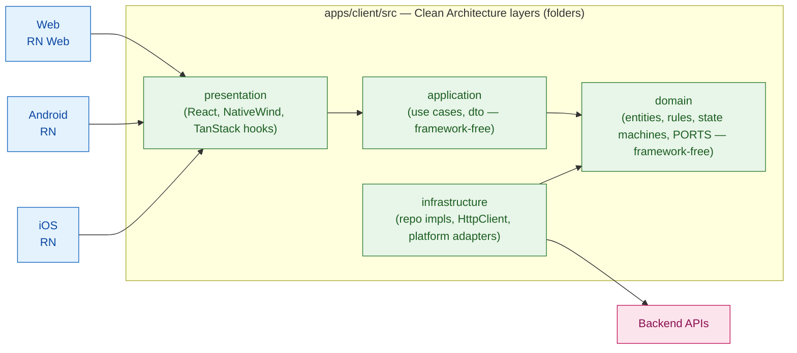
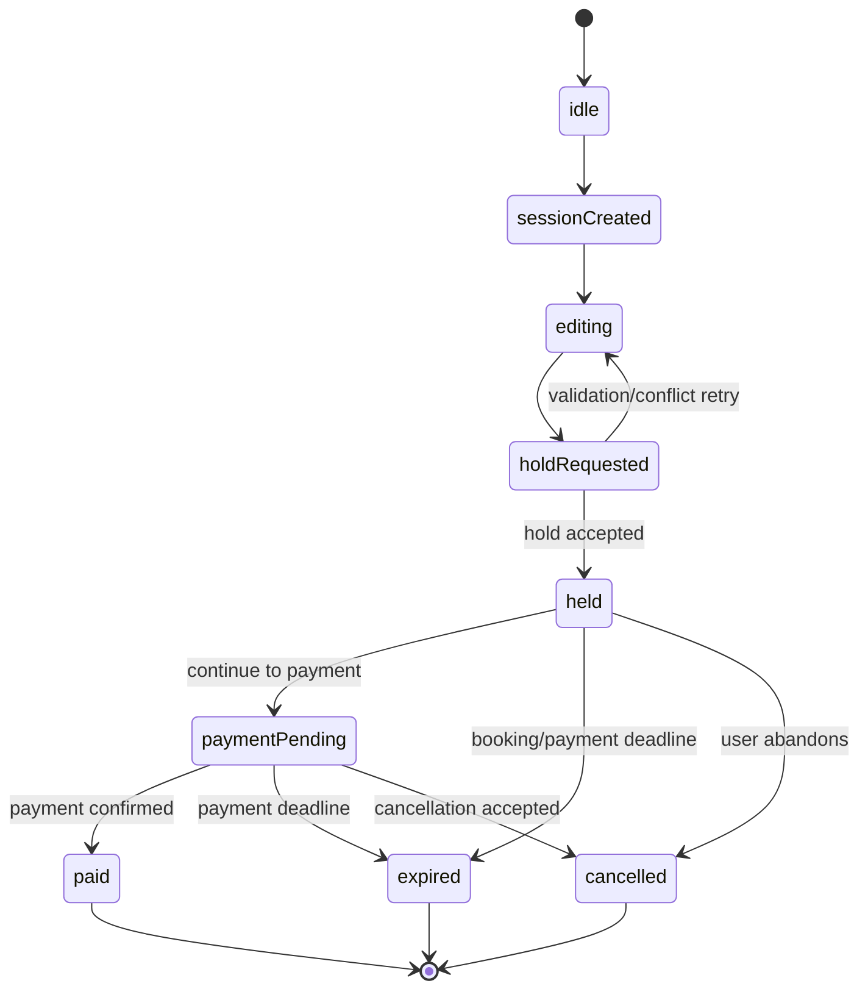
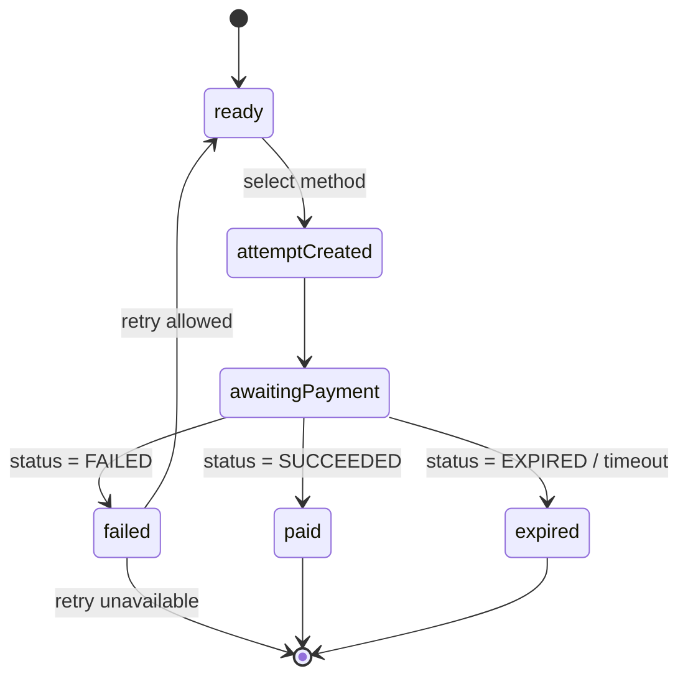

# Grand Architecture — Rusuh Booking Tiket (Expo Universal)

> **Status:** Locked frontend architecture (v2 — single-app Clean Architecture)
> **Date:** 2026-10-30 (supersedes the 2026-10-28 package-monorepo revision)
> **Authors:** FE Architecture
> **Scope:** Frontend for **Web + Android + iOS**, consuming the five backend services defined in `.genesis/docs/api-contract/`.
> **Backend ownership:** API implementation, inventory authority, queue fairness, payment processing, notification delivery, and data persistence remain owned by the BE team.

**Sources of truth:** PDF `.genesis/requirement/Tender Rusuh Booking Ticket.pdf` → OpenAPI contracts in `.genesis/docs/api-contract/` → `.genesis/docs/FE-BE-align-contract.md` → `.genesis/docs/FE-Flow-Diagrams.md` → prototype **`.genesis/prototype/Final`** (V5).

> **v2 change note (2026-10-30).** This revision replaces the eight-package monorepo (`packages/{domain,api-client,state,ui,design-tokens,platform,config,test-fixtures}`) with a **single Expo app whose Clean-Architecture layers are folders under `apps/client/src/`**. The dependency rule, SOLID constraints, ports/adapters, server-authoritative clock, mock-first payment, SEO, and CI/OTA are all **unchanged** — only the physical placement of layers and the enforcement mechanism changed. Decision records in §11 explain why.

## 0. Executive Summary

We build one TypeScript frontend codebase with Expo:

| Target | Runtime | UI layer |
|---|---|---|
| Android | Expo + React Native | React Native components |
| iOS | Expo + React Native | React Native components |
| Web | Expo + React Native Web | React Native components, with selective `.web.tsx` implementations |

The shared frontend core contains API clients, typed contracts, client-side validation, state machines, timers, queue presentation logic, idempotency-key handling, and platform-neutral user flows. The backend remains the final authority for stock, queue order, ticket limits, booking holds, payment state, and expiry.

### Locked decisions

1. **Expo is the application framework.** We use Expo SDK, Expo Router, config plugins, development builds, and EAS or an equivalent internal CI pipeline.
2. **React Native Web is the web target.** We share most components across Android, iOS, and web, while allowing web-specific components where DOM, SEO, print, payment redirects, or desktop interaction requires them.
3. **Expo Go is development-only.** Real development and QA use custom Expo development/preview builds once native capabilities are introduced.
4. **TypeScript is the shared language.** There is no KMP, Kotlin/JS, Compose, SwiftUI, or separate native business-logic implementation in this architecture.
5. **One frontend domain layer, three platform renderers.** Business-flow logic is shared; platform-specific presentation and native adapters are isolated.
6. **The backend is authoritative.** Client validation improves UX but never replaces server validation or atomic inventory control.
7. **Clean Architecture and SOLID are mandatory design principles.** Feature code is organized around use cases and ports, not screens, frameworks, or transport details.
8. **Single app, layers as folders (D1 → Option B).** One `apps/client` Expo app; Clean-Architecture layers are folders under `src/` (`domain/ application/ infrastructure/ presentation/ providers/ shared/`). There is no multi-package split. Layer boundaries are **enforced by ESLint in the commit guard**, not by package graph.
9. **Routes vs composition root (D2 → Option 2B).** `src/app/` holds Expo Router **routes only**; `src/providers/` holds the **composition root** (QueryClient + state + theme + manual DI `container.ts`). No DI library.
10. **Server-data boundary (D3 → hook-seam + HttpClient port).** TanStack Query lives only in `presentation/hooks` (the swap seam). Use cases are framework-free; repositories implement domain ports; the HTTP client is a swappable `HttpClient` port (axios ↔ fetch).
11. **Styling = NativeWind; tokens from prototype V5.** NativeWind (Tailwind for RN) is the styling system. The single source of truth for tokens is `tailwind.config.js`, generated from the `.genesis/prototype/Final` design tokens.

## 1. Product Context and Goals

Rusuh Booking Tiket is a high-contention concert-ticket system:

```text
Event discovery → Event preview → Waiting room → Admission →
Buyer/NIK validation → Ticket selection → Booking hold → Payment → E-ticket
```

The FE must make this flow understandable and resilient while the BE handles contention and authority.

### 1.1 Functional surface

| Screen | Purpose |
|---|---|
| Home | Event catalog, nearby events, history, profile entry |
| Browse results | URL-driven genre, province, time-window, and sort filters for upcoming events |
| Event detail | Event information, categories, availability, queue CTA |
| Waiting room | Queue position, progress, estimated time, refresh-safe state |
| Ticket detail / checkout | Buyer details, attendees, NIK validation, quantity, hold timer |
| Payment | Payment method, SNAP redirect/callback, payment timer, authoritative status verification |
| Success | Order summary, masked NIK, order ID, QR/e-ticket download |
| Expired / failed | Clear reason, released-hold messaging, recovery path |

### 1.2 Quality goals

- One shared implementation of client-side flow rules across Android, iOS, and web.
- Server-authoritative queue, stock, booking, payment, and deadline behavior.
- High-quality responsive web experience without forcing every desktop interaction into mobile conventions.
- Native capabilities for local/remote notifications, file sharing, deep links, secure storage, and QR handling.
- Accessible controls, readable contrast, reduced-motion support, and keyboard-friendly web behavior.
- Fast iteration through development builds and controlled OTA updates.
- Testable domain logic independent of React rendering and platform APIs.
- WCAG 2.1 AA for the web experience, with documented exceptions approved by accessibility review.
- Stampede-safe frontend performance: bounded bundle size, adaptive polling, CDN-friendly assets, and no client-side request storm.

### 1.3 Non-goals

- Reimplementing BE queue or inventory authority in the client.
- Sharing every visual detail across platforms when the platform experience should differ.
- Treating localStorage, AsyncStorage, or secure storage as the source of truth for orders or stock.
- Sending payment, push, or notification requests directly from the client when the contract assigns them to BE.

## 2. System Overview

One shared TypeScript frontend core renders to three platforms (Web via React Native Web, Android and iOS via React Native) and talks to the backend only through outer adapters. The layered structure and dependency direction are shown in §2.1.

### 2.1 Shared system design: Clean Architecture + platform boundaries

The frontend is a Clean Architecture system with one shared core and platform-specific outer adapters, **all within a single app**. The key rule is that source-code dependencies point inward toward higher-level policy. This follows the Clean Architecture dependency rule: the UI, transport, storage, and native APIs may change without changing domain rules. The same pattern also maps well to Expo because platform-specific files and modules can be selected at build time. [Clean Architecture dependency rule](https://www.informit.com/articles/article.aspx?p=2832399) [Expo platform-specific modules](https://docs.expo.dev/router/advanced/platform-specific-modules/)



#### What is shared (and which folder owns it)

| Layer (folder) | Responsibility | Examples |
|---|---|---|
| `domain` | Pure business concepts, rules, ports | NIK validation, quantity rules, money, timer math, queue/booking/payment state machines; `EventRepository`, `PaymentRepository`, `ClockPort` interfaces |
| `application` | User-intent orchestration (use cases, dto) | `JoinQueue`, `HoldBooking`, `CreatePaymentAttempt`, `RestoreSession`; dto + mappers |
| `presentation` | React UI + async-state hooks + stores + theme | screens, components, hooks (TanStack Query seam), Zustand stores, NativeWind theme |
| `infrastructure` | Port implementations + platform adapters | HTTP repositories, `HttpClient` (axios/fetch), notification/storage/file adapters, mock fixtures |
| `providers` | Composition root | manual DI `container.ts`, `service-context.tsx`, `providers.tsx`, `query-client.ts` |
| `shared` | Cross-cutting neutral helpers | `ClockPort` wiring, utils, constants, test fixtures |

#### What is platform-specific

| Platform concern | Responsibility | Where |
|---|---|---|
| Web presentation | SEO metadata, browser URLs, keyboard/focus, desktop nav, print, downloads, hover/pointer | `presentation/**/*.web.tsx` |
| Native presentation | Native navigation, safe areas, gestures, back behavior, haptics | `presentation/**/*.native.tsx` |
| Web adapters | Cookies, browser storage, payment redirects, Blob/download, web notification provider | `infrastructure/**/*.web.ts` |
| Native adapters | Secure storage, push/local notifications, file system, share sheet, deep links, biometric/device APIs | `infrastructure/**/*.native.ts` |
| Platform motion | Shared motion tokens, CSS/Canvas or native-specific where needed | `presentation` |

React Native Web is the default web renderer, while `.web.tsx`, `.native.tsx`, `.ios.tsx`, and `.android.tsx` are explicit escape hatches—not duplicated business logic. Expo and React Native document these platform-specific extension mechanisms. [React Native platform-specific code](https://reactnative.dev/docs/platform-specific-code.html) [Expo web support](https://docs.expo.dev/workflow/web/)

#### Dependency direction

```text
src/app  (Expo Router routes — thin)
            ↓
presentation screens and components
            ↓
presentation hooks / view models   ← TanStack Query lives ONLY here (D3 seam)
            ↓
application use cases and state machines   ← framework-free
            ↓
domain entities, rules, and PORTS   ← framework-free
            ↑ (implements)
infrastructure adapters: repositories → HttpClient port → axios | fetch
            ↓
Backend transport, storage, OS, or browser APIs
```

The domain and application layers must not import React, React Native, Expo, browser globals, or native modules. React components must not call `fetch`, `expo-notifications`, `expo-file-system`, or storage directly; they call a feature hook or use case. Concrete implementations are wired at the composition root (`src/providers`).

**Boundary enforcement (D1 — ESLint, not package graph).** Because all layers live in one app, the dependency rule is enforced by lint rules in the commit guard rather than by package dependencies:

- **MUST** configure `eslint-plugin-boundaries` (or `import/no-restricted-paths`) with the layer zones, wired into the **husky pre-commit guard** so a cross-layer import fails the commit.
- **MUST** ban `react`, `react-native`, `expo`, and browser/native globals inside `src/domain/**` and `src/application/**` via lint.
- **MUST** require a justification comment on any `// eslint-disable` of a boundary rule (no silent bypass).

#### SOLID constraints inside this design

| Principle | Frontend application |
|---|---|
| **S — Single Responsibility** | Screens compose features; use cases perform one user intent; repositories translate one backend capability; adapters wrap one platform API. |
| **O — Open/Closed** | Add a payment method, notification provider, HTTP client, or platform implementation through a new adapter/configuration rather than modifying domain rules. |
| **L — Liskov Substitution** | Mock, staging, and production repositories implement the same interfaces and can be substituted in tests or environments. |
| **I — Interface Segregation** | Depend on focused ports such as `QueueRepository`, `PaymentRepository`, `ClockPort`, `NotificationPort`, `FileSharePort`, and `HttpClient`; do not inject one global service object. |
| **D — Dependency Inversion** | Use cases depend on interfaces; concrete REST, Expo, browser, and native implementations are wired at the composition root (`src/providers/container.ts`). |

This keeps the same booking flow usable by Android, iOS, web, mocks, and automated tests.

### 2.2 Technology choices

| Concern | Locked choice | Notes |
|---|---|---|
| App framework | **Expo** | Universal Android, iOS, and web workflow |
| UI | **React Native** | Shared component primitives and interaction model |
| Web renderer | **React Native Web** | React DOM underneath; `.web.tsx` escape hatch |
| Navigation | **Expo Router** | File-based routes in `src/app`, deep links, browser URLs, layouts, guards |
| Language | **TypeScript** | Shared domain, API types, hooks, and UI |
| Styling | **NativeWind** (Tailwind for RN/RN-Web) | Single token source = `tailwind.config.js`, generated from prototype V5 tokens |
| State | **Zustand** | Client/session/UI state in `presentation/stores`; domain actions remain framework-light |
| Server data | **TanStack Query** | Confined to `presentation/hooks` (D3 seam): cache, retries, refetch, polling, mutation lifecycle |
| HTTP client | **`HttpClient` port** (axios or fetch adapter) | Swappable in `infrastructure`; repositories depend on the port, not a concrete client |
| Forms | **React Hook Form + Zod** | NIK, email, attendee, and checkout validation |
| Animations | **React Native Reanimated** | Shared motion; CSS/SVG/Canvas only for web-specific effects |
| QR | `react-native-svg` + QR library | Render shared QR; platform-specific export/download adapter |
| Notifications | `expo-notifications` | Local scheduling and remote token registration |
| Files | `expo-file-system` + `expo-sharing` | Native save/share; browser download fallback |
| Secure storage | `expo-secure-store` | Tokens and sensitive client credentials on native |
| Local persistence | **AsyncStorage** | Non-authoritative drafts and restore metadata; SQLite is out of scope for v1 |
| Contracts | OpenAPI-generated TypeScript types/client | Keep FE aligned with BE contracts |
| Static quality | **SonarCloud Quality Gate** | TypeScript analysis, bugs, vulnerabilities, code smells, duplication, and coverage thresholds |
| Unit/component testing | **Jest** + React Native Testing Library | Domain rules, hooks, components, accessibility contracts |
| Web QA | **Playwright (local/manual)** | React Native Web in Chromium/WebKit/Firefox, responsive layouts, SEO output, keyboard, download/print; not executed in cloud CI |
| Native QA | **Maestro (local/manual)** | Final Android/iOS development or preview builds, notifications, deep links, permissions, share/download; not executed in cloud CI |
| Delivery | EAS Build/Submit/Update or internal CI | EAS is optional; Expo framework is not tied to EAS |

## 3. App Structure

A **single Expo app**. Clean-Architecture layers are folders under `apps/client/src/`; there is no package split.

```text
apps/
└── client/                            # One Expo app: Android, iOS, Web
    ├── src/
    │   ├── app/                        # Expo Router ROUTES ONLY (no logic, no API calls)
    │   │   ├── (public)/
    │   │   │   ├── index.tsx           # Home
    │   │   │   ├── browse.tsx          # URL-driven filtered event results
    │   │   │   ├── events/[eventId].tsx
    │   │   │   └── history.tsx
    │   │   ├── (booking)/
    │   │   │   ├── waiting/[eventId].tsx
    │   │   │   ├── checkout/[sessionId].tsx
    │   │   │   ├── payment/[bookingId].tsx
    │   │   │   └── success/[bookingId].tsx
    │   │   ├── expired/[resourceId].tsx
    │   │   └── _layout.tsx             # imports providers/providers.tsx, wraps the router tree
    │   ├── domain/                     # PURE TS — no React/RN/Expo (ESLint-enforced)
    │   │   ├── models/                 # event, queue, booking, payment, ticket
    │   │   ├── errors/                 # typed domain errors
    │   │   ├── services/               # server clock, polling policy, money, messages
    │   │   ├── rules/                  # NIK, quantity, attendee, payment-method rules
    │   │   ├── state-machines/         # queue, booking, payment
    │   │   └── repositories/           # PORTS: EventRepository, QueueRepository, PaymentRepository, ClockPort
    │   ├── application/                # PURE TS orchestration
    │   │   ├── use-cases/              # get-event-detail, join-queue, hold-booking, create-payment-attempt, restore-session
    │   │   └── dto/                    # dto + mappers
    │   ├── infrastructure/             # adapters implementing domain ports
    │   │   ├── http/                   # HttpClient port + AxiosHttpClient | FetchHttpClient
    │   │   ├── api/                    # HttpEventRepository, HttpQueueRepository, HttpPaymentRepository, transport, envelope
    │   │   ├── notifications/          # expo-notification.adapter / web-push.adapter (.native.ts / .web.ts)
    │   │   ├── storage/                # secure-store.adapter / web-cookie.adapter
    │   │   └── __fixtures__/           # mock adapters (mock PaymentRepository, mock EventRepository) — dev/demo default
    │   ├── presentation/
    │   │   ├── screens/                # Events/, Waiting/, Checkout/, Payment/, Success/, Expired/
    │   │   ├── components/             # TicketCard (+ .web.tsx), QueueTimer, forms, countdowns, QR display
    │   │   ├── hooks/                  # TanStack Query seam: useEventDetail, useJoinQueue, useHoldBooking …
    │   │   ├── stores/                 # Zustand: checkout-store, payment-store, session-store
    │   │   └── theme/                  # NativeWind token re-exports for non-className use (canvas/SVG/QR)
    │   ├── providers/                  # COMPOSITION ROOT
    │   │   ├── container.ts            # manual DI: HttpClient → repositories → use cases; reads EXPO_PUBLIC_USE_MOCKS
    │   │   ├── service-context.tsx     # exposes the container to hooks
    │   │   ├── query-client.ts         # TanStack QueryClient instance (retry, staleTime config)
    │   │   └── providers.tsx           # composes QueryClientProvider + ServiceProvider + ThemeProvider + SafeArea
    │   └── shared/                     # neutral helpers
    │       ├── utils/
    │       ├── constants.ts
    │       └── test-fixtures/          # contract-shaped data + scenarios (≥5 events incl. SOLD_OUT/NOT_STARTED/CLOSED)
    ├── app.config.ts
    ├── tailwind.config.js              # SINGLE token source of truth (from prototype V5)
    ├── eas.json
    ├── metro.config.js
    ├── babel.config.js
    ├── index.js
    └── package.json
```

`src/app` is intentionally limited to routing and route configuration. It must not contain API calls or business rules. Routes render feature screens from `src/presentation/screens`, which call hooks from `src/presentation/hooks`, which call use cases from `src/application`, which depend on ports from `src/domain`.

```text
src/app/events/[eventId].tsx
        ↓
src/presentation/screens/Events/EventDetailScreen.tsx
        ↓
src/presentation/hooks/useEventDetail.ts          # TanStack Query seam
        ↓
src/application/use-cases/get-event-detail.ts     # framework-free
        ↓
src/domain/repositories/event.repository.ts        # PORT (interface)
        ↓
src/infrastructure/api/http-event.repository.ts    # implements port, uses HttpClient
        ↓
src/infrastructure/http/HttpClient (port) → AxiosHttpClient | FetchHttpClient
```

This keeps Expo Router replaceable, keeps the route tree out of the business layer, keeps TanStack Query swappable at the hook, and keeps the HTTP client swappable at the composition root.

### 3.1 Platform file conventions

Use shared files first, then split only when behavior or UX genuinely differs:

```text
TicketCard.tsx          # shared default
TicketCard.web.tsx      # desktop/web-specific version
TicketCard.native.tsx   # Android + iOS version
PaymentRedirect.web.ts  # browser payment callback
PaymentRedirect.native.ts # app deep-link callback
```

### 3.2 Platform divergence governance

Platform files are an escape hatch, not a second architecture. Apply these rules:

- **Logic never splits.** Validation, state transitions, API calls, timers, and business rules stay in the shared `domain`/`application` layers.
- **Only presentation or platform integration may split.** A `.web.tsx` file may change layout, semantics, keyboard behavior, print, or browser APIs; it may not reimplement booking behavior.
- **Shared-first rule.** Start with one shared component and split only after a measured accessibility, UX, native capability, or performance reason.
- **One web + one native variant is the normal maximum.** A third full implementation (`.ios.tsx` or `.android.tsx`) requires architecture review.
- **Duplication threshold.** If platform variants duplicate more than roughly 25% of their logic/markup, extract shared primitives or redesign the component.
- **Feature-level forks are a smell.** If several components in one feature require parallel platform trees, the feature needs a shared view model and smaller platform adapters.

The owner of a platform fork must record its reason, shared contract, test coverage, and removal/review date in the feature documentation.

## 4. Shared Frontend Core

### 4.1 Domain layer (`src/domain`)

`src/domain` owns pure client-side rules and state transitions, framework-free (ESLint forbids importing React/RN/Expo here):

```text
src/domain/
├── models/             # event, queue, booking, payment, ticket
├── errors/             # typed domain errors
├── services/           # server clock, polling policy, money, messages
├── rules/              # NIK, quantity, attendee, payment-method rules
├── state-machines/     # queue, booking, payment
└── repositories/       # PORTS: Event/Queue/Booking/Payment repositories, ClockPort
```

Client rules include NIK formatting, required fields, quantity limits for UX, duplicate attendee checks, timer presentation, retry policy, and route transitions. The BE must repeat and enforce all security- or inventory-sensitive rules.

### 4.2 Server-authoritative clock

Every timed API response may carry `serverTime`, `expiresAt`, or an equivalent contract field. The FE calculates a display offset and never treats the device clock as authoritative.

```ts
export class ServerClock {
  constructor(private readonly clock: ClockPort) {}
  private offsetMs = 0;

  sync(serverTimeMs: number, deviceNowMs = this.clock.now()) {
    this.offsetMs = serverTimeMs - deviceNowMs;
  }

  now() { return this.clock.now() + this.offsetMs; }
  remaining(expiresAtMs: number) { return Math.max(0, expiresAtMs - this.now()); }
}

export interface ClockPort {
  now(): number;
}
```

The FE displays booking and payment countdowns and reacts to expiry. It does not extend, release, or settle a booking locally; it refreshes server state and renders the authoritative result.

### 4.3 Server-data access pattern (D3)

Server data crosses exactly one seam per concern:

- **Presentation** calls a **custom hook** (`useEventDetail`, `useHoldBooking`) and names no library. The hook is the only place TanStack Query appears — swapping Query (→ SWR, → plain effect) changes the hook body only.
- The hook calls an **application use case** (framework-free).
- The use case depends on a **domain repository port**.
- **Infrastructure** implements the port using the **`HttpClient` port**; `AxiosHttpClient` / `FetchHttpClient` are swapped at the composition root.

```ts
// presentation/hooks/useEventDetail.ts — the ONLY place TanStack Query is named
export function useEventDetail(id: string) {
  const { getEventDetail } = useServices();         // from service-context (DI)
  return useQuery({ queryKey: ['event', id], queryFn: () => getEventDetail(id) });
}
```

**Mutations** (join queue, hold booking, create payment) use `useMutation` in the hook; the **Idempotency-Key is minted in the use case/domain** and reused across retries — never by Query.

### 4.4 Queue, booking, and payment states

The queue hook exposes a platform-neutral view model:

```ts
type QueueViewState =
  | { status: 'idle' }
  | { status: 'joining' }
  | { status: 'waiting'; position: number; estimatedWaitMs?: number }
  | { status: 'admitted'; admissionToken: string }
  | { status: 'session-created'; sessionId: string }
  | { status: 'expired' | 'left' | 'error'; message: string };
```

Polling frequency is adaptive according to the contract and server response. SSE or streaming is used when supported; polling remains the fallback. Refresh-safe restoration uses persisted identifiers, then revalidates with BE.

Booking and payment are explicit state machines:





Every mutating request receives an idempotency key generated once per user action and reused for safe retries. The response is reconciled with server state before navigation.

## 5. Backend Services Consumed

The FE consumes the existing contracts; this architecture does not change BE ownership.

| Service | FE responsibility | Main contract usage |
|---|---|---|
| User | Optional OTP/profile UI, session presentation | OTP request/verify, profile, refresh, logout |
| Queue | Join, restore, observe, claim, leave | Queue entry and status endpoints |
| Booking | Event catalog, session, attendee checks, hold, ticket retrieval | Events, sessions, bookings, ticket endpoints |
| Payment | Show page, create attempt, SNAP redirect/callback, verify status | Payment page, attempts, status, optional page tokens |
| Notification | No direct business send from FE | Backend sends e-ticket/expiry email and remote push |

### 5.1 Shared API conventions

The API layer (`src/infrastructure/api` + `src/infrastructure/http`) centralizes:

- `{meta, data}` and `ErrorEnvelope` unwrapping.
- OpenAPI-generated request/response types.
- `serverTime` synchronization.
- Authentication and visitor-token injection.
- `Idempotency-Key` generation and retry reuse for mutations covered by the contract.
- `Retry-After` handling for rate limits.
- Error-code mapping into user-facing domain errors.
- Request correlation IDs and safe logging with NIK/payment data redacted.

For every mutation that the contract declares idempotent, generate the key at action start, persist it with the resumable action/session, reuse it across refresh and network retry, and clear it only after the server returns a terminal result or the action is explicitly abandoned. For queue join/claim and other mutations without a defined key, FE must follow the endpoint-specific reconciliation contract and must not invent an unsupported header.

### 5.2 Known contract gaps

The existing FE/BE alignment document identifies these gaps and they remain tracked rather than silently invented in the client:

- Anonymous queue `JoinRequest` shape.
- Queue join/claim idempotency and unknown-outcome reconciliation.
- Buyer/profile completion endpoint and response indicator.
- `EventSummary.remainingTickets`.
- Structured `EventDetail.description` and banner image fields.
- Structured event genre/category and province/location fields for catalog filtering.
- Server-side event filter, time-window, and sort parameters; V5 currently filters the fetched catalog in the browser.
- Event history/archive endpoint or retention guarantee; V5 currently derives history from past `startsAt` values or `CLOSED` status in the fetched catalog.

These are represented through typed optional fields or feature flags until BE contract changes are agreed.

## 6. Native and Web Capabilities

### 6.1 Notifications

Use `expo-notifications` for local schedules and device-token registration. Remote push delivery remains a BE concern through Expo Push Service, FCM, APNs, or the agreed provider. Push behavior must be tested in a custom development build and release build, not only Expo Go.

Required flows include booking/payment expiry reminder, payment success, queue admission, event reminder, and notification tap → deep link to the relevant route.

Web notifications are **mandatory in v1 (H1 decision, 2026-10-29 — supersedes the earlier deferral).** The web target must implement web push through a service worker + browser Notification/Push permission flow, behind the same shared domain notification flow used by native. Remote web push delivery remains a BE concern (web-push provider / VAPID or the agreed service), consumed through a web notification adapter in `src/infrastructure/notifications` (`*.web.ts`); the shared domain flow does not change between native and web. The web push adapter covers the same required flows as native (booking/payment expiry reminder, payment success, queue admission, event reminder, notification tap → deep link).

### 6.2 QR and ticket download

The QR payload comes from BE and is rendered as a visual QR on all platforms. The FE must not place raw NIK or payment secrets in the QR unless the contract explicitly requires it.

```text
Native: QR SVG/image → expo-file-system → expo-sharing / OS share sheet
Web:    QR SVG/image → Blob or print stylesheet → browser download/print
```

### 6.3 Animation and motion

- Use Reanimated for shared transitions, queue progress, timers, card interactions, and bottom sheets.
- Use SVG or Canvas only for effects that materially need them.
- Use `.web.tsx` for complex desktop hero motion when DOM/CSS or browser APIs produce a better result.
- Respect `prefers-reduced-motion` on web and the native reduced-motion accessibility setting.
- Never make queue position, expiry, stock, or payment status dependent on animation completion.

### 6.4 React Native Web

The default implementation uses React Native primitives and renders through React Native Web. Web-specific escape hatches are allowed for SEO metadata, browser keyboard/focus behavior, payment redirects, print/download behavior, desktop navigation, hover/pointer interactions, and Canvas/CSS hero effects.

The web target must retain semantic labels, keyboard access, focus visibility, readable contrast, responsive breakpoints, and useful loading/error fallbacks for critical public content.

### 6.5 Styling and design tokens (NativeWind + prototype V5)

Styling uses **NativeWind** (Tailwind for React Native / React Native Web), so the same utility classes render on native and web.

- **Single source of truth = `apps/client/tailwind.config.js`.** Its `theme` is generated from the `.genesis/prototype/Final` design tokens (colors, radii, spacing, motion). No invented hex — tokens come from the prototype (`--red:#EC1C24`, `--ember`, `--ink`, `--paper`, `--muted`, status `--ok`/`--warn`/error; radii 7/12/20/22/26/999; ease `cubic-bezier(.32,.72,0,1)`).
- `src/presentation/theme` only **re-exports** the same token values for contexts NativeWind cannot style (SVG/Canvas/QR colors, Reanimated). It mirrors `tailwind.config.js`; it is never an independent source.
- Dark mode via NativeWind's class strategy; the prototype's light/dark values map to the token set.

### 6.6 SEO strategy

SEO is supported in this stack through Expo Router’s web rendering modes. Public event pages must be prerendered or server-rendered; the app must not ship as a single SPA if those pages need to be indexed.

```text
Public home/event pages  → static or server-rendered HTML → SEO/indexing
Queue/checkout/payment   → client-rendered authenticated flow → conversion
Success/expired pages    → client state + server validation → privacy-safe details
```

Target web configuration for the public ticket catalog is `web.output: "static"` (or `"server"` where request-time data is required). **Note:** the RBT-001 skeleton temporarily ships `web.output: "single"` to boot; switching the public catalog to `static`/`server` is RBT-033 and MUST land before any public route is indexed (D6.2 — never ship a public route as `single`). Expo documents that `single` produces one SPA HTML file with no statically indexable HTML, while `static` produces HTML per route and `server` renders on each request. [Expo static rendering and SEO](https://docs.expo.dev/router/web/static-rendering/) [Expo publishing websites](https://docs.expo.dev/guides/publishing-websites/)

SEO requirements:

- Route-level title, description, canonical URL, Open Graph, and Twitter metadata.
- Prerendered event name, date, venue, city, price-from, and availability messaging.
- `generateStaticParams` or server rendering for `/events/[eventId]`.
- JSON-LD Event structured data where the BE provides reliable event fields.
- `sitemap.xml`, `robots.txt`, favicon, and social share images in `public/`.
- Semantic web markup and meaningful text, with web-specific components where React Native primitives are insufficient.
- No indexing of waiting-room positions, NIK, payment state, or personal ticket details.
- V5 filter results use URL query parameters on `/browse` (`genre`, `province`, `time`, `sort`) and are client-filtered from the fetched catalog. Production must either add server-backed filter parameters or explicitly cap the catalog size and mark query-result pages `noindex` until they have reliable server/static HTML.

Therefore, React Native Web does not prevent SEO. It changes the implementation requirement: public catalog content must use Expo Router static/server rendering, while transactional screens remain interactive client flows.

#### SEO capability and trade-offs

| Capability | Benefit | Trade-off / mitigation |
|---|---|---|
| Static event HTML | Crawlable event pages, fast cacheable delivery | Content changes require a rebuild or revalidation strategy |
| Server-rendered event HTML | Fresh event metadata and dynamic routes | Requires a server runtime and adds TTFB/hosting complexity |
| Route metadata and JSON-LD | Better search snippets and social previews | Must be generated from trusted BE event data and kept privacy-safe |
| RN Web shared components | Reuse across mobile and web | Some semantic HTML/SEO details need `.web.tsx` or web-only primitives |
| Client-side queue/checkout | Correct for personalized, volatile state | These pages are not SEO targets and should be `noindex` |
| React Native Web bundle | One UI codebase | Requires bundle budgets, route splitting, and performance testing |

SEO is therefore capable for the public catalog and event discovery surface, but it is not a reason to expose authenticated transactional screens to crawlers.

## 7. Screen and Flow Mapping

| Route | Presentation feature | Primary API activity |
|---|---|---|
| `/` | events | List events, filters, history |
| `/browse` | events | Read URL filters, show upcoming filtered results, reset/remove filters |
| `/events/[eventId]` | event-detail | Event detail, categories, availability |
| `/waiting/[eventId]` | queue | Join/restore/observe/claim |
| `/checkout/[sessionId]` | booking | Buyer, attendee checks, hold |
| `/payment/[bookingId]` | payment | Page, attempt, SNAP redirect, callback verification |
| `/success/[bookingId]?orderId={orderId}` | ticket | Ticket detail, QR, download/share |
| `/expired/[resourceId]` | recovery | Re-fetch state, explain booking/payment/SNAP failure, restart |

The navigation layer only coordinates routes. It must not contain inventory rules, payment settlement logic, or duplicate validation implementations.

## 8. Security and Privacy

- Never log full NIK, payment credentials, access tokens, or QR payloads containing sensitive data.
- Store native tokens in `expo-secure-store`; use an appropriate secure cookie/session strategy on web.
- Treat all client state as tamperable.
- Do not trust client-calculated price, stock, queue position, or expiry.
- Validate deep-link parameters before rendering sensitive order data.
- Clear checkout/session state after success, expiry, logout, or explicit cancellation.
- Keep payment UI within the BE/payment-provider contract; do not collect raw card data unless the approved PCI-compliant integration requires it.

## 9. Testing Strategy

| Layer | Tooling | Coverage |
|---|---|---|
| Domain rules | **Jest** | NIK, quantity, duplicate attendees, money, timer math, state transitions |
| API adapters | MSW or contract fixtures | Envelope mapping, error codes, retries, idempotency, server clock |
| Components | React Native Testing Library | Accessible labels, loading/error/empty/expired states |
| Native adapters | Jest unit tests + local/manual Maestro flows | Notifications, secure storage, deep links, file sharing |
| Web | Local/manual Playwright | Responsive layout, keyboard flow, URL routes, download/print, reduced motion |
| End-to-end | Test BE environment | Queue → booking → payment → success/expiry |

Accessibility target: **WCAG 2.1 AA** for the web target, based on the [W3C WCAG 2.1 Recommendation](https://www.w3.org/TR/WCAG21/). Automated checks are supplemented by keyboard-only testing, screen-reader smoke tests, focus-order review, reduced-motion testing, contrast checks, form-error announcements, and manual testing of queue/payment status changes.

### 9.1 E2E tool decision

Use both tools for local/manual validation because the product has two different UI runtimes. They are intentionally excluded from cloud CI to keep the merge and OTA pipeline fast and predictable:

| Target | Tool | Why |
|---|---|---|
| Web / React Native Web | **Playwright** | Local/manual browser validation for SEO HTML, URLs, keyboard/focus behavior, responsive viewports, downloads, and print. |
| Android/iOS / React Native | **Maestro** | Local/manual validation of final native builds through the accessibility/UI layer, including permissions, deep links, notifications, and OS share flows. |

Playwright remains the browser-specific tool and Maestro remains the native-specific tool, but neither runs in cloud CI. Developers or QA run them locally against development/preview builds. [Maestro React Native support](https://docs.maestro.dev/get-started/supported-platform/react-native) [Playwright browser coverage](https://playwright.dev/docs/browsers)

SonarCloud is a static quality gate, not an E2E runner. It runs in cloud CI before OTA and fails the pipeline on agreed bugs, vulnerabilities, code smells, duplication, or coverage thresholds. Playwright and Maestro are not cloud quality gates.

Minimum acceptance scenarios:

1. Refresh while waiting preserves and then revalidates queue state.
2. Two taps on hold use one idempotency key.
3. Device clock changes do not extend a booking.
4. Stock and maximum-per-NIK errors from BE render as recoverable UI states.
5. Payment redirect/deep-link resumes the correct payment attempt.
6. Expired booking clears the local hold and cannot be paid.
7. QR ticket renders and downloads/shares on each target.
8. Reduced motion keeps timers and functional state updates active.

### 9.2 Rusuh performance and capacity treatment

The frontend must remain calm when demand is not. Backend capacity and inventory correctness are BE-owned, but the FE must avoid amplifying a launch stampede.

Initial release budgets:

| Area | Target |
|---|---|
| Public web initial JavaScript | ≤ 300 KB gzip for the landing/event route; ≤ 500 KB gzip for transactional routes |
| Public web performance | p75 LCP ≤ 2.5 s, INP ≤ 200 ms, CLS ≤ 0.1 on the agreed mobile 4G profile |
| Public assets | CDN-cacheable images/fonts; responsive images; no unbounded hero video or Canvas workload |
| Route loading | Code-split booking/payment features; do not load payment/native-only modules on public pages |
| Queue polling | One active poller per queue session, adaptive intervals, jitter, cancellation on unmount/background, no duplicate refresh loops |
| Client request behavior | Exponential backoff for transient failures; honor `Retry-After`; deduplicate identical reads |
| Burst baseline | FE load test baseline: **50,000 concurrent** public browsers, **10,000 concurrent** waiting-room clients, and **1,000 concurrent** checkout clients; BE must confirm final launch capacity and SLOs |

Capacity tests must measure CDN hit rate, JavaScript transfer, memory, event-list rendering, queue poll volume, reconnect behavior, and recovery after a network interruption. The FE must never attempt to simulate or locally reconcile inventory under load; it displays BE responses and backs off when instructed.

## 10. Build, CI/CD, and OTA

Detailed GitHub Actions jobs, SonarCloud gates, Expo build routing, and OTA promotion rules are defined in [`PIPELINE.md`](./PIPELINE.md). Web and native QA tools are defined in this architecture's testing strategy, not in the CI/CD pipeline.

### 10.1 Build profiles

```text
development → custom dev client, local/mock BE, debug tooling
preview → internal distribution, staging BE, QA and product review
production → store build, production BE, release monitoring
web-preview → web build against staging
web-production → web deployment against production
```

### 10.2 OTA policy

For Android/iOS, OTA updates may deliver compatible JavaScript and asset changes such as UI fixes, feature flags, flow fixes, copy, styling, animation, and safe bug fixes. React Native Web is delivered through the web hosting/CDN deployment pipeline, not the native EAS OTA channel. Native changes still require a new Android/iOS build and store or internal-distribution release.

### 10.3 Branch-to-environment OTA strategy

There are exactly two app environments and two long-lived branches:

```text
feature/* ── merge request ──> develop ── native OTA: development + web deployment
                                  │
                                  └── merge request ──> main ── native OTA: production + web deployment
```

| Git event | Target app | Delivery | Required checks |
|---|---|---|---|
| Feature branch merged into `develop` | Development app + web | Native channel `development` + development web host | Typecheck, lint, unit/component tests, web-build/SEO checks, runtime compatibility |
| `develop` merged into `main` | Production app + web | Native channel `production` + production web host/CDN | Full CI, approval, release notes, rollback readiness |

Feature branches never publish directly to production. The delivery pipeline must publish the commit that exists on the target branch, keep native runtime versions compatible, record Git SHA and deployment/update IDs, and support native OTA rollback plus web artifact rollback. Native changes are detected and routed to the build pipeline instead of OTA.

A new native build is required for new native modules, permission or entitlement changes, push configuration changes, app identity changes, URL schemes, or native payment/camera/biometric/file-system integration changes.

Every native OTA update is assigned a runtime-compatible channel, tested on preview first, monitored, and rollback-capable. Every web deployment is tied to a Git SHA, tested as a web artifact, monitored, and rollback-capable. Never use OTA to bypass app-store review for native or policy-sensitive changes.

### 10.4 CI gates

```text
typecheck → lint (incl. layer-boundary rules) → unit tests → component tests →
SonarCloud gate → web-build/SEO output check → bundle-size check →
preview build → production approval
```

This sequence describes the post-merge release path. Pull requests run the validation gates through SonarCloud and stop before web deployment, OTA publication, native distribution, or production approval. Native-affecting changes branch to Android/iOS build jobs; compatible JavaScript/assets use OTA, while React Native Web always uses the web deployment path.

## 11. Key Decisions

### 11.1 Expo Universal — ACCEPTED

Expo provides the framework and tooling for one React Native application targeting Android, iOS, and web. It also supports custom development builds and native extensions; Expo Go is not the production runtime.

### 11.2 React Native Web — ACCEPTED

React Native Web provides shared primitives and renders through React DOM. It maximizes reuse while preserving `.web.tsx` escape hatches for SEO, payment, print, desktop interaction, and advanced web motion.

### 11.3 TypeScript shared domain — ACCEPTED

Queue presentation, client validation, timer math, error mapping, and flow state machines are implemented once. Server-sensitive rules remain duplicated at BE by necessity; the BE result always wins.

### 11.4 Custom development builds — ACCEPTED

Expo Go is suitable for early UI exploration. Development and preview builds are required for notifications, custom native modules, app identity, deep links, credentials, and production-like QA.

### 11.5 Separate UI where justified — ACCEPTED

The target is shared product behavior and a shared design language, not forced visual identity. Platform-specific files are allowed when they improve accessibility, performance, payment compatibility, or platform conventions.

### 11.6 D1 — Single app, Clean-Architecture layers as folders — ACCEPTED (2026-10-30)

**Decision:** One `apps/client` Expo app; layers are folders under `src/` (Option B), not separate workspace packages. **Context:** one app (`client`), BE is a separate team consuming contracts — no second package consumer today. **Why:** a multi-package split is justified by cross-app reuse the project does not have; packages add npm-workspace/Expo hoisting cost (seen in RBT-001: `expo/config` resolution, `query-string`/`/gv` Hermes crash, `tsc` emit leaks) with no payoff for one app. **Cost / risk accepted:** layer boundaries are convention-enforced, not compile-enforced. **Mitigation (MUST):** `eslint-plugin-boundaries` (or `import/no-restricted-paths`) in the husky pre-commit guard; a lint rule banning `react`/`react-native`/`expo`/browser globals inside `domain/**` and `application/**`; justification comment required on any boundary `eslint-disable`. **Revisit if:** a second app (admin/organizer/kiosk) or a shared TS contract package with BE appears → reassess toward packages.

### 11.7 D2 — Routes vs composition root — ACCEPTED (2026-10-30)

**Decision:** `src/app/` = Expo Router routes only; `src/providers/` = composition root (QueryClient + state + theme + manual DI `container.ts`), Option 2B. **Why:** Expo Router owns `app/` for file-based routing; the DI/composition root must live elsewhere or Router treats it as a route. `providers/` matches the wording already used for "Query, state, theme, DI composition root". **Manual DI, no library:** a plain `container.ts` that constructs adapters and binds ports — no InversifyJS/tsyringe; a DI library adds decorators + reflect-metadata for no benefit at this size (NFC reference used manual wiring with a testable `container.test.ts`).

### 11.8 D3 — Server-data boundary: hook-seam + swappable HttpClient port — ACCEPTED (2026-10-30)

**Decision:** TanStack Query is confined to `presentation/hooks` (the swap seam); use cases and repositories are framework-free; repositories depend on an `HttpClient` port whose adapters (axios/fetch) are swapped at the composition root. **Why not a neutral QueryPort:** TanStack Query is a React hook library — it cannot run in the framework-free `infrastructure` layer, and wrapping it behind a framework-neutral interface either strips its features (cache, background refetch, `isStale`, suspense, devtools) or leaks its concepts, per its maintainer's guidance. The custom hook is the correct seam: screens name no library, swapping Query changes the hook body only. **Swappability achieved:** axios↔fetch swaps in `infrastructure` (one container binding); Query↔alternative swaps in the hook; domain/application never change. **Mutations:** `useMutation` in the hook; **Idempotency-Key minted in the use case/domain** and reused across retries — never by Query. **Sources:** tkdodo "Creating Query Abstractions" (Feb 2026); harunou Clean-Architecture + TanStack reference repo; nbottarini/http-client-js (swappable HTTP client via DIP).

### 11.9 D-styling — NativeWind with prototype-V5 token source — ACCEPTED (2026-10-30)

**Decision:** NativeWind (Tailwind for RN/RN-Web) is the styling system; the single token source of truth is `apps/client/tailwind.config.js`, generated from `.genesis/prototype/Final` tokens. `presentation/theme` only re-exports those values for non-className use (SVG/Canvas/QR/Reanimated). **Why:** one token home prevents drift; the prototype carries the real tokens (no invented hex), honoring the Figma/prototype-1:1 discipline. **Rule:** NativeWind config is authoritative; the theme re-export mirrors it, never the reverse.

## 12. Risks and Mitigations

| Risk | Mitigation |
|---|---|
| Layer boundary violated (convention-only under D1) | ESLint boundary rules in the husky commit guard; CI lint gate; justification required on disables |
| Domain purity eroded (React/Expo import into domain) | Lint ban on framework imports in `domain/**` and `application/**`; reviewed in Phase 3.5 |
| RN Web differs from DOM-first React | Keep web escape hatches and test real browsers with Playwright |
| Native library lacks Expo support | Prefer Expo-compatible libraries; add a config plugin or native module through a development build |
| Push behavior differs by OS | Test physical devices and release builds; keep BE delivery observable |
| OTA ships incompatible JS | Enforce runtime versions, preview channels, staged rollout, and rollback |
| SEO/indexing failure | Lock `web.output` to `static` or `server` (RBT-033); add a CI check that rejects `single` for public routes and verifies prerendered HTML |
| Bundle-budget regression | Add a CI bundle-size gate for public and transactional route budgets; investigate any regression before merge |
| Client logic diverges from BE | Treat API responses as authoritative; generate types from contracts and run contract validation locally or in the separate integration-validation process |
| Token drift (NativeWind vs theme re-export) | Single source `tailwind.config.js`; theme file re-exports only; review on token change |
| Desktop web UX feels too mobile | Use responsive layout tokens and `.web.tsx` implementations for complex sections |
| Animation impacts accessibility/performance | Reduced-motion mode, performance budgets, and animation-independent state updates |
| Sensitive data leaks into local state/logs | Redaction, secure storage, short-lived checkout state, and security review |

## 13. Delivery Roadmap

| Phase | Deliverable |
|---|---|
| P0 | Expo Universal app, `apps/client/src` Clean-Architecture folders (`app`, `domain`, `application`, `infrastructure`, `presentation`, `providers`, `shared`), Expo Router, NativeWind + prototype tokens, ESLint boundary rules, CI skeleton |
| P1 | API layer, OpenAPI types, `HttpClient` port + adapter, mock adapter (`infrastructure/__fixtures__`), auth/session, shared error and loading states |
| P2 | Events and event detail, responsive web layout, motion system, accessibility baseline |
| P3 | Queue state machine, refresh-safe waiting room, server clock, adaptive polling/stream fallback |
| P4 | Booking checkout, NIK/attendee validation, idempotency, server hold and expiry reconciliation |
| P5 | Payment methods, SNAP redirect/callback, failure and expiry recovery (mock `PaymentRepository` → real BE adapter swap at composition root) |
| P6 | E-ticket QR, native share/download, web download/print, notification registration |
| P7 | Local/manual web QA and native device QA, preview builds, OTA channels, production release readiness |

## Appendix A — Glossary

| Term | Meaning |
|---|---|
| Expo | React Native framework, SDK, CLI, and optional build/update services |
| Expo Go | Generic prebuilt development container; not the production app |
| Development build | Project-specific native app containing the selected Expo/native modules |
| React Native Web | React Native compatibility layer that renders React Native components in the browser |
| NativeWind | Tailwind CSS for React Native / React Native Web; utility classes render on native and web |
| Composition root | The single place (`src/providers/container.ts`) where ports are bound to concrete adapters |
| HttpClient port | Interface over the HTTP transport; axios/fetch are swappable adapters behind it |
| Hook seam | The custom presentation hook that is the only place TanStack Query is named |
| EAS Build | Optional hosted build service for Android/iOS binaries |
| EAS Update | Optional OTA service for compatible JavaScript/assets |
| Server-authoritative | The backend response is the final source of truth for state and deadlines |
| Idempotency key | Stable key reused when retrying one mutating action |
