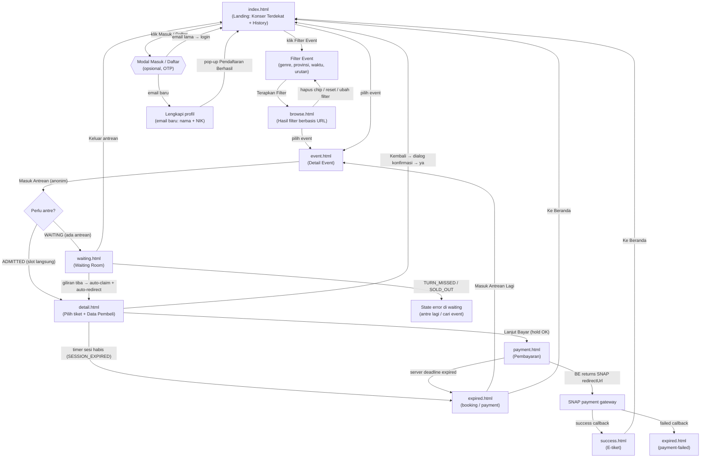
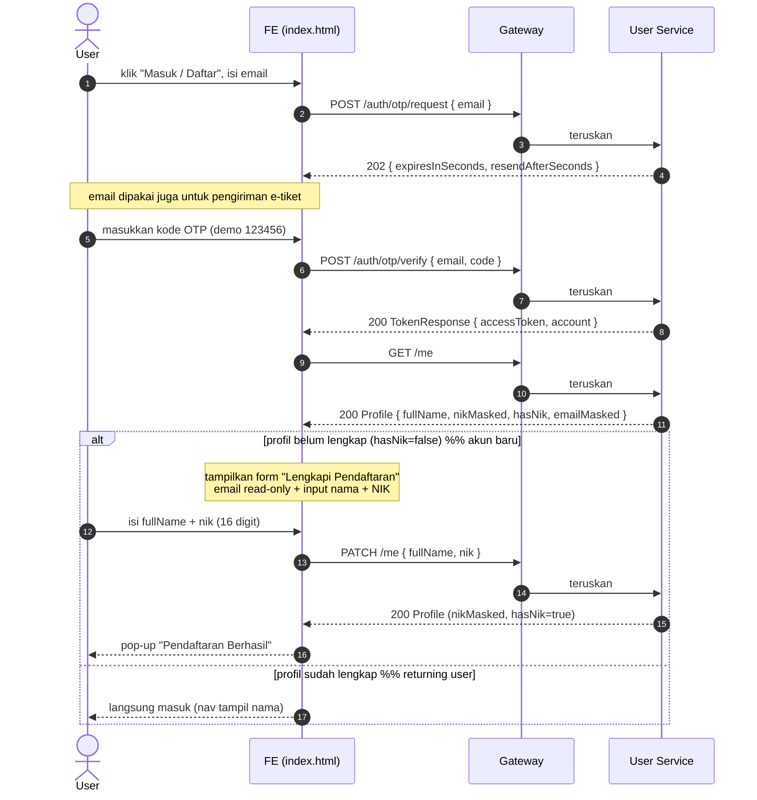
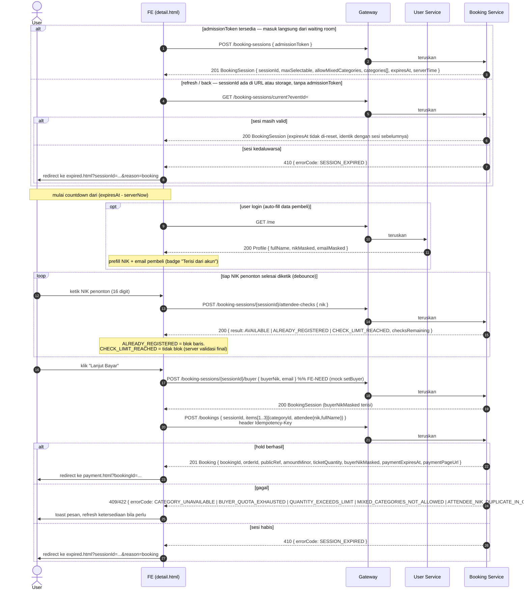
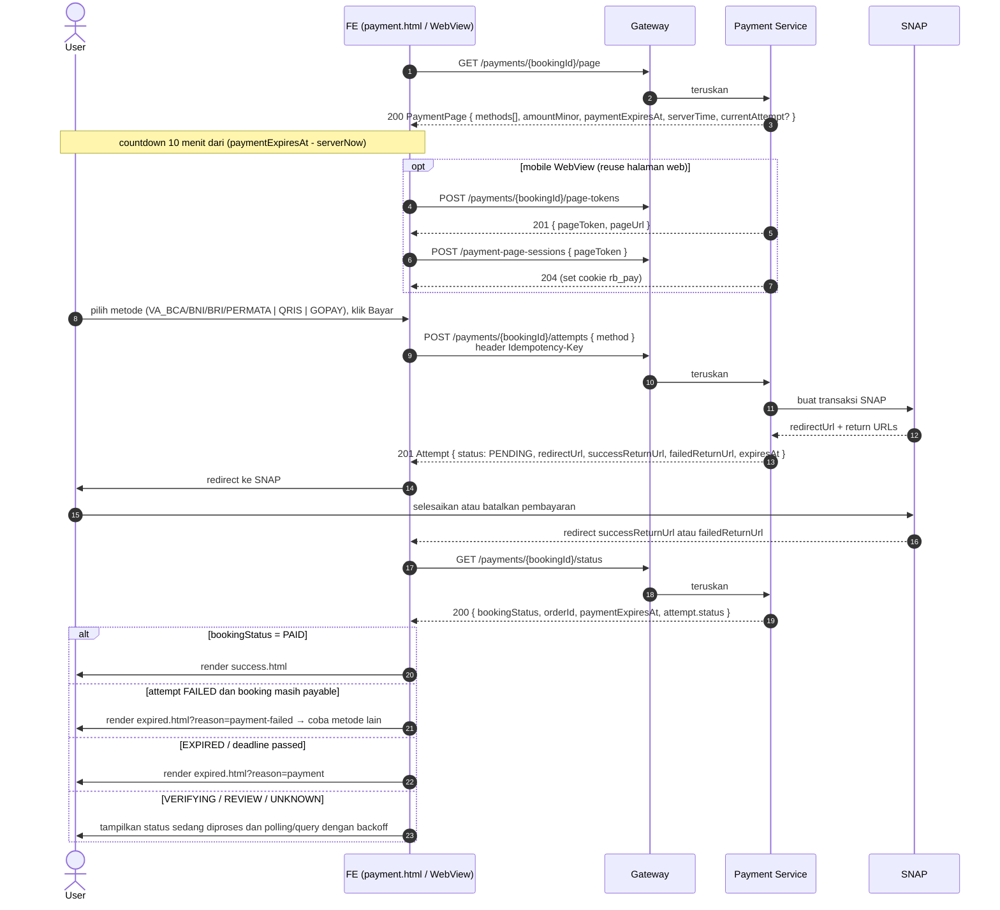
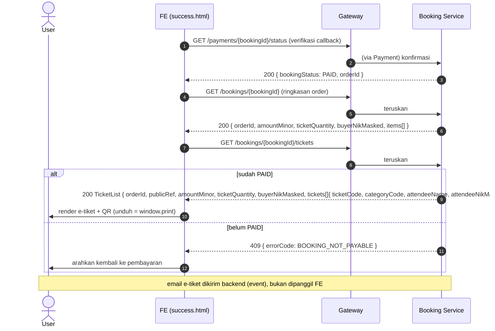
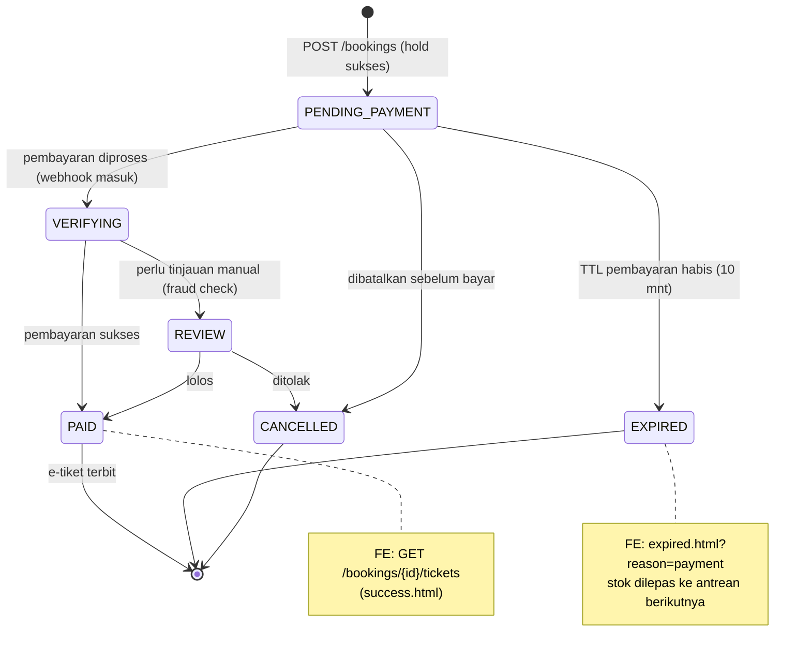
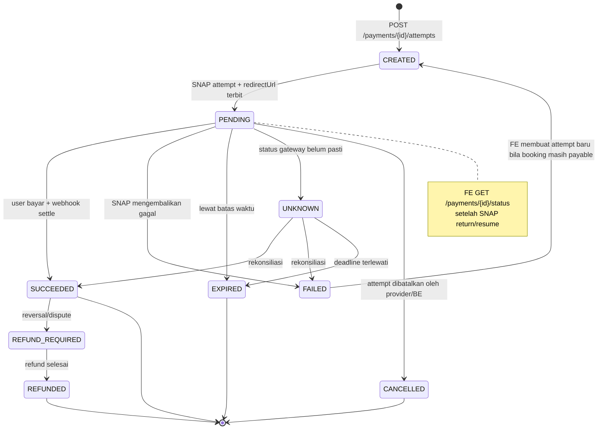
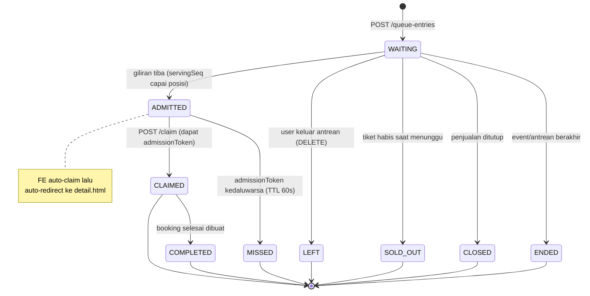
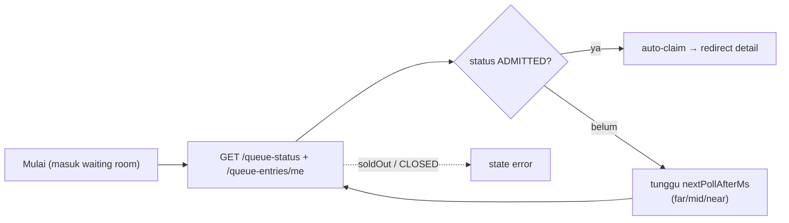
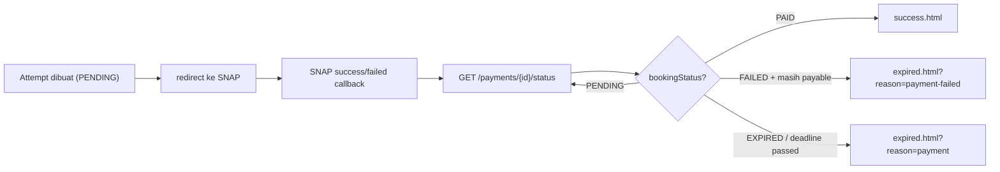

# FE Flow Diagrams — Rusuh Booking Tiket

Diagram alur dari sudut pandang **Front-End (FE)** untuk disepakati bersama **Back-End (BE)**.
Semua diagram memakai **Mermaid** (render otomatis di GitHub/editor yang mendukung).

Acuan: prototype **Final** (`../prototype/Final/`, internal version "V5") + API contract (`../api-contract/`) + canonical FE-BE contract (`./FE-BE-align-contract.md`).
Catatan konvensi lintas-API (envelope `{meta,data}`, harga `*Minor`, `serverTime` untuk clock-skew,
cookie `rb_visitor` / header `X-Visitor-Token`, `Idempotency-Key`, `errorCode`) lihat
`./FE-BE-align-contract.md` §2.

**Implementasi FE yang dikunci:** Expo + React Native untuk Android/iOS dan React Native Web untuk web, dengan Clean Architecture, shared TypeScript domain/use cases, Zustand, dan platform adapters. Nama HTML di bawah adalah label logis yang dipertahankan dari prototype `Final/` (V5); pemetaan route production adalah:

```text
index.html   → /
browse.html  → /browse?genre=&province=&time=&sort=
event.html   → /events/[eventId]
waiting.html → /waiting/[eventId]
detail.html  → /checkout/[sessionId]
payment.html → /payment/[bookingId]
success.html → /success/[bookingId]?orderId={orderId}
expired.html → /expired/[resourceId]?reason=booking|payment|payment-failed
```

Isi:
1. [Screen Flow](#1-screen-flow-peta-perpindahan-halaman)
2. [Sequence Diagrams](#2-sequence-diagrams)
   - 2.1 [Login / Register (OTP)](#21-login--register-otp)
   - 2.2 [Join Queue → Waiting Room → Claim](#22-join-queue--waiting-room--claim)
   - 2.3 [Detail / Checkout (hold tiket)](#23-detail--checkout-hold-tiket)
   - 2.4 [Payment (attempt → SNAP → callback → hasil)](#24-payment-attempt--snap--callback--hasil)
   - 2.5 [Success (e-tiket)](#25-success-e-tiket)
3. [State Diagrams](#3-state-diagrams)
   - 3.1 [Booking](#31-state-booking)
   - 3.2 [Payment Attempt](#32-state-payment-attempt)
   - 3.3 [Queue Entry](#33-state-queue-entry)
4. [Polling / Timing](#4-polling--timing)

> Catatan: endpoint bertanda **(FE-NEED)** belum ada di contract saat ini (lihat daftar
> **FE NEED THIS** di `FE-BE-align-contract.md`): `POST /booking-sessions/{id}/buyer` (set-buyer),
> `JoinRequest` anonim, `remainingTickets`, `description` JSON, dsb. Di prototype di-mock.

---

## 1. Screen Flow (peta perpindahan halaman)

Perpindahan antar halaman FE beserta percabangannya (guest vs login, ada antrean vs langsung masuk,
sukses vs expired).



**Catatan percabangan:**
- **Filter V5:** Home membuka modal filter dengan genre, provinsi, waktu, dan urutan. Submit mengarah ke `browse.html` dengan query URL. Browse hanya menampilkan event mendatang, menyediakan chip filter yang dapat dihapus, reset, dan filter ulang.
- **Filter prototype-only:** V5 mengambil seluruh katalog lalu memfilter di browser karena kontrak `GET /events` belum menyediakan parameter filter. Production harus memakai field genre/lokasi terstruktur dan filter/sort server-side, atau menetapkan batas katalog dan aturan `noindex` yang jelas.
- **Waktu filter:** `Minggu ini`, `Bulan ini`, dan `3 Bulan ke depan` adalah rolling windows 7/30/90 hari dari `serverNow`, bukan batas kalender.
- **History:** Home menurunkan history dari event dengan `startsAt < serverNow` atau status `CLOSED`, diurutkan paling baru. Ini adalah fallback prototype; endpoint arsip resmi masih menjadi GAP.
- **Login opsional.** Guest bisa lanjut tanpa login; NIK + email diisi manual di `detail.html`. Jika login, data pembeli **auto-fill**.
- **Masuk Antrean bersifat anonim** (tanpa form). BE memutuskan `WAITING` atau `ADMITTED` (FR-05).
- Dari `detail.html`, tombol **Kembali** tidak langsung keluar — ada **dialog konfirmasi** (keluar = ulang antrean).

---

## 2. Sequence Diagrams

Partisipan:
- **FE** = Expo screen (React Native on Android/iOS, React Native Web on web; payment may use a native WebView)
- **Gateway** = API gateway (meneruskan ke service)
- **User Svc / Queue Svc / Booking Svc / Payment Svc** = microservice di belakang gateway
- **SNAP** = third-party payment gateway; provider callbacks are verified through BE status

### 2.1 Login / Register (OTP)

Registrasi = verify OTP pertama + lengkapi profil (nama + NIK). Email lama langsung login.



> **FE-NEED (lihat §6 FE-BE-align-contract):** respons `verify` belum memuat indikator "akun baru / profil belum lengkap".
> Sementara FE memakai `GET /me.hasNik` untuk memutuskan perlu-tidaknya langkah lengkapi profil.

### 2.2 Join Queue → Waiting Room → Claim

Antrean anonim; posisi real-time via polling adaptif; saat giliran tiba FE auto-claim lalu redirect.

```mermaid
sequenceDiagram
  autonumber
  actor U as User
  participant FE as FE (event.html → waiting.html)
  participant G as Gateway
  participant Q as Queue Service

  U->>FE: klik "Masuk Antrean"
  FE->>G: POST /events/{eventId}/queue-entries  %% FE-NEED: body anonim
  G->>Q: teruskan
  Q-->>FE: 201 QueueEntry { entryId, seq, status, queueToken, claimDeadline, serverTime }
  Note over FE: simpan entryId+token melalui platform persistence adapter, tahan refresh

  alt status = ADMITTED (FR-05, langsung dapat slot)
    FE->>FE: lanjut ke claim (lihat bawah)
  else status = WAITING → tampilkan waiting room
    loop polling adaptif (honor nextPollAfterMs)
      FE->>G: GET /queue-status/{eventId}
      G->>Q: teruskan
      Q-->>FE: 200 StatusDocument { servingSeq, guaranteedUntilSeq, soldOut, admissionRatePerMin, nextPollAfterMs, poll{...} }
      FE->>G: GET /queue-entries/me?eventId
      G->>Q: teruskan
      Q-->>FE: 200 EntryStatus { exactPosition, zone, status }
      Note over FE,U: tampilkan "orang di depan" + "estimasi"<br/>warna zona GUARANTEED/POSSIBLE/NOT_ENOUGH
    end
  end

  Note over FE: hanya status ADMITTED yang memberi otorisasi; posisi 0 saja belum cukup
  FE->>G: POST /queue-entries/{entryId}/claim   %% auto, tanpa tombol
  G->>Q: teruskan
  alt sukses
    Q-->>FE: 200 ClaimResponse { admissionToken (TTL 60s), bookingUrl }
    FE->>U: auto-redirect ke detail.html
  else giliran terlewat / sold out
    Q-->>FE: 410 { errorCode: TURN_MISSED | EVENT_SOLD_OUT }
    FE->>U: tampilkan state error (antre lagi / cari event)
  end
```

### 2.3 Detail / Checkout (hold tiket)

Buat sesi dari admission token, cek NIK penonton saat diketik, set data pembeli, lalu hold.



> **Checkbox "Gunakan NIK pembeli (pembeli ikut nonton)"**: mengisi `attendee.nik = buyerNik` &
> `attendee.fullName = nama pembeli` otomatis; **single-use** (hanya satu tiket) agar tidak memicu
> `ATTENDEE_NIK_DUPLICATE_IN_ORDER`.

### 2.4 Payment (attempt → SNAP → callback → hasil)

> **KOREKSI (2026-10-29, user) — ikuti prototype.** Model pembayaran = **FE membangun halaman pembayaran** (`.genesis/prototype/Final/payment.html`): ringkasan pesanan (total = `amountMinor`, **tanpa biaya layanan**), **UI pemilihan metode** (VA BCA/BNI/BRI/Permata · QRIS · GoPay, dari `page.methods`), dan timer 10-menit server-authoritative (`paymentExpiresAt` + `serverTime`). "Bayar" → `createAttempt(bookingId, method, Idempotency-Key)` → **BE mengembalikan `redirectUrl` SNAP Midtrans** → FE handoff ke SNAP (web: redirect; mobile: WebView) → SNAP (gateway 3rd-party) menampilkan UI charge sebenarnya (prototype mensimulasikan via `snap.html`) → dua callback success/failed (`successReturnUrl`/`failedReturnUrl`) → FE **verifikasi status ke BE** (`GET /payments/{id}/status`), tidak pernah percaya callback saja. Konsekuensi terhadap diagram di bawah:
> - Blok `opt mobile WebView` (page-token / `rb_pay` / `POST /payment-page-sessions`) **TETAP scope FE** (D10.3) — halaman bayar FE yang sama dipakai ulang di WebView mobile lewat one-time pageToken; timer tetap server-authoritative lintas handoff. Diagram di bawah akurat.
> - Pemilihan metode terjadi **di halaman FE kita** (bucket metode); detail instrumen (no. kartu/VA/PIN) terjadi di SNAP → PCI tetap di luar scope.
> - **FR-24 dipenuhi oleh halaman bayar FE reusable + handoff SNAP** (konsisten web+mobile tanpa membangun ulang UI native).
> - **Terbuka (O2, diskusikan dengan BE):** bentuk persis request/response `createAttempt`, endpoint page-token (`POST /payments/{id}/page-tokens`, `POST /payment-page-sessions`), dan bentuk success/failed return URL untuk web vs WebView mobile.

Pilih metode → buat attempt → redirect ke SNAP → kembali ke success/failed callback → verifikasi status BE.



### 2.5 Success (e-tiket)



---

## 3. State Diagrams

Mengikuti enum pada contract (`Booking.status`, `Attempt.status`, `QueueEntry.status`).
Transisi dipicu oleh server; FE hanya **mengamati** (SSE/polling bila diperlukan, serta status check
setelah SNAP return) dan bereaksi di UI.

### 3.1 State Booking



### 3.2 State Payment Attempt



### 3.3 State Queue Entry



---

## 4. Polling / Timing

FE menerima redirect callback dari SNAP, tetapi callback hanya menjadi pemicu navigasi. FE tetap
meminta status dari BE sebelum menampilkan hasil. Timer dihitung dari deadline server.

### 4.1 Waiting Room — polling adaptif

Interval diatur server via `nextPollAfterMs` (makin dekat giliran, makin cepat). FE tidak hard-code interval.



| Zona posisi | Interval (dari `poll`) | Keterangan |
|---|---|---|
| Jauh dari giliran (`> farAbove`) | `poll.farMs` (mis. 15 dtk) | hemat request |
| Sedang (`> midAbove`) | `poll.midMs` (mis. 6 dtk) | — |
| Dekat giliran | `poll.nearMs` (mis. 2.5 dtk) | responsif |

### 4.2 Payment — callback + status verification



### 4.3 Timer (server-authoritative)

Berlaku untuk **TTL booking (5 mnt)** dan **TTL pembayaran (10 mnt)**:

```
sisaMs   = expiresAt - serverNow()
serverNow() = Date.now() + (serverTime - clientNow)   // offset dari respons API
```

FE menampilkan hitung mundur dari `sisaMs`. Karena berbasis `expiresAt` absolut dari server,
**refresh / pindah perangkat tidak mereset** timer, dan jam perangkat yang meleset terkoreksi.

---

*Disusun dari sudut pandang FE; konsisten dengan prototype V5 dan API contract. Endpoint bertanda
**FE-NEED** adalah usulan FE yang belum ada di contract (detail & justifikasi di
`./FE-BE-align-contract.md`).*
