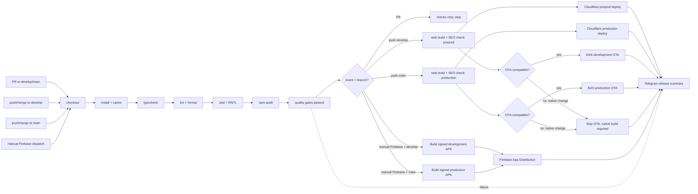

# CI/CD Pipeline — Rusuh Booking Tiket

> **Status:** Target delivery flow; automation rollout is in progress
> **Scope:** Expo + React Native + React Native Web frontend
> **CI:** GitHub Actions
> **Static quality:** SonarCloud is temporarily skipped by explicit project decision
> **Native delivery:** Android QA APKs build on GitHub Actions and distribute through Firebase App Distribution; EAS is reserved for compatible OTA updates. iOS device builds use a separate macOS runner workflow when configured.
> **Architecture reference:** `.genesis/docs/ARCHITECTURE.md`
> **FE-BE contract:** `.genesis/docs/FE-BE-align-contract.md`

The repository package manager is **npm** and CI uses the committed `package-lock.json`. If the implementation adopts pnpm or Yarn before delivery, replace the install, cache, and audit commands as one controlled pipeline change; this document does not support mixed lockfiles.

This pipeline is adapted from an internal CI/CD reference pipeline for the ticketing architecture: Android, iOS, web, native capabilities, React Native Web SEO, and OTA promotion through `develop` and `main`.

**Implementation status (2026-11-07):** The single Release Pipeline in `.github/workflows/deploy-web-dev.yml` is on the default `main` branch. Merges to `develop` trigger its preprod web path; Android Firebase distribution is a manual mode on the same orchestrator, with no independent trigger. SonarCloud is temporarily skipped. EAS OTA remains guarded until the Expo project, channels, credentials, Expo environment variables, and a newly built OTA-capable native app are ready. The production Cloudflare Pages environment is also pending, so the target production behavior below is not live yet.

## 1. Delivery model

```text
feature/*
    │
    ├── pull request → develop
    │                  └── validation gates only
    │
    └── merged into develop → one orchestrated pipeline
                              ├── auto: Cloudflare preprod web deployment
                              ├── auto: EAS development OTA, only if OTA-compatible
                              └── optional/manual: development APK → Firebase QA
                                  │
                                  └── pull request → main
                                                      └── validation + release approval
                                                          └── merged into main → one orchestrated pipeline
                                                              ├── auto: Cloudflare production web deployment
                                                              ├── auto: EAS production OTA, only if OTA-compatible
                                                              └── optional/manual: production APK → Firebase
```

There are two runtime environments:

| Environment | Branch | Android/iOS OTA channel | Web deployment | Backend target | Purpose |
|---|---|---|---|---|---|
| Preprod / development | `develop` | `development` | Dedicated Cloudflare Pages preprod project | Development/mock or integration BE | QA and team integration |
| Production | `main` | `production` | Separate Cloudflare Pages production project/CDN | Production BE | End-user release |

Use separate GitHub Environments and configuration for `development` and `production`. Preprod currently uses `EXPO_PUBLIC_ENV=development` and `EXPO_PUBLIC_USE_MOCKS=true` with its own Pages project and test URLs. Production must use `EXPO_PUBLIC_ENV=production`, `EXPO_PUBLIC_USE_MOCKS=false`, the live API URL, and a separate Pages project. Do not copy development/mock configuration into production.

Preview builds are distribution artifacts for QA and product review, not a third runtime environment. They use the development or production-compatible configuration explicitly declared by the build profile.

## 2. Trigger rules

| Git event | Pipeline behavior |
|---|---|
| Pull request opened, synchronized, reopened, or marked ready for review → `develop` | Run typecheck, lint/format, unit/component tests, and dependency audit. SonarCloud is temporarily skipped. Stop before web build/deployment, OTA publication, and native distribution. |
| Successful push to `develop` after merge | Start the single release orchestrator. Run shared quality gates, then automatically build/validate and deploy the web app to the preprod Cloudflare Pages project and publish an EAS `development` OTA only when the change is runtime-compatible and has no native-affecting change. Do not distribute an APK automatically. |
| Pull request opened or synchronized → `main` | Run full release validation. Require approval before merge. |
| Successful push to `main` after merge from `develop` | Start the same release orchestrator. Run shared release gates, then automatically build/validate and deploy the web app to the production Cloudflare Pages project and publish an EAS `production` OTA only when the change is runtime-compatible and has no native-affecting change. |
| `workflow_dispatch` on the same orchestrator | Manually select Firebase APK distribution for the selected branch/environment: `develop` produces a preprod/development APK; `main` produces a production APK. The manual run validates that the selected ref and environment match. Reusable workflow files may separate implementation details, but only the orchestrator is independently triggered. |
| Native-affecting change | Skip OTA for that change. A new native binary is required. Firebase APK distribution remains manually triggerable for the matching branch/environment; it is not silently substituted for an OTA. |

An OTA is published only from the target branch after the merge has succeeded. Opening or updating a pull request never deploys user-facing code. “Automatic OTA” means automatic for OTA-compatible changes; it cannot deliver native code, new native dependencies, or native configuration changes.

### One orchestrator, separated implementation

Expose one top-level GitHub Actions workflow (the **Release Pipeline**) for pull-request checks, post-merge releases, and manual Firebase distribution. It may call reusable `workflow_call` jobs/workflows for web, EAS, and Firebase so each concern stays maintainable. Those reusable files must not add their own independent `push` or `workflow_dispatch` entry points. A push to `develop` or `main` therefore creates one coordinated run; the orchestrator owns the shared gates, environment selection, parallel delivery jobs, and final Telegram summary. Firebase is an optional manual mode on that same orchestrator, not an automatic APK upload on every merge.

GitHub shows the **Run workflow** button only when the orchestrator file exists on the repository's default branch. Promote the orchestrator to `main` before relying on its manual Firebase mode, then select `develop` or `main` as the dispatch ref.

## 3. Job dependency graph

The graph below shows the target triggers. Pull requests run quality gates and stop there. A successful push to either release branch starts one coordinated automatic web + compatible OTA release. Firebase APK distribution is an optional manual mode exposed by the same orchestrator. SonarCloud is temporarily omitted from the gates.



### Meaning of `native-affecting change?`

This is a release-routing decision, not a separate test. The pipeline checks whether the commit changes anything that is compiled into, configured for, or required by the Android/iOS binary. A change that only corrects the Expo project `slug` to match the already-linked EAS project is treated as OTA-compatible metadata; it does not change the update URL, runtime version, or native binary configuration.

- native Android/iOS code or a new/changed native dependency;
- Expo config (other than the slug-only EAS project-link correction described above), config plugins, app identity, URL schemes, entitlements, permissions, icons, or splash assets;
- push-notification, payment, camera, biometric, file-system, WebView, or other native capability configuration;
- Expo SDK or React Native version changes.

If **no**, compatible JavaScript and assets are published automatically through the matching EAS channel after a successful branch push, subject to runtime-version compatibility. If **yes**, the pipeline skips OTA for that change; a new native build is required. Android APKs are built on GitHub Actions and sent to Firebase only when the operator manually selects the Firebase mode. React Native Web is still exported and deployed separately.

The OTA job stays disabled until the app has `expo-updates`, a compatible `runtimeVersion`, an EAS `updates.url`/`extra.eas.projectId`, the correct update channel embedded in native builds, `EXPO_TOKEN` and `EXPO_PROJECT_ID` in the relevant GitHub environments, and matching public app variables in the Expo `development` and `production` environments. Install a newly generated OTA-aware native APK/build on QA devices and verify a JavaScript-only update before setting repository variable `EAS_OTA_DEVELOPMENT_ENABLED=true`. Set `EAS_OTA_PRODUCTION_ENABLED=true` separately only after the production environment and release path are ready. The workflow checks app/project configuration before publishing.

This protects users from receiving JavaScript that expects native APIs, permissions, or configuration that do not exist in the installed binary.

## 4. Quality and security gates

### 4.1 `typecheck`

- Run TypeScript in strict mode.
- Validate shared packages and the Expo app.
- Fail on unresolved route types, invalid API models, and platform adapter contract mismatches.

### 4.2 `lint`

- Run ESLint for `.ts`, `.tsx`, and configuration files.
- Run Prettier check.
- Reject unused imports, unsafe `any`, accessibility violations configured for React Native, and forbidden direct infrastructure access from UI layers.

### 4.3 `unit_test`

- Run **Jest** with the `jest-expo` preset.
- Run React Native Testing Library component tests.
- Test domain rules, Zustand stores, hooks, use cases, error mapping, timer math, and platform adapter mocks.
- Generate `lcov` coverage for SonarCloud.
- Do not treat snapshots as the primary UI quality mechanism; use behavior assertions and the agreed QA strategy.

### 4.4 Contract validation — outside CI/CD

OpenAPI remains the FE-BE source of truth, but contract validation is not a cloud CI/CD job. FE and BE teams may run it locally or in a separate integration-validation process when an API contract changes. It is intentionally excluded from merge gates and OTA gates.

### 4.5 `vulnerability_scan`

- Run `npm audit --omit=dev --audit-level=high`.
- Run dependency and secret scanning configured by the repository.
- Fail on high/critical production dependency vulnerabilities unless an approved security exception exists.

### 4.6 `sonarcloud`

Temporarily skipped by explicit project decision while the SonarCloud scan is unavailable in GitHub Actions. When the connection and branch-analysis configuration are ready, restore this gate with the following requirements:

- Run after typecheck, lint, unit tests, and vulnerability scanning.
- Upload Jest `lcov` coverage.
- Enforce the SonarCloud quality gate for new code:
  - no new blocker/critical bugs;
  - no new security vulnerabilities;
  - no unacceptable new code smells;
  - duplication within the approved threshold;
  - shared domain/application coverage target of **at least 90%** unless explicitly waived.

When restored, SonarCloud is a static analysis gate. It does not replace Jest or the agreed QA strategy.

## 5. Web build artifacts

### 5.1 `web_build`

- Run `npx expo export --platform web`.
- Use `web.output: "static"` for build-time prerendered public catalog pages or `"server"` where request-time rendering is required.
- Fail if public SEO routes accidentally use `web.output: "single"`.
- Verify that `/`, representative generated event-detail routes for `/events/[eventId]`, and public event metadata produce indexable HTML. The check validates generated route output, not a literal bracket placeholder URL.
- Verify that `/browse` accepts URL-driven `genre`, `province`, `time`, and `sort` values, handles invalid values safely, and applies the approved canonical/noindex policy for query-result pages.
- Check title, description, canonical URL, Open Graph metadata, JSON-LD, sitemap, and robots output.
- Enforce public and transactional bundle budgets:
  - every route: ≤ 1 MB gzip initial JavaScript.

This is artifact validation only. Browser-level QA, responsive interaction testing, and accessibility walkthroughs are outside this CI/CD pipeline.

## 6. Native build artifacts

### 6.1 `native_build`

Use GitHub Actions to generate native artifacts for device-level QA. Expo Go is not a distribution artifact.

Build targets:

| Target | Artifact | Use |
|---|---|---|
| Android | Signed APK through a GitHub Actions `ubuntu-latest` runner | Firebase App Distribution for QA |
| iOS | Simulator/device build through the planned macOS GitHub Actions workflow | Internal distribution or store release; setup pending |
| Web | Exported web artifact | Web deployment |

## 7. OTA strategy

### 7.1 Preprod (`develop`) native OTA and web deployment

After a successful merge into `develop`, the orchestrator automatically:

1. Run the shared quality gates.
2. Build and validate the Expo Web export, including SEO and bundle checks.
3. Deploy the checked artifact to the dedicated preprod Cloudflare Pages project.
4. If the change is OTA-compatible, publish JavaScript/assets to the EAS `development` channel. Otherwise, skip OTA and report that a native build is required.
5. Record Git SHA, Expo runtime version, environment, OTA update ID (if published), and web deployment ID.
6. Send one Telegram release summary with each job result and the failed job name(s), if any.

Firebase distribution is not part of the automatic post-merge path. An operator may manually select Firebase distribution in the same orchestrator; it builds a signed development APK with development/mock configuration and sends it to the QA tester group.

### 7.2 Production (`main`) native OTA and web deployment

Before the `develop` → `main` merge, PR validation and the repository's approval policy must pass.
After the merge, the same orchestrator automatically:

1. Run the shared release gates.
2. Build and validate the Expo Web export, including SEO and bundle checks, with production configuration.
3. Deploy the checked artifact to the separate production Cloudflare Pages project.
4. If the change is OTA-compatible, publish JavaScript/assets to the EAS `production` channel. Otherwise, skip OTA and report that a native build is required.
5. Record Git SHA, Expo runtime version, environment, OTA update ID (if published), and web deployment ID.
6. Send one Telegram release summary with each job result and the failed job name(s), if any.
7. Monitor native update adoption, crashes, web health, and critical booking-flow metrics; roll back either delivery independently if needed.

Firebase production APK distribution is not automatic. An operator may manually select Firebase distribution in the same orchestrator; it builds a signed production APK with production configuration and sends it to the production tester group. Production signing credentials and Firebase settings must be stored in a protected `production` GitHub Environment.

### 7.3 Web deployment

React Native Web is delivered as web assets through the web hosting/CDN pipeline. It does not receive EAS mobile OTA updates. A web deployment may be rolled back by redeploying the previous successful artifact or reverting the hosting release to its previous version.

Web deployment requirements:

- Deploy only the output that passed the web build, SEO-output, and bundle-size checks.
- Record the Git SHA and deployment ID.
- Keep the previous web artifact available for rollback.
- Invalidate or version CDN assets safely; do not leave HTML pointing to missing assets.
- Verify public route health after deployment.

### 7.4 Native-change routing

Create a new native build instead of OTA when a change includes:

- New or changed native dependency.
- Expo config/plugin change.
- Android/iOS permission or entitlement change.
- Push-notification credentials or configuration.
- App icon, splash, bundle identifier, URL scheme, or associated-domain change.
- Native payment, camera, biometric, file-system, or WebView integration change.

## 8. Build and distribution jobs

### 8.1 `build_android`

- Run only when the operator selects the manual Firebase mode on the Release Pipeline orchestrator. The selected branch must be `develop` or `main`; reject any branch/environment mismatch.
- Use the Expo config-prebuild project and Gradle on `ubuntu-latest`.
- For `develop`, build a signed preprod APK with development/mock configuration and the protected `development` environment's signing/Firebase settings.
- For `main`, build a signed production APK with production configuration and separate protected production signing/Firebase settings. Never use development mocks or QA signing credentials in the production APK.
- Name the development APK `rusuh-booking.preprod.apk`; name the production APK `rusuh-booking.apk`.
- Keep persistent keystores in GitHub Environment secrets; never generate or commit signing keys in CI. Increment Android `versionCode` monotonically for each environment's distributed build.
- Upload the APK as a workflow artifact, then distribute it to the configured Firebase App Distribution tester group.
- Run typecheck, lint/format, Jest/RNTL, and production dependency audit before building or distributing. SonarCloud is temporarily skipped by explicit project decision.

### 8.2 `build_ios`

- Use a macOS GitHub Actions runner for native iOS builds; this workflow is not configured yet.
- Build simulator artifacts for smoke checks and signed device artifacts for human QA/distribution.
- Store Apple signing credentials in GitHub environment secrets or an approved enterprise secret manager.

### 8.3 `distribute_preview`

- Distribute an Android APK through Firebase only when the operator selects the manual Firebase mode on the Release Pipeline orchestrator; use the selected branch's matching environment and tester group.
- Add iOS to the approved internal distribution channel when its signed build workflow is configured.
- Do not automatically deploy feature-branch web previews to either user-facing Pages project; preprod is the `develop` environment and production is `main`.
- Include branch, commit SHA, API environment, build profile, and test summary in release notes.

## 9. Required repository scripts

```json
{
  "scripts": {
    "typecheck": "tsc --noEmit",
    "lint": "eslint .",
    "format:check": "prettier --check .",
    "test": "jest --coverage",
    "test:unit": "jest --runInBand",
    "web:build": "expo export --platform web",
    "web:serve": "npx expo serve",
    "ota:development": "eas update --channel development",
    "ota:production": "eas update --channel production"
  }
}
```

## 10. Required secrets and variables

| Secret/variable | Used by | Purpose |
|---|---|---|
| `SONAR_TOKEN` | SonarCloud | Authentication for analysis and quality gate |
| `SONAR_ORGANIZATION` | SonarCloud | SonarCloud organization identifier |
| `SONAR_PROJECT_KEY` | SonarCloud | SonarCloud project identifier |
| `EXPO_TOKEN` | EAS Update | CI authentication for OTA publication only |
| `EXPO_PROJECT_ID` | EAS Update | Expo project attribution for OTA updates |
| `EAS_OTA_DEVELOPMENT_ENABLED` | Release Pipeline | Repository Actions variable; set to `true` only after development EAS settings and an OTA-capable QA build are verified |
| `EAS_OTA_PRODUCTION_ENABLED` | Release Pipeline | Repository Actions variable; keep unset/false until production EAS and release settings are ready |
| `EXPO_PUBLIC_API_BASE_URL`, `EXPO_PUBLIC_ENV`, `EXPO_PUBLIC_USE_MOCKS`, `EXPO_PUBLIC_SITE_URL` | Web and Android builds | Non-secret environment-specific app configuration; use development mocks only in `development` |
| `CLOUDFLARE_API_TOKEN` | Cloudflare Pages | Secret with Pages Edit access; configure separately in `development` and `production` Environments |
| `CLOUDFLARE_ACCOUNT_ID` | Cloudflare Pages | Cloudflare account identifier; configure per GitHub Environment |
| `CLOUDFLARE_PAGES_PROJECT` | Cloudflare Pages | Pages project name; use distinct preprod and production projects |
| `ANDROID_KEYSTORE_BASE64` | Android GitHub Actions | Base64-encoded signing keystore; separate protected development and production values |
| `ANDROID_KEYSTORE_PASSWORD` | Android GitHub Actions | Environment-specific keystore password |
| `ANDROID_KEY_ALIAS` | Android GitHub Actions | Environment-specific signing key alias |
| `ANDROID_KEY_PASSWORD` | Android GitHub Actions | Environment-specific signing key password |
| `FIREBASE_SERVICE_ACCOUNT_JSON` | Firebase App Distribution | Environment-scoped CI authentication for APK distribution |
| `FIREBASE_ANDROID_APP_ID` | Firebase App Distribution | Registered Android app ID for the selected Firebase project/environment |
| `FIREBASE_TESTER_GROUPS` | Firebase App Distribution | Environment-specific tester group alias(es) |
| Apple signing credentials | iOS GitHub Actions | iOS device build signing, managed securely |
| `TELEGRAM_BOT_TOKEN`, `TELEGRAM_CHAT_ID` | Release Pipeline | Environment-scoped release result and failed-job notifications |

Never store NIK, payment data, API secrets, signing keys, or service-account JSON in the repository or in client-exposed `EXPO_PUBLIC_*` variables.

## 11. Rollback and failure handling

- A failed quality gate blocks merge.
- On each post-merge release or manual Firebase run, the Telegram summary job runs even when a gate or delivery job fails. Include the outcome of each job and identify the failed job(s); report a partial release when OTA is disabled or skipped for a native change. A notification failure must be visible as a failed job too.
- A failed OTA publication does not change the currently deployed update.
- A bad development OTA is rolled back to the previous development update.
- A bad production OTA is rolled back to the previous production update when runtime-compatible.
- A native regression requires a new build or store/internal-distribution rollback; OTA cannot repair native code.
- Every release records the exact Git SHA, runtime version, channel, update ID, and artifact IDs.
- CI artifacts retain test reports, coverage, SonarCloud links, web export, build logs, and release metadata according to repository retention policy.

### 11.1 OTA rollback procedure

Each OTA release must be associated with a compatible runtime version and retain the previous known-good update group. EAS Update serves the newest compatible update on the channel, so rollback means republishing a known-good update as the newest update rather than deleting the bad history.

#### Emergency production rollback

1. Declare the incident and stop the production promotion pipeline.
2. Protect the `production` channel; only release managers can publish or roll back it.
3. Pause the channel if we need to stop new updates while the incident is assessed:

   ```bash
   eas channel:pause production
   ```

4. Identify the last known-good update group from the EAS deployment history.
5. Republish that compatible update to the production channel, or run the interactive rollback flow:

   ```bash
   eas update:republish --group <known-good-update-group> --destination-channel production
   eas update:rollback <latest-bad-update-group>
   ```

   `eas update:republish` is the preferred explicit recovery path because it promotes a named known-good update to the destination channel. `eas update:rollback <latest-bad-update-group>` rolls back the latest update group on its branch/runtime; use it only with the exact affected group ID. Pin and verify the EAS CLI version used by CI, and run the command with the appropriate platform/runtime controls for the project. Never mix Android/iOS runtimes or publish an incompatible JavaScript bundle.

6. Resume the channel when the rollback is confirmed:

   ```bash
   eas channel:resume production
   ```

7. Verify the rollback with a production-like build, monitor update adoption/crashes, and record the incident, bad update ID, rollback update ID, and Git SHA.

If the previous OTA is not safe, roll back to the update embedded in the installed native build using the EAS rollback-to-embedded flow. If the issue is caused by native code or an incompatible data migration, do not use OTA rollback; release a new native build or fix forward.

#### Development rollback

The same procedure applies to the `development` channel, with a lower approval threshold. Development rollback must still record the update group and verify the current runtime version before republishing.

#### Web rollback

Web rollback is separate from native OTA rollback:

1. Stop the web deployment promotion.
2. Identify the previous successful web artifact and deployment ID.
3. Redeploy that artifact to the affected host/CDN, or use the hosting provider's release rollback.
4. Purge or refresh CDN caches without removing assets still referenced by active HTML.
5. Verify the public routes, metadata, and critical booking entry points.
6. Record the Git SHA, deployment ID, incident, and recovery result.

#### Rollback limitations

- Users who already downloaded a bad update may continue running it until they fetch and launch the rollback update.
- Automatic crash recovery can help with early startup crashes, but it is not the primary incident-control mechanism.
- OTA rollback cannot undo irreversible local-storage or file-system migrations; updates must be backward-compatible or use a fix-forward release.
- A new native build is required when the runtime version, native dependency, permission, or native configuration changes.

## 12. Quality-gate summary

| Gate | Tool | Blocks merge? | Blocks OTA? |
|---|---|---:|---:|
| Type safety | TypeScript | Yes | Yes |
| Code quality | ESLint + Prettier | Yes | Yes |
| Unit/component behavior | Jest + React Native Testing Library | Yes | Yes |
| API compatibility | OpenAPI types and FE-BE review | No | No |
| Dependency security | npm audit + secret scan | Yes | Yes |
| Static analysis | SonarCloud (temporarily skipped) | No, until restored | No, until restored |
| SEO output | Expo export validation | Yes for web release | Yes for web release |
| Web bundle budget | Bundle-size check | Yes for web release | Yes for web release |

## 13. Known limitations

- Backend load, inventory correctness, queue fairness, payment settlement, and notification delivery remain BE responsibilities.
- OTA cannot deliver native dependency or permission changes.
- React Native Web uses web deployment rollback, not EAS mobile OTA rollback.
- iOS device testing requires Apple signing and appropriate CI/device access.
- Production web SEO is only valid when the deployed output is static or server-rendered and the public routes have generated HTML.
