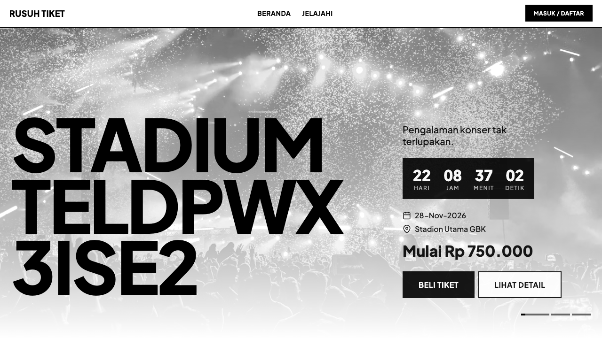
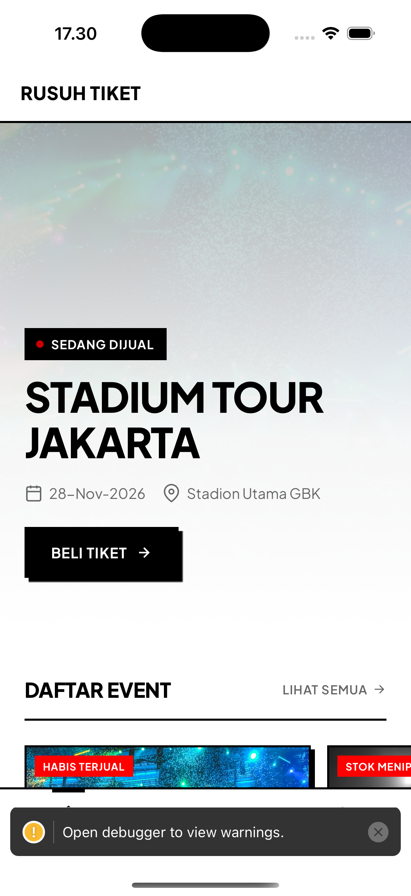
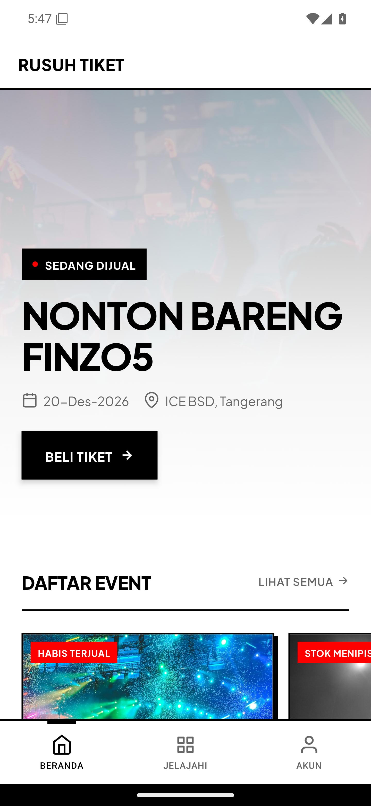

# RBT-122 — Plus Jakarta Sans validation

- **Branch:** `codex/rbt-122-plus-jakarta-sans`
- **Base:** `develop` at `0f560ec71ee4f96ec065ead8951ef17615327d2d`
- **Issue:** [RBT-122](https://github.com/tiket-sampai-nonton/rusuh-booking-mobile/issues/137)

## Acceptance criteria

- Bundled Plus Jakarta Sans Regular, Medium, SemiBold, Bold, and ExtraBold assets load through Expo Font on web and native.
- App typography uses one family, including the waiting room; Inter and JetBrains Mono runtime font references are removed.
- Existing text hierarchy maps to 400/500/600/700/800; former 900 styles use the available 800 face.
- Theme tokens, Tailwind, font tests, and the design-system typography entry match the V5 choice.

## Validation

- `npm run typecheck` — passed.
- `npm run lint` — passed; 29 existing `require()` warnings, no lint errors.
- `npm test -- --runInBand --watchman=false` — passed, 185 suites and 1,097 tests.
- `npm run format:check` — passed.
- Expo web export and web verification with `EXPO_PUBLIC_SITE_URL=https://rusuh-booking.pages.dev` — passed; 9 public routes, 15 transactional routes, SEO files, and gzip bundle budgets verified.
- Playwright web check — `document.fonts.check` passed for regular and bold; computed body font is `PlusJakartaSans_400Regular`.
- iOS simulator build and launch — passed.
- Android debug build and launch on Pixel 7 Pro emulator — passed. The generated Android directory on this machine was stale and had JSC enabled despite `app.config.js` specifying Hermes; `npx expo prebuild --platform android --clean` regenerated the ignored native project, after which the Hermes build launched successfully. No generated Android files are tracked.
- `git diff --check` — passed.

## Live screenshots

### Web

### iOS

### Android

## Security review

- No API, authentication, storage, payment, or PII handling changed.
- No secrets or `EXPO_PUBLIC_*` values were added.
- The Inter dependency was removed; the new local font assets include the upstream SIL Open Font License.
- SonarCloud was not run, per the user's instruction to skip the scan for now.
