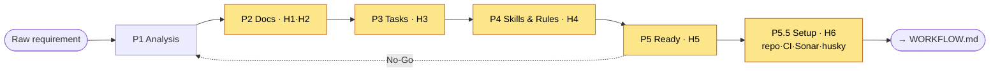
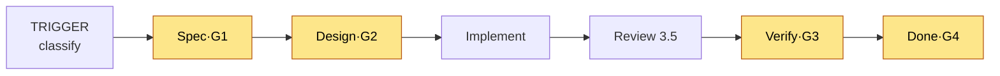

# GENESIS.md — Requirement to Production Pipeline

> The meta-workflow that transforms raw requirements into implementation-ready specs.
> 5 phases + Phase 5.5 (Project Setup), 6 human gates. Critical grooming, not passive Q&A.

---

## Pipeline Overview



---

## Output Layout (STANDARD — every GENESIS run produces this)

All GENESIS output lives under a single top-level **`.genesis/`** directory at the repo root. Do **not** scatter artifacts across `specs/…` or ad-hoc folders. The layout is fixed so every project looks the same and agent runtimes always know where to read.

```
.genesis/
├── docs/                         ← the ENTIRE implementation-ready doc set, one folder
│   ├── 01-PHASE-1-REQUIREMENT-ANALYSIS.md   ┐
│   ├── 02-PHASE-1-GROOMING-AGENDA.md        │ numbered = process/gate trail
│   ├── 03-GROOMING-DECISIONS.md   (H1)      │ (read in order)
│   ├── 04-PHASE-2-INDEX.md        (H2)      │
│   ├── 05-TASK-LIST.md            (H3)      │
│   ├── 06-TASK-ORDER.md           (H3)      │
│   ├── 07-SKILLS-MAP.md           (H4)      │
│   ├── 08-RULES.md                (H4)      │
│   ├── 09-IMPLEMENTATION-READINESS.md (H5)  │
│   ├── 10-PROJECT-SETUP.md        (H6)      ┘
│   ├── ARCHITECTURE.md            ┐
│   ├── API-CONTRACT.md            │ un-numbered = the deliverable documentation set
│   ├── FLOW-DIAGRAMS.md           │ (generated from TEMPLATES/, filled not templated)
│   ├── SEQUENCE-DIAGRAMS.md       │
│   ├── DESIGN-SYSTEM.md           │
│   ├── EDGE-CASES.md              │
│   ├── INFRASTRUCTURE.md          │
│   ├── CI-CD.md (or PIPELINE.md)  │
│   ├── SECURITY.md                │
│   ├── OBSERVABILITY.md           │
│   ├── TESTING-STRATEGY.md        ┘
│   ├── api-contract/              ← OpenAPI JSON/YAML files
│   ├── mock-fixtures/             ← contract-faithful mock responses (when BE is a dependency)
│   └── README.md                  ← index of the doc set + gate status
├── requirement/                  ← raw input ONLY (the PDF/doc the project started from)
├── prototype/                    ← UX reference prototype, if any
└── workflow/                     ← this generic GENESIS workflow (copied in per project)

AGENTS.md                         ← repo ROOT (not under .genesis/) — runtimes read it first
```

**Rules for the layout:**
- **Numbered `NN-` prefixes** mark the phase/gate trail (01 → 10), so the process order is self-evident. The gate each closes is noted beside it.
- **Un-numbered docs** are the deliverable set, generated from `workflow/TEMPLATES/` (filled, never left with `{...}` placeholders).
- `AGENTS.md` sits at the **repo root** and its source-of-truth table points at `.genesis/docs/…`.
- `requirement/` holds only the raw input; never generate into it.
- When the backend is delivered by another team, add `docs/mock-fixtures/` (contract-faithful) so the FE is unblocked.
- Save each phase's artifacts to disk before the next phase (long-session rule below).

> Throughout this document, when a phase says "output `ARCHITECTURE.md`" it means `.genesis/docs/ARCHITECTURE.md`; "output `TASK-LIST.md`" means `.genesis/docs/05-TASK-LIST.md`; and so on per the tree above.

---

## Phase 1: REQUIREMENT ANALYSIS

**Input:** Raw requirement (PDF, doc, conversation, idea)

**Agent actions:**
1. Parse the raw requirement thoroughly
2. Extract functional requirements (what the system does)
3. Extract non-functional requirements (how the system performs)
4. List explicit assumptions
5. List unknowns, ambiguities, and gaps
6. Identify stakeholders mentioned or implied
7. Identify external dependencies
8. Prepare grooming questions

**Output** (to `.genesis/docs/`):
- `01-PHASE-1-REQUIREMENT-ANALYSIS.md` — parsed requirement summary, FR/NFR lists, assumptions, unknowns
- `02-PHASE-1-GROOMING-AGENDA.md` — the grooming agenda (challenges pre-loaded)

---

## Gate H1: GROOMING SESSION

**Type:** Human interaction (critical, not passive)

**Agent behavior:** See `GROOMING-PROTOCOL.md`
- Agent asks questions from `GROOMING-CHECKLIST.md`
- Agent challenges weak or risky decisions
- Agent identifies contradictions
- Agent suggests alternatives with reasoning
- Agent pushes back on scope creep
- Agent warns about complexity vs value tradeoffs

**Topics covered (10 sections):**
1. BUSINESS — users, goals, MVP, compliance
2. ARCHITECTURE — mono/micro, repo, DB, cache, queue
3. DESIGN PATTERNS — state, API, auth, error, logging
4. TECH STACK — language, framework, UI, testing, build
5. INFRASTRUCTURE — cloud, containers, CDN, DNS
6. CI/CD & DELIVERY — pipelines, environments, rollback
7. SECURITY — auth, secrets, SAST/DAST
8. OBSERVABILITY — logging, metrics, tracing, alerting
9. QUALITY — coverage, static analysis, E2E, perf
10. OPERATIONS — SLA, DR, backup, incident response

**Pass criteria:**
- All 10 sections addressed
- All critical decisions justified
- All contradictions resolved
- All blockers identified

**Output:** `.genesis/docs/03-GROOMING-DECISIONS.md` (captured answers + rationale — the Phase 2 source of truth)

---

## Phase 2: DOCUMENTATION GENERATION

**Input:** Grooming decisions

**Agent actions:**

> Use the corresponding template from `TEMPLATES/` as the document structure (e.g., `TEMPLATES/ARCHITECTURE.md`). Fill in the `{...}` placeholders with actual grooming decisions — do not leave placeholders unfilled.

1. Generate `ARCHITECTURE.md` from architecture decisions
2. Generate `DESIGN-SYSTEM.md` from UI/design decisions
3. Generate `API-CONTRACT.md` + OpenAPI specs from API decisions
4. Generate `FLOW-DIAGRAMS.md` from user flow discussions
5. Generate `SEQUENCE-DIAGRAMS.md` from technical flows
6. Generate `EDGE-CASES.md` from error handling discussions
7. Generate `INFRASTRUCTURE.md` from infra decisions
8. Generate `CI-CD.md` from delivery decisions
9. Generate `SECURITY.md` from security decisions
10. Generate `OBSERVABILITY.md` from monitoring decisions
11. Generate `TESTING-STRATEGY.md` from quality decisions

**Output:** all documentation filled (not templated — filled with actual content) into `.genesis/docs/`, plus `.genesis/docs/04-PHASE-2-INDEX.md` (a manifest listing each doc as adopted/generated + the H2 review checklist). When a doc already exists as authoritative input (e.g. a provided ARCHITECTURE), **adopt + verify + fill gaps** rather than regenerate from scratch; record that in the index.

---

## Gate H2: DOCUMENTATION VERIFICATION

**Type:** Human review

**Agent behavior:** STOP. Present all generated docs. Wait for approval.

**Human reviews:**
- [ ] Architecture matches grooming decisions?
- [ ] API contracts are complete and consistent?
- [ ] Flow diagrams cover all user journeys?
- [ ] Edge cases are comprehensive?
- [ ] Infrastructure matches scale requirements?
- [ ] Security covers all sensitive areas?
- [ ] No contradictions between docs?

**Pass criteria:**
- All docs reviewed and approved
- Corrections applied if needed
- No open questions about system design

---

## Phase 3: TASK DECOMPOSITION

**Input:** Verified documentation

**Agent actions:**
1. Identify epics (large feature areas)
2. Break epics into stories (user-facing deliverables)
3. Break stories into tasks (implementation units)
4. Identify dependencies between tasks
5. Identify parallelizable vs sequential work
6. Estimate complexity (S/M/L or story points)
7. Map tasks to documentation sections
8. Identify critical path
9. **Group tasks by domain** (the system area / path set each belongs to) and **order them into execution waves** — each wave holds tasks that are dependency-free of their wave-siblings and file-disjoint, so they can run in parallel; tasks that share a file (lockfile, route registry, barrel, migration) are serialized across waves
10. Build the **Shared-File Register** so the parallel waves never collide

**Output:**
- `.genesis/docs/05-TASK-LIST.md` (full decomposition) with:
  - Epic → Story → Task hierarchy
  - Dependencies graph
  - **Delivery Checklist** — every task with a Delivered ☐/✅ + PR/merge/evidence status
  - Complexity estimates
  - Critical path highlighted
  - Milestone mapping
- `.genesis/docs/06-TASK-ORDER.md` (from `TEMPLATES/TASK-ORDER.md`) — **the MAIN RUN REFERENCE**: tasks grouped by domain and ordered into parallel-aware execution waves, with a "Run Next" pointer, critical path, parallelism summary and shared-file register. WORKFLOW.md Phase 0 selects the next task from THIS file, and its Status/Delivered columns are the live run state.

> `TASK-LIST.md` = what the work is (detail). `TASK-ORDER.md` = how to run it (order + parallelism). The two stay in lockstep; the order file wins for "what runs next".

---

## Gate H3: TASK VERIFICATION

**Type:** Human review

**Agent behavior:** STOP. Present task breakdown. Wait for approval.

**Human reviews:**
- [ ] All features from requirement covered?
- [ ] Task granularity appropriate?
- [ ] Dependencies correctly identified?
- [ ] Estimates reasonable?
- [ ] Critical path makes sense?
- [ ] Execution waves in TASK-ORDER.md are dependency-safe and file-disjoint (parallelism is real)?
- [ ] Nothing missing?

**Pass criteria:**
- Task list approved
- Execution order / waves approved (TASK-ORDER.md)
- Priorities confirmed
- Scope locked (no more additions without re-grooming)

---

## Phase 4: SKILL & RULES GENERATION

**Input:** Verified task list

### Skill Tool Availability

**If skill tools are available** (`skill_search`, `skill_discover`, `skill_fetch`):
Use the tool-driven protocol below.

**If skill tools are unavailable** (non-Kiro runtime, Claude Code, Codex, etc.):
1. Manually identify technology domains in the task list
2. For each domain, document known patterns and best practices from training knowledge
3. Note any domains where external documentation should be consulted
4. Proceed with manual survey — skills generation becomes a knowledge inventory rather than a tool-driven search
5. Output the same artifacts (SKILLS-MAP.md, RULES.md, AGENTS.md) but mark skills as "manual — no tool verification"

### Agent actions (tool-driven path):
1. For each task, identify required domains/technologies
2. Search local skills: `skill_search(query)`
3. Search public registry: `skill_discover(query)`
4. If local + registry both miss → **web research** official docs (`web_search`/`web_fetch`, ≤2 fetches, record URL + date)
5. Fetch registry skill instructions: `skill_fetch(id)` (read-only — never installs)
6. Evaluate skills against project decisions (registry/web = untrusted reference)
7. **Present a SKILL CANDIDATES list to the human and STOP** — the human picks which to install (agent cannot install)
8. Map **human-approved** skills to tasks; park the rest as candidates
9. Generate project-specific `RULES.md`
10. Generate project-specific `AGENTS.md`

**Output:**
- `.genesis/docs/07-SKILLS-MAP.md` — approved skills mapped to tasks + a "Candidates (not approved)" list (source tagged local/registry/web/manual, with URL+date for web)
- `.genesis/docs/08-RULES.md` — project-specific MUST/NEVER/ASK rules
- `AGENTS.md` (repo ROOT) — project manifest for implementation; its source-of-truth table points at `.genesis/docs/…`

---

## Gate H4: SKILL & RULES VERIFICATION

**Type:** Human review

**Agent behavior:** STOP. Present skills and rules. Wait for approval.

**Human reviews:**
- [ ] Skills appropriate for the stack?
- [ ] No skill conflicts with project decisions?
- [ ] Which candidate skills to install? (human installs registry skills via Settings → Skills → Discover; agent cannot)
- [ ] Web-sourced findings cite an official URL and are treated as reference only?
- [ ] Rules are complete and correct?
- [ ] AGENTS.md accurately reflects the project?

**Pass criteria:**
- Skills approved (and chosen candidates installed by the human)
- Rules approved
- AGENTS.md approved

---

## Phase 5: READINESS CHECK

**Input:** All verified artifacts

**Agent actions:**
1. Run readiness checklist
2. Identify any remaining blockers (P0/P1)
3. Verify all docs exist and are verified
4. Verify all tasks are specified
5. Verify all skills are identified
6. Verify infrastructure prerequisites
7. Generate `.genesis/docs/09-IMPLEMENTATION-READINESS.md`

**Readiness checklist:**
```
DOCUMENTATION
[ ] ARCHITECTURE.md verified
[ ] DESIGN-SYSTEM.md verified
[ ] API-CONTRACT.md verified
[ ] FLOW-DIAGRAMS.md verified
[ ] SEQUENCE-DIAGRAMS.md verified
[ ] EDGE-CASES.md verified
[ ] INFRASTRUCTURE.md verified
[ ] CI-CD.md verified
[ ] SECURITY.md verified
[ ] OBSERVABILITY.md verified
[ ] TESTING-STRATEGY.md verified

TASKS
[ ] All epics defined
[ ] All stories specified
[ ] Dependencies mapped
[ ] Critical path identified
[ ] Execution order & parallel waves defined (TASK-ORDER.md)

SKILLS & RULES
[ ] Skills mapped to tasks
[ ] RULES.md generated
[ ] AGENTS.md generated

BLOCKERS
[ ] No P0 blockers open
[ ] P1 blockers have mitigation plan

INFRASTRUCTURE
[ ] Repo created
[ ] CI/CD pipeline ready
[ ] Environments provisioned (or plan exists)
[ ] Secrets management ready
[ ] Husky commit guard + coverage gate (≥ threshold) planned
[ ] Static analysis (Sonar) project planned
```

> The INFRASTRUCTURE items above are *planned/verified* here (H5) and *actually stood up* in Phase 5.5 (PROJECT SETUP), tracked in `10-PROJECT-SETUP.md`.

**Output:** `.genesis/docs/09-IMPLEMENTATION-READINESS.md` with status of all items

---

## Gate H5: FINAL APPROVAL

**Type:** Human Go/No-Go decision

**Agent behavior:** STOP. Present readiness report. Wait for final approval.

**Human decides:**
- [ ] All checklist items green or acceptable?
- [ ] Team ready to start?
- [ ] Timeline agreed?
- [ ] GO or NO-GO?

**If GO:**
- Readiness approved
- Proceed to **Phase 5.5: PROJECT SETUP** (prepare repo/CI/Sonar/hooks/secrets)
- Then hand off to `WORKFLOW.md` for implementation

**If NO-GO:**
- Identify blocking issues
- Return to appropriate phase
- Re-groom if needed

---

## Phase 5.5: PROJECT SETUP

**Input:** Approved readiness (Gate H5 passed) + grooming decisions (tech stack, CI/CD, security).

**Why here:** the tech stack is now locked, but no code can be committed/pushed/scanned until the project scaffolding exists. This phase turns the groomed decisions into a **working repo** so the first WORKFLOW task hits zero setup gaps.

**Agent actions** (each item is derived from an existing doc — nothing invented):
1. Create repo + base/integration branch; apply branch protection and required checks (`CI-CD.md`, `TRACKING.md`)
2. Install the **husky commit guard** + `lint-staged` with the ≥ {coverage_threshold}% (default 80%) coverage gate (`TESTING-STRATEGY.md`, RULES R008/R017)
3. Commit the CI pipeline (Install → Lint → Type-check → Test+coverage → Build → Scan) (`CI-CD.md`)
4. Stand up **static analysis** — Sonar project, `sonar-project.properties`, lcov path, quality gate `new_coverage ≥ {threshold}` (`CI-CD.md §SAST`, `SECURITY.md`)
5. Configure **secrets/env** (`SONAR_TOKEN`, registry/deploy keys), `.env.example`, dependency scanning (`SECURITY.md`)
6. Scaffold the project + install the approved stack deps; commit lint/format/type-check/test configs (`ARCHITECTURE.md`, RULES R054)
7. Place `AGENTS.md` at repo root; verify its source-of-truth table resolves
8. Capture anything else the grooming surfaced (feature flags, error tracking, observability agent, preview envs)

**Output:** `.genesis/docs/10-PROJECT-SETUP.md` — the filled setup checklist (from `TEMPLATES/PROJECT-SETUP.md`) with every item ✅ or a tracked exception.

---

## Gate H6: SETUP VERIFICATION

**Type:** Human review

**Agent behavior:** STOP. Present the setup checklist + proof of a green trivial PR. Wait for approval.

**Human reviews:**
- [ ] Repo + branch protection + required checks in place?
- [ ] Husky commit guard rejects a sub-threshold commit?
- [ ] CI goes green end-to-end on a trivial PR?
- [ ] Sonar project scans and the quality gate reports?
- [ ] Secrets configured, none committed?

**Pass criteria:**
- A trivial PR flows end-to-end: commit (guard passes) → push → CI green → Sonar gate → mergeable
- No P0 setup blocker open

**If PASS:**
- GENESIS is fully complete
- Hand off to `WORKFLOW.md` → Phase 0 (TRIGGER), first task from `06-TASK-ORDER.md` (Run Next)

**If FAIL:**
- Fix the setup gap and re-verify (does not require re-grooming)

---

## Timing Guidelines

| Phase | Typical | Max |
|-------|---------|-----|
| Analysis | 30 min - 1 hr | 2 hr |
| Grooming | 1 - 2 hr | 4 hr |
| Doc Generation | 1 - 2 hr | 4 hr |
| Doc Verification | 30 min - 1 hr | 2 hr |
| Task Decomposition | 30 min - 1 hr | 2 hr |
| Task Verification | 15 - 30 min | 1 hr |
| Skill/Rules Gen | 30 min - 1 hr | 2 hr |
| Skill Verification | 15 - 30 min | 1 hr |
| Readiness Check | 15 - 30 min | 1 hr |
| Final Approval | 15 - 30 min | 1 hr |

**Total:** 5 - 10 hours for a medium-complexity project

### Long-Session Guidance

GENESIS may span 5-10 hours and multiple turns. Context loss mid-session is a real risk.

**After each phase completes:**
1. Save the grooming decisions document to disk (after Phase 1/Gate H1)
2. Save all generated artifacts to disk (after each subsequent phase)
3. Confirm artifacts are written before proceeding to the next phase

**If context is lost mid-session:**
1. Read the saved files — they are the recovery point
2. Restart from the last **completed** phase, not from the beginning
3. The grooming decisions document is the source of truth for all downstream generation

**Rule:** Never proceed to the next phase without confirming the current phase's outputs are saved to disk.

---

## After Genesis: Implementation

Once Gate H6 passes (readiness approved at H5, project stood up at Phase 5.5), the project is ready for implementation.

Use `WORKFLOW.md` to execute:
- One task at a time (single-ticket mode)
- Multiple tasks in parallel (batch mode)
- Research tasks (spike mode)

The implementation workflow has 5 phases + a REVIEW step, with 4 human gates:


REVIEW is a multi-perspective AI quality gate (no human gate) that runs after code is pushed but before the PR opens. By this point, specs are already written — implementation is execution, not discovery.
