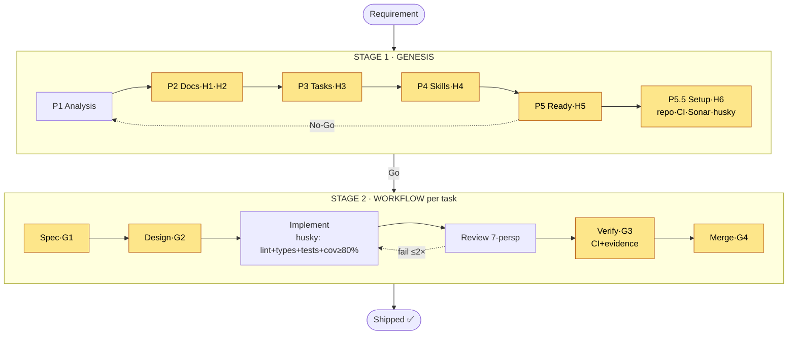
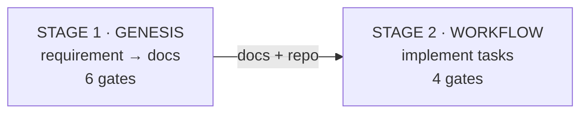

# Final Workflow — Requirement to Production

> Generic, reusable workflow that takes raw requirements and produces
> production-ready documentation, task lists, and implementation-ready specs.

---

## ⚡ Start every agent session here

**Point your agent at the PLAYBOOK at the start of every session:**

> Read `.genesis/PLAYBOOK.md` and follow it.

`.genesis/PLAYBOOK.md` is the runtime-agnostic operating protocol — the gates, the
standing rules, and a map of which file to read for each phase (so the agent does
**not** read the whole docset up front). This one pointer is what makes a fresh
session follow the entire workflow.

- **Kiro** loads it automatically (`.kiro/steering/genesis.md` → PLAYBOOK) — no action needed.
- **Every other agent** (Claude Code, Codex, Cursor, Gemini, Copilot, ad-hoc): the
  human pastes the line above each session, or adds it once to that tool's own
  instruction file (`CLAUDE.md`, root `AGENTS.md`, `.cursorrules`, `GEMINI.md`,
  `.github/copilot-instructions.md`). The PLAYBOOK's last section lists the exact
  line per runtime.

> If you skip this, the agent may miss the protocol. The PLAYBOOK is the single
> entry point; everything below is reference.

---

## What This Workflow Does

```
RAW REQUIREMENT → [5 Phases + Phase 5.5 Setup + 6 Human Gates] → READY FOR IMPLEMENTATION
```

**Input:** A raw requirement (PDF, doc, conversation, idea)

**Output:** (all under `.genesis/docs/` — see GENESIS.md "Output Layout")
- Complete architecture documentation
- API contracts
- Flow & sequence diagrams
- Task list (full decomposition) + **`TASK-ORDER.md` — domain-grouped, parallel-aware run plan (main run reference)** + delivery checklist
- Skills mapped to tasks
- Project-specific rules
- Implementation readiness checklist
- **Project setup checklist** (repo, CI, Sonar, husky commit guard, secrets) + a stood-up repo

> **Standard layout:** every GENESIS run writes to a single `.genesis/` root — `.genesis/docs/` (numbered `01-10` phase/gate trail + un-numbered deliverable docs + `api-contract/` + `mock-fixtures/`), `.genesis/requirement/` (raw input), `.genesis/prototype/`, `.genesis/workflow/` (this workflow), and `AGENTS.md` at the repo root. GENESIS.md "Output Layout" is authoritative.

---

## GENESIS Flow — what happens when you run this workflow



**Legend:** amber = step carrying a gate. GENESIS gates H1–H6 (H1 grooming, H2 docs, H3 tasks, H4 skills, H5 go/no-go, H6 setup). Per-task gates G1–G4 (G1 spec, G2 design, G3 evidence, G4 release — G4 base→main is a human merge). Phase 3.5 AI review loops back to Implement ≤2×. Full step detail: `GENESIS.md` and `WORKFLOW.md`.

---

## Design: Two Stages



---

## Files

| File | Purpose | Read When |
|------|---------|-----------|
| `README.md` | This file — entry point | First |
| `PLAYBOOK.md` | **Agent operating protocol — point every session here** | Every session, first |
| `GENESIS.md` | The meta-workflow (5 phases + Phase 5.5 setup, 6 gates) | Starting a new project |
| `GROOMING-PROTOCOL.md` | How agent challenges decisions | During grooming |
| `GROOMING-CHECKLIST.md` | All questions to ask | During grooming |
| `WORKFLOW.md` | Implementation pipeline | After Genesis completes |
| `RULES.md` | MUST/NEVER/ASK rules | Reference |
| `SKILLS-PROTOCOL.md` | Skill discovery protocol | During implementation |
| `TRACKING.md` | Branch/commit/PR conventions | Setting up |
| `TEMPLATES.md` | Task dispatch templates | Dispatching agents |
| `RECOVERY.md` | Failure protocols | On failure |
| `GLOSSARY.md` | Term definitions | Reference |
| `METRICS.md` | Observability metrics | Sprint review |
| `TEMPLATES/` | Doc templates to fill | Phases 2-5 |

---

## Quick Start

### For a New Project

1. **Give the agent your raw requirement**
   - PDF, document, conversation, or verbal description
   - The messier, the more grooming helps

2. **Go through grooming (Gate H1)**
   - Agent asks critical questions
   - Agent challenges weak decisions
   - Agent suggests alternatives
   - You defend or adjust

3. **Review generated docs (Gate H2)**
   - Agent produces all documentation
   - You verify accuracy and completeness

4. **Review task breakdown (Gate H3)**
   - Agent decomposes into epics/stories (`TASK-LIST.md`)
   - Agent produces the domain-grouped, parallel-aware run plan (`TASK-ORDER.md`) — the main run reference
   - You verify scope, priorities, and that the execution waves are safe to parallelize

5. **Review skills & rules (Gate H4)**
   - Agent discovers required skills
   - Agent generates project rules
   - You verify applicability

6. **Final approval (Gate H5)**
   - Readiness checklist complete
   - All blockers resolved
   - Go/No-Go decision

7. **Project setup (Phase 5.5 / Gate H6)**
   - Agent stands up repo, branch protection, CI, Sonar, husky commit guard, secrets
   - Verified by a green trivial PR end-to-end
   - Produces `10-PROJECT-SETUP.md`

8. **Implementation begins**
   - Hand off to `WORKFLOW.md`
   - Execute task by task (run order from `06-TASK-ORDER.md`)

---

## Reading Order

```
PLAYBOOK.md (agent, every session) → README.md → GLOSSARY.md → GENESIS.md → GROOMING-PROTOCOL.md
```

Establish shared vocabulary first, then know the 5 phases (+ Phase 5.5 setup), 6 gates, and critical grooming mindset. Everything else is reference.

---

## Key Principles

### Critical Grooming
The agent doesn't just accept answers. It challenges, questions, and recommends.
See `GROOMING-PROTOCOL.md`.

### Human Gates
Nothing proceeds without human verification. The agent stops and waits at each gate.

### AI Quality Gate
Before any PR opens, the agent reviews its own work from 7 perspectives (acceptance criteria, architecture, contracts, edge cases, security, tests, style). This is not optional and has no human gate — it is the agent's professional responsibility to catch issues before human review time is spent on them.
See `WORKFLOW.md §Phase 3.5`.

### Production-Grade
This isn't about "making it work" — it's about making it deployable, observable, secure, and maintainable.

### Skill-Aware
The agent discovers and loads skills dynamically based on task requirements.
See `SKILLS-PROTOCOL.md`.
