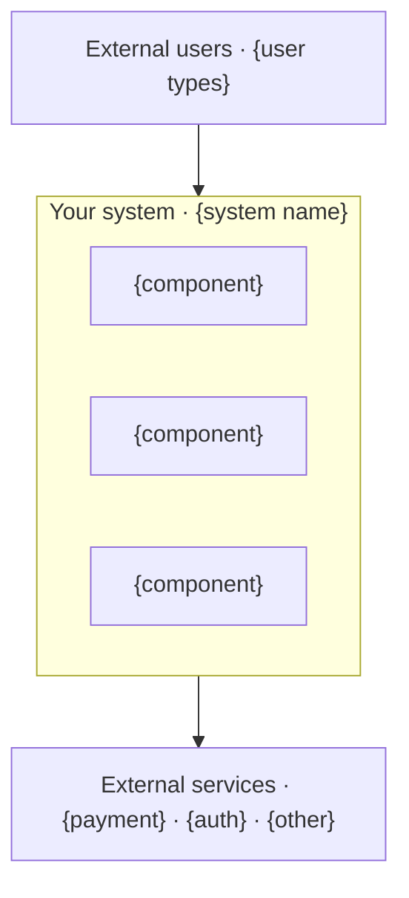
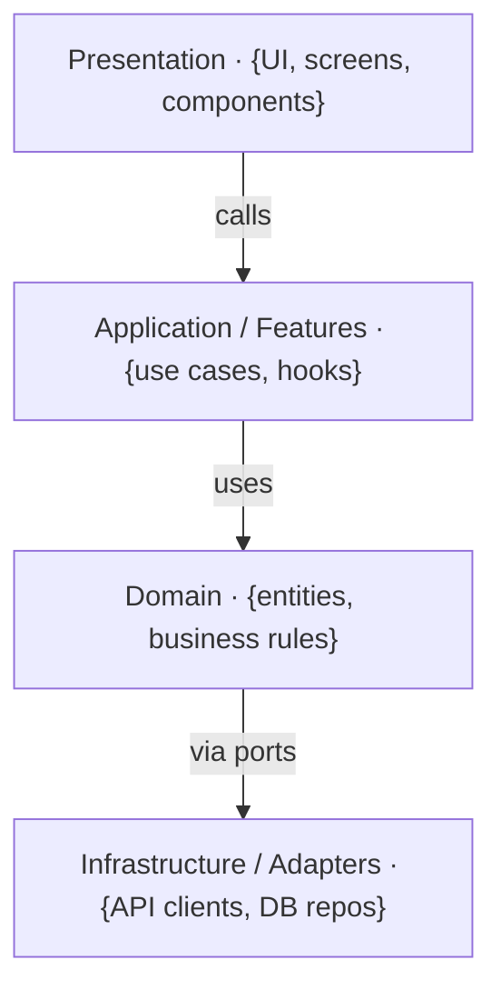
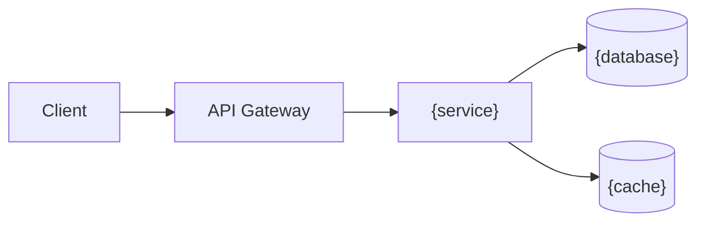

# ARCHITECTURE.md — System Architecture

> Generated from GENESIS grooming decisions.
> Fill `{...}` placeholders with actual project values.

---

## Overview

**Project:** {project name}
**Type:** {web app | mobile app | API | full-stack | other}
**Topology:** {monolith | modular monolith | microservices | serverless}

---

## System Context



---

## Repository Structure

**Strategy:** {monorepo | polyrepo | hybrid}

```
{repo-name}/
├── apps/
│   └── {app-name}/           # {description}
│       └── src/
│           ├── {folder}/     # {purpose}
│           └── {folder}/     # {purpose}
├── packages/
│   ├── {package}/            # {purpose}
│   └── {package}/            # {purpose}
├── docs/                     # Documentation
├── scripts/                  # Build/deploy scripts
└── ...
```

---

## Layer Architecture



### Dependency Rules

| Layer | May Import | Must Not Import |
|-------|------------|-----------------|
| Presentation | Application, UI libs | Domain directly, Infrastructure |
| Application | Domain | Infrastructure directly |
| Domain | Nothing external | React, HTTP, DB, any framework |
| Infrastructure | Domain (ports) | Presentation, Application |

---

## Tech Stack

| Concern | Choice | Rationale |
|---------|--------|-----------|
| Language | {language} | {why} |
| Framework | {framework} | {why} |
| UI Library | {library} | {why} |
| State Management | {library} | {why} |
| Server State | {library} | {why} |
| Forms | {library} | {why} |
| Validation | {library} | {why} |
| Testing | {library} | {why} |
| Build | {tool} | {why} |

---

## Data Architecture

### Database Strategy

**Primary DB:** {database} — {purpose}
**Secondary DB:** {database} — {purpose} (if applicable)
**Cache:** {cache solution} — {purpose}

### Data Flow



### Key Entities

| Entity | Storage | Description |
|--------|---------|-------------|
| {entity} | {where} | {what it represents} |
| {entity} | {where} | {what it represents} |

---

## API Architecture

**Style:** {REST | GraphQL | gRPC | hybrid}
**Authentication:** {method}
**Authorization:** {method}

### API Contracts

See `API-CONTRACT.md` for full specifications.

### Key Endpoints / Operations

| Endpoint/Operation | Method | Purpose |
|--------------------|--------|---------|
| {endpoint} | {method} | {purpose} |
| {endpoint} | {method} | {purpose} |

---

## Integration Points

| External Service | Purpose | Integration Method |
|------------------|---------|-------------------|
| {service} | {purpose} | {REST/webhook/SDK} |
| {service} | {purpose} | {REST/webhook/SDK} |

---

## Scalability Considerations

### Expected Load

| Metric | Expected | Peak |
|--------|----------|------|
| Concurrent users | {number} | {number} |
| Requests per second | {number} | {number} |
| Data volume | {size} | {growth rate} |

### Scaling Strategy

- **Horizontal:** {how}
- **Vertical:** {limits}
- **Caching:** {strategy}
- **CDN:** {strategy}

---

## Security Architecture

See `SECURITY.md` for full details.

### Key Security Controls

| Control | Implementation |
|---------|----------------|
| Authentication | {method} |
| Authorization | {method} |
| Data encryption | {at rest, in transit} |
| Secret management | {method} |

---

## Deployment Architecture

See `INFRASTRUCTURE.md` and `CI-CD.md` for full details.

### Environment Overview

| Environment | Purpose | URL |
|-------------|---------|-----|
| Development | Local development | localhost |
| Staging | Pre-production testing | {url} |
| Production | Live system | {url} |

---

## Decisions Log

| Decision | Date | Rationale | ADR |
|----------|------|-----------|-----|
| {decision} | {date} | {why} | {link if exists} |
| {decision} | {date} | {why} | {link if exists} |

---

## Constraints

| Constraint | Impact |
|------------|--------|
| {constraint from grooming} | {how it affects architecture} |
| {constraint from grooming} | {how it affects architecture} |

---

## Open Questions

| Question | Owner | Needed By |
|----------|-------|-----------|
| {question} | {who} | {date} |
