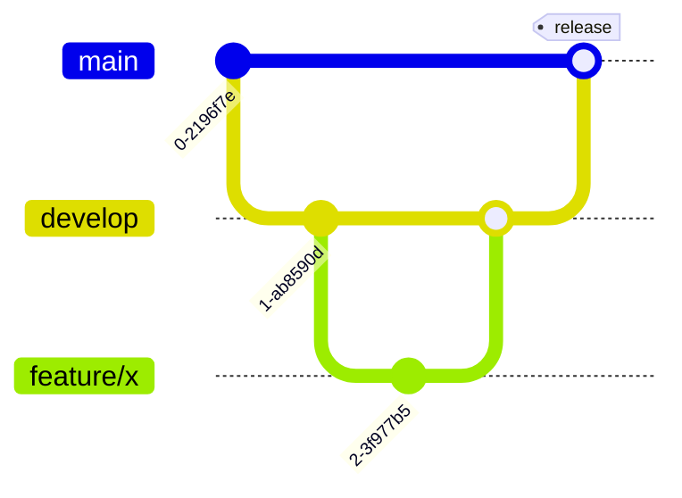
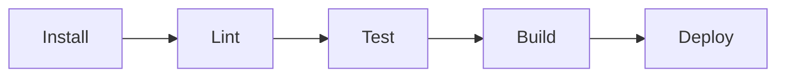
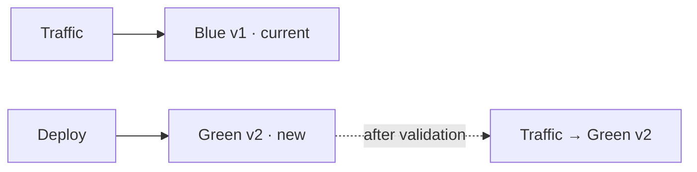
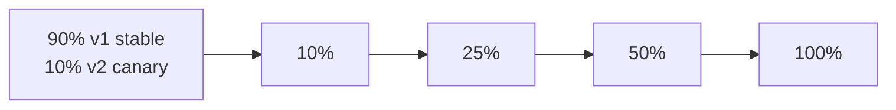

# CI-CD.md — Continuous Integration & Deployment

> Generated from GENESIS grooming decisions.
> Fill `{...}` placeholders with actual project values.

---

## Local Git Hooks (Husky)

> The commit guard that runs on the developer/agent machine **before** CI.
> It mirrors a subset of the CI quality gates so broken code never gets committed.

**Tool:** Husky + lint-staged
**Installed by:** `prepare` npm script (`"prepare": "husky"`) — runs on `{install command}`

### Pre-Commit Hook

| Step | Command | Blocks commit on |
|------|---------|------------------|
| Lint (staged) | `{lint command}` | any error |
| Type check | `{typecheck command}` | any error |
| Related tests | `{test command for changed files}` | any failure |
| Coverage gate | `{coverage command}` | changed-code coverage < {coverage_threshold}% (default 80%) |

See `TESTING-STRATEGY.md §Pre-Commit Coverage Gate` for the hook script and config.
Bypassing with `--no-verify` is forbidden (RULES R009).

### Commit-Msg Hook (optional)

Enforce the commit convention from `TRACKING.md` (issue key + Conventional Commits):

```sh
# .husky/commit-msg
npx --no-install commitlint --edit "$1"
```

> **Local vs CI:** the hook is fast, per-machine feedback and can be skipped or drift between machines — so CI re-runs lint, type-check, the **full** test suite and the coverage threshold as the authoritative gate (below).

---

## Overview

**CI Platform:** {GitHub Actions | GitLab CI | Jenkins | CircleCI}
**CD Platform:** {same as CI | ArgoCD | Spinnaker | other}
**Container Registry:** {ECR | GCR | Docker Hub | GHCR}
**Artifact Storage:** {S3 | GCS | Artifactory}

---

## Branching Strategy

**Strategy:** {GitFlow | Trunk-based | GitHub Flow}



> `feature/*` → PR → `develop` (staging) → release PR → `main` (production). Agent merges feature→develop after G3; human merges develop→main at G4.

### Branch Rules

| Branch | Protected | Required Reviews | CI Required |
|--------|-----------|-----------------|-------------|
| `main` | Yes | {n} | Yes |
| `develop` | Yes | {n} | Yes |
| `feature/*` | No | - | Yes |

---

## Environments

| Environment | Branch | URL | Auto-Deploy |
|-------------|--------|-----|-------------|
| Development | `develop` | `{url}` | Yes |
| Staging | `develop` | `{url}` | Yes |
| Production | `main` | `{url}` | {Yes/No} |
| Preview | PR branches | Dynamic | Yes |

---

## CI Pipeline

### Stages



### Stage Details

#### 1. Install
```yaml
- name: Install dependencies
  run: |
    {install command}
  cache:
    paths:
      - {cache paths}
```

#### 2. Lint
```yaml
- name: Lint
  run: |
    {lint command}
```

#### 3. Test
```yaml
- name: Test
  run: |
    {test command}
  coverage:
    minimum: {percentage}
```

#### 4. Build
```yaml
- name: Build
  run: |
    {build command}
  artifacts:
    paths:
      - {build output}
```

#### 5. Deploy
```yaml
- name: Deploy
  run: |
    {deploy command}
  environment: {env}
  when: {condition}
```

---

## Quality Gates

### Required Checks

| Check | Blocking | Threshold |
|-------|----------|-----------|
| Lint | Yes | 0 errors |
| Type check | Yes | 0 errors |
| Unit tests | Yes | 100% pass |
| Coverage | Yes | ≥ {x}% (default 80%) |
| Security scan | Yes | 0 critical |
| Build | Yes | Success |

### Optional Checks

| Check | Purpose |
|-------|---------|
| Performance | Detect regressions |
| Bundle size | Track growth |
| Accessibility | A11y violations |

---

## Security Scanning

### SAST (Static Analysis)

**Tool:** {SonarQube | CodeQL | Semgrep}
**When:** Every PR

```yaml
- name: SAST Scan
  run: |
    {sast command}
  fail_on:
    - critical
    - high
```

### Dependency Scanning

**Tool:** {Dependabot | Snyk | npm audit}
**When:** Every PR + Daily

### Container Scanning

**Tool:** {Trivy | Snyk | Clair}
**When:** On image build

---

## CD Pipeline

### Deployment Strategy

**Type:** {Blue-Green | Canary | Rolling | Recreate}

### Blue-Green Deployment



### Canary Deployment



---

## Feature Flags

**Provider:** {LaunchDarkly | Unleash | custom}

| Flag | Default | Purpose |
|------|---------|---------|
| `{flag}` | {value} | {purpose} |

### Flag Lifecycle

1. Create flag (disabled)
2. Deploy code behind flag
3. Enable flag (gradual rollout)
4. Monitor
5. Remove flag (cleanup)

---

## Rollback

### Automatic Rollback

**Triggers:**
- Health check failures > {threshold}
- Error rate > {threshold}
- Latency p99 > {threshold}

### Manual Rollback

```bash
# Rollback to previous version
{rollback command}

# Rollback to specific version
{rollback command with version}
```

### Rollback Verification

- [ ] Health checks passing
- [ ] Error rate normal
- [ ] Key metrics stable
- [ ] No user complaints

---

## Release Process

### Versioning

**Scheme:** {SemVer | CalVer | other}
**Format:** `{format}`

### Changelog

**Tool:** {Conventional Changelog | Release Drafter | manual}
**Location:** `CHANGELOG.md`

### Release Steps

1. [ ] All PRs merged to `develop`
2. [ ] CI passing on `develop`
3. [ ] Create release branch/tag
4. [ ] Deploy to staging
5. [ ] QA verification
6. [ ] Merge to `main`
7. [ ] Deploy to production
8. [ ] Verify production
9. [ ] Create GitHub release
10. [ ] Notify stakeholders

---

## Secrets Management

### CI Secrets

| Secret | Scope | Rotation |
|--------|-------|----------|
| `{NAME}` | {where used} | {frequency} |

### Secret Injection

```yaml
env:
  {VAR_NAME}: ${{ secrets.{SECRET_NAME} }}
```

---

## Notifications

### Build Notifications

| Event | Channel | Recipients |
|-------|---------|------------|
| PR build failed | {Slack/Email} | PR author |
| Deploy to staging | {Slack} | Team channel |
| Deploy to production | {Slack} | Team channel |
| Rollback | {PagerDuty} | On-call |

---

## Pipeline Configuration

### GitHub Actions Example

```yaml
name: CI/CD

on:
  push:
    branches: [main, develop]
  pull_request:
    branches: [main, develop]

jobs:
  build:
    runs-on: ubuntu-latest
    steps:
      - uses: actions/checkout@v4
      - name: Setup
        uses: {setup action}
      - name: Install
        run: {install command}
      - name: Lint
        run: {lint command}
      - name: Test
        run: {test command}
      - name: Build
        run: {build command}

  deploy:
    needs: build
    if: github.ref == 'refs/heads/main'
    runs-on: ubuntu-latest
    steps:
      - name: Deploy
        run: {deploy command}
```

---

## Metrics & Monitoring

### Pipeline Metrics

| Metric | Target | Alert |
|--------|--------|-------|
| Build time | < {minutes} | > {threshold} |
| Deploy time | < {minutes} | > {threshold} |
| Success rate | >  | > {threshold} |
