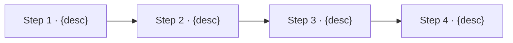
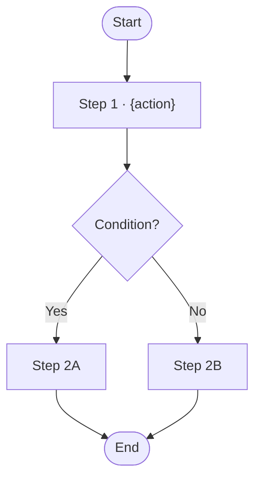
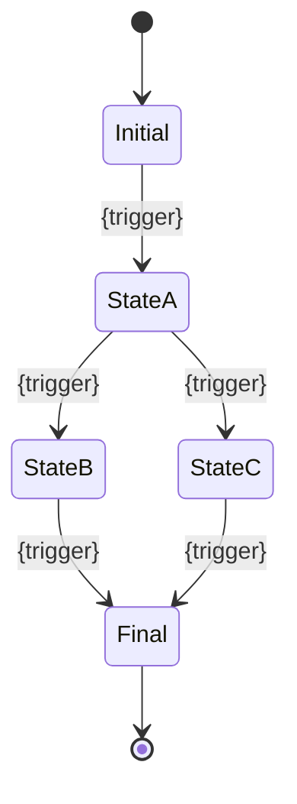
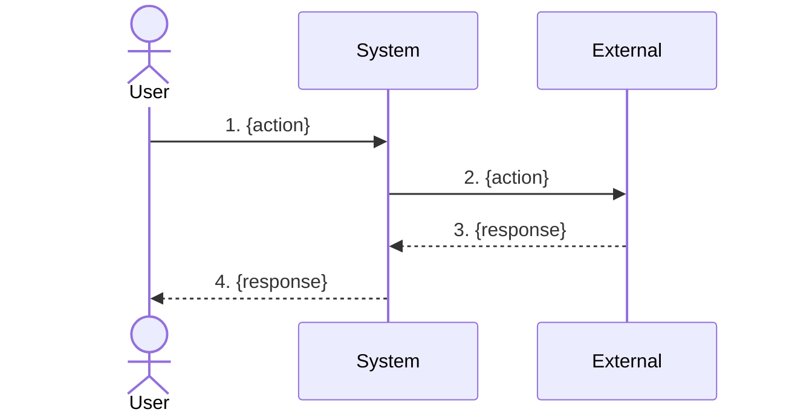
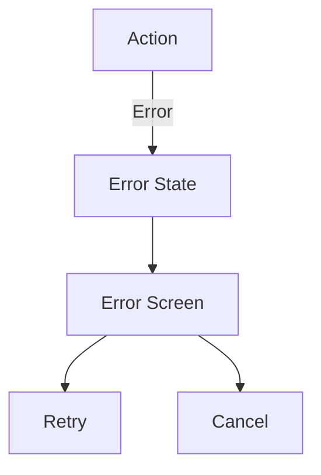

# FLOW-DIAGRAMS.md — User & System Flows

> Generated from GENESIS grooming decisions.
> Fill `{...}` placeholders with actual project values.

---

## Overview

This document describes the key user journeys and system flows.

---

## User Journeys

### Journey 1: {journey name}

**Actor:** {user type}
**Goal:** {what user wants to accomplish}
**Preconditions:** {what must be true before starting}



**Steps:**
1. **{Step 1}** — {description}
2. **{Step 2}** — {description}
3. **{Step 3}** — {description}
4. **{Step 4}** — {description}

**Happy Path Outcome:** {what happens on success}

**Alternative Paths:**
- If {condition} → {what happens}
- If {condition} → {what happens}

**Error Paths:**
- If {error} → {how handled}
- If {error} → {how handled}

---

### Journey 2: {journey name}

**Actor:** {user type}
**Goal:** {what user wants to accomplish}

...

---

## Screen Flow

### Route Map

```
{route}                    {screen name}
  │
  ├── {route}              {screen name}
  │     ├── {route}        {screen name}
  │     └── {route}        {screen name}
  │
  └── {route}              {screen name}
        └── {route}        {screen name}
```

### Navigation Matrix

| From | To | Trigger | Condition |
|------|-----|---------|-----------|
| {screen} | {screen} | {action} | {if any} |
| {screen} | {screen} | {action} | {if any} |

---

## Flow Diagrams

### Flow 1: {flow name}



---

### Flow 2: {flow name}

...

---

## State Diagrams

### {Entity} States



### State Definitions

| State | Description | Allowed Transitions |
|-------|-------------|---------------------|
| {state} | {meaning} | → {states} |
| {state} | {meaning} | → {states} |

---

## Interaction Flows

### {Interaction name}

**Trigger:** {what initiates this}
**Actors:** {who/what is involved}



---

## Error Flows

### Error: {error type}

**Trigger:** {what causes this error}
**Detection:** {how system detects it}
**User Impact:** {what user sees}



**Recovery Options:**
1. {option 1}
2. {option 2}

---

## Routes

### Public Routes

| Route | Screen | Purpose |
|-------|--------|---------|
| `{route}` | {screen} | {purpose} |
| `{route}` | {screen} | {purpose} |

### Protected Routes

| Route | Screen | Required Auth |
|-------|--------|---------------|
| `{route}` | {screen} | {auth level} |
| `{route}` | {screen} | {auth level} |

### Route Parameters

| Route | Params | Example |
|-------|--------|---------|
| `{route}` | `{param}` | `{example}` |

---

## Deep Links

| Link | Route | Purpose |
|------|-------|---------|
| `{scheme}://{path}` | `{route}` | {purpose} |

---

## Analytics Events

| Event | Trigger | Properties |
|-------|---------|------------|
| `{event_name}` | {when fired} | `{properties}` |
| `{event_name}` | {when fired} | `{properties}` |
