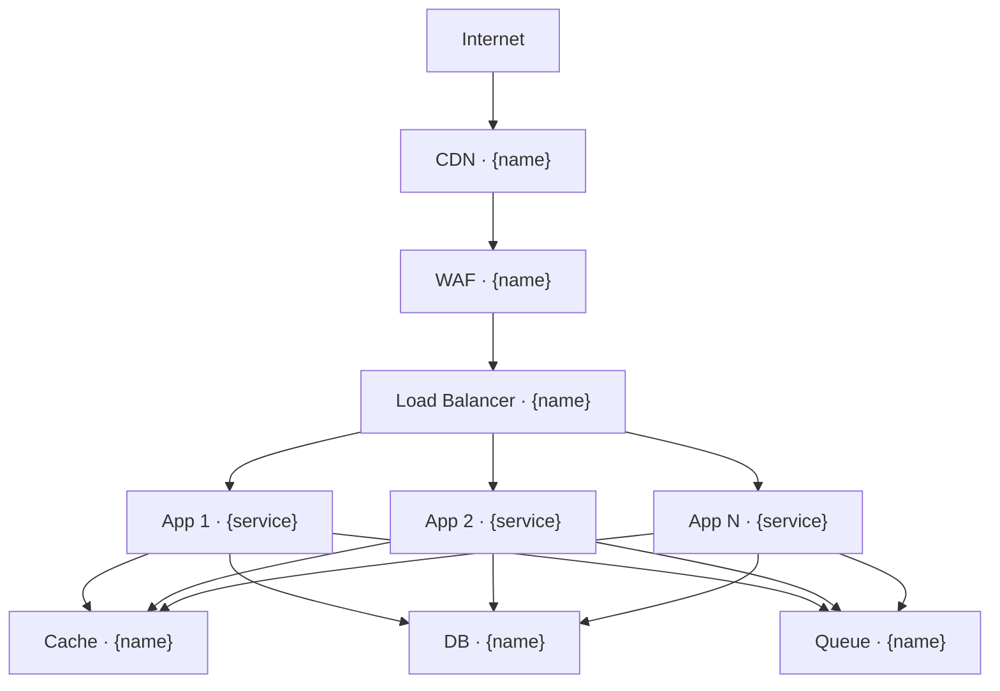

# INFRASTRUCTURE.md — Infrastructure Architecture

> Generated from GENESIS grooming decisions.
> Fill `{...}` placeholders with actual project values.

---

## Overview

**Cloud Provider:** {AWS | GCP | Azure | other}
**Region:** {primary region}
**DR Region:** {if applicable}

---

## Architecture Diagram



---

## Compute

### Strategy
**Type:** {VMs | Containers | Serverless | PaaS}

### Services

| Service | Type | Size | Count | Purpose |
|---------|------|------|-------|---------|
| {name} | {type} | {spec} | {n} | {purpose} |
| {name} | {type} | {spec} | {n} | {purpose} |

### Container Configuration (if applicable)

**Orchestration:** {ECS | EKS | Cloud Run | K8s}
**Registry:** {ECR | GCR | Docker Hub}

```yaml
# Example container spec
resources:
  requests:
    cpu: "{value}"
    memory: "{value}"
  limits:
    cpu: "{value}"
    memory: "{value}"
```

---

## Database

### Primary Database

**Service:** {RDS | Cloud SQL | Atlas | other}
**Engine:** {PostgreSQL | MySQL | MongoDB}
**Version:** {version}
**Instance:** {type/size}

**Configuration:**
- Storage: {size}
- IOPS: {if applicable}
- Multi-AZ: {yes/no}
- Read replicas: {count}

### Cache

**Service:** {ElastiCache | Memorystore | Redis Cloud}
**Engine:** {Redis | Memcached}
**Size:** {instance type}
**Cluster:** {yes/no}

### Data Stores

| Store | Service | Purpose |
|-------|---------|---------|
| {name} | {service} | {purpose} |

---

## Networking

### VPC Configuration

**CIDR:** `{x.x.x.x/xx}`

| Subnet | CIDR | AZ | Purpose |
|--------|------|-----|---------|
| Public | `{cidr}` | {az} | Load balancers, NAT |
| Private App | `{cidr}` | {az} | Application servers |
| Private Data | `{cidr}` | {az} | Databases |

### Security Groups

| SG Name | Inbound | Outbound | Purpose |
|---------|---------|----------|---------|
| {name} | {rules} | {rules} | {purpose} |

### DNS

**Provider:** {Route53 | Cloud DNS | Cloudflare}
**Domain:** `{domain}`

| Record | Type | Value |
|--------|------|-------|
| `{subdomain}` | {A/CNAME} | {value} |

---

## CDN & Edge

**Provider:** {CloudFront | Cloudflare | Fastly}

### Configuration

- **Origins:** {list of origins}
- **Cache behavior:** {TTLs}
- **SSL:** {ACM | custom}
- **Compression:** {gzip, brotli}

### Edge Functions (if applicable)

| Function | Trigger | Purpose |
|----------|---------|---------|
| {name} | {trigger} | {purpose} |

---

## Storage

### Object Storage

**Service:** {S3 | GCS | Azure Blob}

| Bucket | Purpose | Access |
|--------|---------|--------|
| `{name}` | {purpose} | {public/private} |

### File Storage

**Service:** {EFS | Filestore | other}
**Purpose:** {what it's for}

---

## Message Queue / Events

### Queue Service

**Service:** {SQS | Cloud Tasks | RabbitMQ}

| Queue | Purpose | DLQ |
|-------|---------|-----|
| `{name}` | {purpose} | {yes/no} |

### Event Bus (if applicable)

**Service:** {EventBridge | Pub/Sub | Kafka}

| Topic | Publishers | Subscribers |
|-------|------------|-------------|
| `{name}` | {who publishes} | {who subscribes} |

---

## Security

### WAF

**Service:** {AWS WAF | Cloudflare | other}
**Rules:** {managed rules, custom rules}

### DDoS Protection

**Service:** {Shield | Project Shield | other}
**Level:** {standard/advanced}

### Secrets Management

**Service:** {Secrets Manager | Parameter Store | Vault}

| Secret | Path | Rotation |
|--------|------|----------|
| `{name}` | `{path}` | {frequency} |

### Certificates

**Provider:** {ACM | Let's Encrypt | other}
**Renewal:** {automatic/manual}

---

## Backup & DR

### Backup Strategy

| Resource | Frequency | Retention | Location |
|----------|-----------|-----------|----------|
| Database | {freq} | {days} | {where} |
| Files | {freq} | {days} | {where} |

### Disaster Recovery

**RTO:** {hours}
**RPO:** {hours}
**Strategy:** {pilot light | warm standby | multi-region active}

---

## Scaling

### Auto Scaling

| Service | Min | Max | Metric | Threshold |
|---------|-----|-----|--------|-----------|
| {service} | {n} | {n} | {metric} | {value} |

### Database Scaling

**Vertical:** {max size}
**Horizontal:** {read replicas, sharding}

---

## Cost Estimates

### Monthly Estimate

| Service | Specification | Est. Cost |
|---------|---------------|-----------|
| Compute | {spec} | ${amount} |
| Database | {spec} | ${amount} |
| Storage | {spec} | ${amount} |
| Network | {spec} | ${amount} |
| **Total** | | **${total}** |

### Cost Optimization

- {optimization 1}
- {optimization 2}

---

## Infrastructure as Code

**Tool:** {Terraform | CloudFormation | Pulumi | CDK}
**Location:** `{path to IaC}`

### Modules

| Module | Purpose |
|--------|---------|
| `{module}` | {purpose} |
