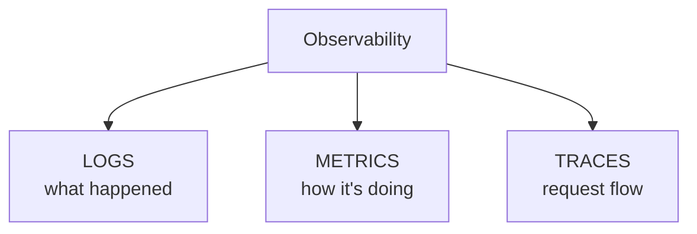

# OBSERVABILITY.md — Monitoring & Observability

> Generated from GENESIS grooming decisions.
> Fill `{...}` placeholders with actual project values.

---

## Overview

**Logging:** {CloudWatch | ELK | Datadog | Loki}
**Metrics:** {CloudWatch | Prometheus | Datadog}
**Tracing:** {X-Ray | Jaeger | Datadog APM | none}
**Alerting:** {PagerDuty | Opsgenie | CloudWatch | Slack}

---

## The Three Pillars



---

## Logging

### Log Format

**Format:** {JSON structured | plain text}

```json
{
  "timestamp": "2024-01-15T10:30:00.000Z",
  "level": "info",
  "service": "{service-name}",
  "requestId": "{correlation-id}",
  "userId": "{user-id}",
  "message": "Request processed",
  "data": { ... }
}
```

### Log Levels

| Level | Usage | Example |
|-------|-------|---------|
| error | Failures requiring attention | Unhandled exception |
| warn | Potential issues | Retry attempted |
| info | Normal operations | Request completed |
| debug | Development details | Variable values |

### Log Categories

| Category | What to Log | Retention |
|----------|-------------|-----------|
| Application | Business events, errors | {days} |
| Access | HTTP requests | {days} |
| Security | Auth events, admin actions | {days} |
| Audit | Data changes | {days} |

### Sensitive Data

**Never log:**
- Passwords, tokens, API keys
- Full credit card numbers
- Social security numbers
- Health information

**Redact/mask:**
- Email: `j***@example.com`
- Phone: `***-***-1234`
- IP: Logged but access-controlled

---

## Metrics

### Key Metrics

#### Application Metrics

| Metric | Type | Description | Alert |
|--------|------|-------------|-------|
| `http_requests_total` | Counter | Total HTTP requests | - |
| `http_request_duration_seconds` | Histogram | Request latency | p99 > {ms} |
| `http_requests_errors` | Counter | 4xx/5xx responses | Rate > {%} |
| `active_users` | Gauge | Current active users | - |

#### Business Metrics

| Metric | Type | Description | Alert |
|--------|------|-------------|-------|
| `{business_metric}` | {type} | {description} | {condition} |
| `{business_metric}` | {type} | {description} | {condition} |

#### Infrastructure Metrics

| Metric | Type | Description | Alert |
|--------|------|-------------|-------|
| `cpu_utilization` | Gauge | CPU % | > {%} |
| `memory_utilization` | Gauge | Memory % | > {%} |
| `disk_utilization` | Gauge | Disk % | >  | Successful requests / Total |
| Latency (p50) | < {ms} | 50th percentile response time |
| Latency (p99) | < {ms} | 99th percentile response time |
| Error rate | < {%} | 5xx responses / Total |

---

## Tracing

### Span Structure

```
Trace: {trace-id}
└── Span: API Gateway
    └── Span: Auth Service
    └── Span: Business Logic
        └── Span: Database Query
        └── Span: External API Call
    └── Span: Response Serialization
```

### What to Trace

| Operation | Trace | Tags |
|-----------|-------|------|
| HTTP requests | Yes | method, path, status |
| Database queries | Yes | query type, table |
| External API calls | Yes | service, endpoint |
| Queue operations | Yes | queue, operation |
| Cache operations | Optional | operation, hit/miss |

### Sampling

**Strategy:** {always | rate-based | adaptive}
**Rate:** {percentage} (production)

---

## Alerting

### Alert Severity

| Severity | Response | Notification |
|----------|----------|--------------|
| P1 Critical | Immediate | {PagerDuty} + {Slack} |
| P2 High | < 1 hour | {Slack} + {Email} |
| P3 Medium | < 4 hours | {Slack} |
| P4 Low | Next business day | {Email} |

### Alert Rules

| Alert | Condition | Severity | Runbook |
|-------|-----------|----------|---------|
| High Error Rate | 5xx >  | P2 | {link} |

### Alert Routing

| Time | Primary | Secondary |
|------|---------|-----------|
| Business hours | {team/channel} | {escalation} |
| After hours | {on-call} | {escalation} |
| Weekends | {on-call} | {escalation} |

---

## Dashboards

### Overview Dashboard

| Panel | Metric | Visualization |
|-------|--------|---------------|
| Request Rate | http_requests_total | Line chart |
| Error Rate | http_requests_errors | Line chart |
| Latency p50/p99 | http_request_duration | Line chart |
| Active Users | active_users | Single stat |

### Service Dashboard

| Panel | Purpose |
|-------|---------|
| Health status | Service up/down |
| Request breakdown | By endpoint |
| Error breakdown | By error type |
| Dependencies | External service status |

### Business Dashboard

| Panel | Metric |
|-------|--------|
| {business KPI} | {metric} |
| {business KPI} | {metric} |

---

## Runbooks

### High Error Rate

**Trigger:** 5xx rate > {%}
**Steps:**
1. Check recent deployments
2. Check error logs for patterns
3. Check database connectivity
4. Check external dependencies
5. If deployment-related: rollback
6. If not: escalate to engineering

### High Latency

**Trigger:** p99 > {ms}
**Steps:**
1. Check for traffic spike
2. Check database query performance
3. Check external API latency
4. Check CPU/memory utilization
5. Scale if needed
6. Investigate slow queries/calls

### Service Down

**Trigger:** No successful requests
**Steps:**
1. Check infrastructure status
2. Check container/pod status
3. Check health endpoints
4. Check recent changes
5. Restart service if needed
6. Check DNS if routing issue

---

## Implementation

### Logging Setup

```{language}
// Example logging configuration
{logging setup code example}
```

### Metrics Setup

```{language}
// Example metrics configuration
{metrics setup code example}
```

### Tracing Setup

```{language}
// Example tracing configuration
{tracing setup code example}
```

---

## Retention & Costs

| Data Type | Retention | Storage | Est. Cost |
|-----------|-----------|---------|-----------|
| Logs | {days} | {service} | ${amount}/mo |
| Metrics | {days} | {service} | ${amount}/mo |
| Traces | {days} | {service} | ${amount}/mo |
