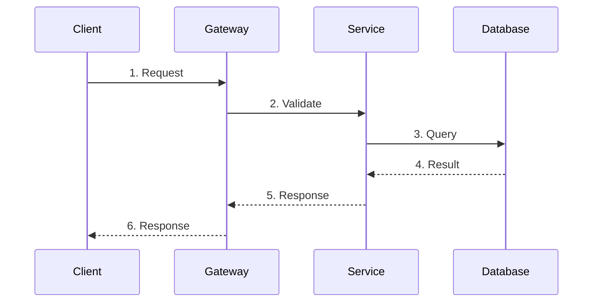
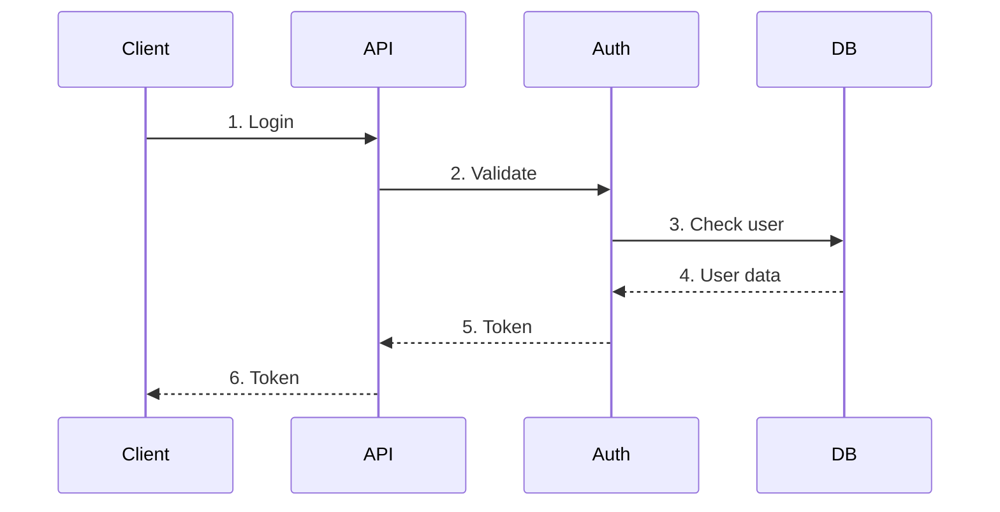
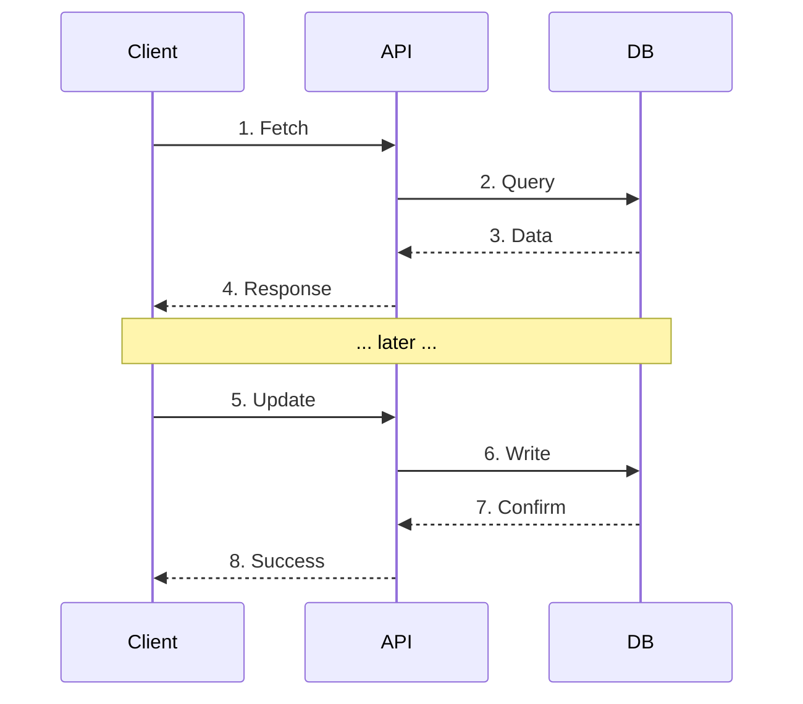
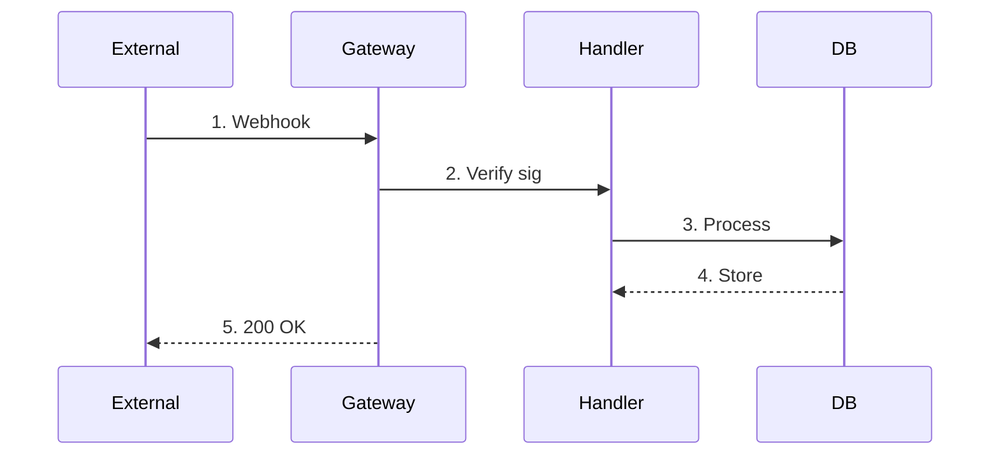
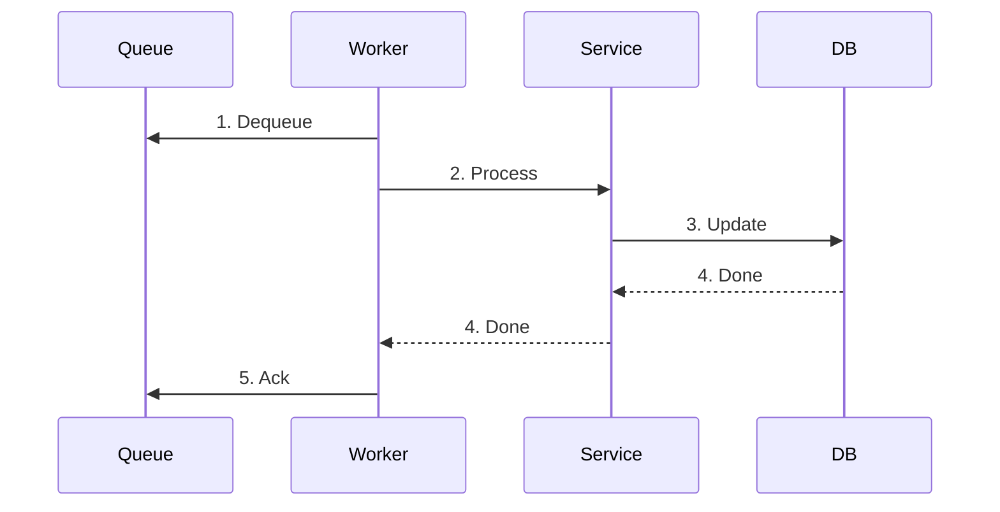

# SEQUENCE-DIAGRAMS.md — Technical Sequences

> Generated from GENESIS grooming decisions.
> Fill `{...}` placeholders with actual project values.

---

## Overview

Technical sequence diagrams showing system component interactions.

---

## Sequence 1: {sequence name}

**Purpose:** {what this sequence accomplishes}
**Trigger:** {what initiates this sequence}

### Steps

| # | From | To | Action | Data |
|---|------|----|---------|----|
| 1 | Client | Gateway | {action} | {data} |
| 2 | Gateway | Service | {action} | {data} |
| 3 | Service | Database | {action} | {data} |
| 4 | Database | Service | {action} | {data} |
| 5 | Service | Gateway | {action} | {data} |
| 6 | Gateway | Client | {action} | {data} |

### Error Cases

| Step | Error | Handling |
|------|-------|----------|
| {step} | {error} | {how handled} |

---

## Sequence 2: {sequence name}

...

---

## Authentication Sequence

---

## Data Sync Sequence

---

## Webhook Sequence

---

## Background Job Sequence

---

## Component Interactions

### {Component A} ↔ {Component B}

**Communication:** {sync/async, protocol}
**Contract:** See `API-CONTRACT.md` section {X}

---

## Timing Constraints

| Sequence | Step | Max Duration | Timeout Action |
|----------|------|--------------|----------------|
| {sequence} | {step} | {duration} | {action} |
