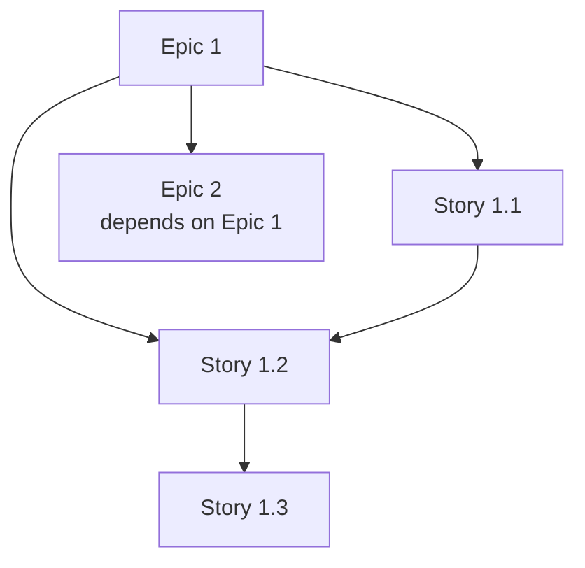

# TASK-LIST.md — Task Decomposition

> Generated from GENESIS Phase 3.
> Fill `{...}` placeholders with actual project values.

---

## Overview

**Total Epics:** {n}
**Total Stories:** {n}
**Total Tasks:** {n}
**Estimated Duration:** {weeks}

---

## Epic Overview

| Epic | Priority | Stories | Est. Points |
|------|----------|---------|-------------|
| {Epic 1} | P0 | {n} | {points} |
| {Epic 2} | P0 | {n} | {points} |
| {Epic 3} | P1 | {n} | {points} |
| ... | ... | ... | ... |

---

## Execution Order

> **The run order lives in `06-TASK-ORDER.md`** (domain-grouped, parallel-aware
> waves + "Run Next" pointer) — that file is the main run reference and the live
> Status/Delivered state. This section is a quick index only; do not duplicate the
> wave plan here. See `TASK-ORDER.md`.

| # | Task | Domain | Depends On | Wave |
|---|------|--------|-----------|------|
| 1 | {PREFIX}-001 | {auth} | — | 1 |
| 2 | {PREFIX}-003 | {catalog} | — | 1 |
| 3 | {PREFIX}-002 | {payments} | 001 | 2 |
| … | … | … | … | … |

---

## Delivery Checklist

> What has actually shipped. A task is **Delivered ✅** only when merged to base +
> CI green + evidence approved (Gate G3) — i.e. issue state `Done`. Keep this in
> lockstep with the waves in `06-TASK-ORDER.md` (the live run state).

| Task | Title | PR | Merged | Evidence (G3) | Delivered |
|------|-------|----|--------|---------------|-----------|
| {PREFIX}-001 | {name} | {#/url} | ☐ | ☐ | ☐ |
| {PREFIX}-002 | {name} | {#/url} | ☐ | ☐ | ☐ |
| {PREFIX}-003 | {name} | {#/url} | ☐ | ☐ | ☐ |

**Delivered:** {n}/{total}  •  **In progress:** {n}  •  **Remaining:** {n}

---

## Dependency Graph



---

## Critical Path

```
{Story A} → {Story B} → {Story C} → {Story D} → MVP
   2d          3d          2d          1d       = 8d minimum
```

---

## Epic 1: {Epic Name}

**Description:** {what this epic delivers}
**Priority:** {P0 | P1 | P2}
**Dependencies:** {none | Epic X}

### Stories

#### {PREFIX}-001: {Story Name}

**Type:** Story
**Priority:** {P0 | P1 | P2}
**Estimate:** {S | M | L | XL} ({points} points)
**Dependencies:** None

**Description:**
{What this story delivers to the user}

**Acceptance Criteria:**
- [ ] AC1: {observable, testable}
- [ ] AC2: {observable, testable}
- [ ] AC3: {observable, testable}

**Technical Notes:**
- {implementation hint}
- {files affected}

**Skills Required:**
- {skill domain}

---

#### {PREFIX}-002: {Story Name}

**Type:** Story
**Priority:** {P0 | P1 | P2}
**Estimate:** {S | M | L | XL} ({points} points)
**Dependencies:** {PREFIX}-001

**Description:**
{What this story delivers}

**Acceptance Criteria:**
- [ ] AC1: {observable, testable}
- [ ] AC2: {observable, testable}

**Technical Notes:**
- {implementation hint}

**Skills Required:**
- {skill domain}

---

### Epic 1 Summary

| Story | Priority | Est. | Depends On | Status |
|-------|----------|------|------------|--------|
| {PREFIX}-001 | P0 | M | - | To Do |
| {PREFIX}-002 | P0 | L | 001 | Blocked |
| ... | ... | ... | ... | ... |

---

## Epic 2: {Epic Name}

**Description:** {what this epic delivers}
**Priority:** {P0 | P1 | P2}
**Dependencies:** Epic 1

### Stories

#### {PREFIX}-010: {Story Name}

...

---

## Milestones

### Milestone 1: {Name}

**Target Date:** {date}
**Definition:** {what "done" means}

**Stories Included:**
- [ ] {PREFIX}-001
- [ ] {PREFIX}-002
- [ ] {PREFIX}-003

**Blockers:**
- {blocker if any}

---

### Milestone 2: {Name}

**Target Date:** {date}
**Definition:** {what "done" means}

**Stories Included:**
- [ ] {PREFIX}-010
- [ ] {PREFIX}-011

---

## Parallel Work Opportunities

The following stories can be worked in parallel (disjoint files):

### Batch 1
- {PREFIX}-001 (files: `{paths}`)
- {PREFIX}-003 (files: `{paths}`)
- {PREFIX}-005 (files: `{paths}`)

### Batch 2
- {PREFIX}-002 (files: `{paths}`)
- {PREFIX}-006 (files: `{paths}`)

---

## Estimation Guide

| Size | Points | Typical Duration | Description |
|------|--------|------------------|-------------|
| S | 1-2 | < 4 hours | Simple change, well-defined |
| M | 3-5 | 4-8 hours | Moderate complexity |
| L | 8-13 | 1-2 days | Complex, some unknowns |
| XL | 20+ | 3+ days | Should be split |

---

## Risk Register

| Story | Risk | Impact | Mitigation |
|-------|------|--------|------------|
| {PREFIX}-{n} | {risk description} | {H/M/L} | {mitigation} |
| {PREFIX}-{n} | {risk description} | {H/M/L} | {mitigation} |

---

## Out of Scope

The following were discussed but are explicitly NOT in this release:

| Item | Reason | Future Phase |
|------|--------|--------------|
| {item} | {why excluded} | {when/if} |
| {item} | {why excluded} | {when/if} |

---

## Task Tracking

### States

```
Backlog → To Do → In Progress → QA → In Review → Done
```

### Labels

| Label | Meaning |
|-------|---------|
| `blocked` | Cannot proceed |
| `needs-spec` | Spec incomplete |
| `needs-review` | Awaiting human review |
| `tech-debt` | Technical debt cleanup |

---

## Velocity Tracking

| Sprint/Week | Planned | Completed | Notes |
|-------------|---------|-----------|-------|
| Week 1 | {points} | {points} | {notes} |
| Week 2 | {points} | {points} | {notes} |
| ... | ... | ... | ... |
