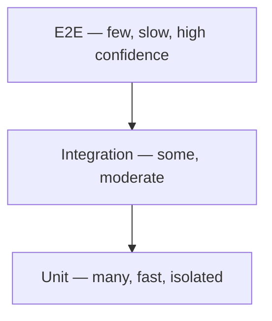

# TESTING-STRATEGY.md — Testing Strategy

> Generated from GENESIS grooming decisions.
> Fill `{...}` placeholders with actual project values.

---

## Pre-Commit Coverage Gate (Husky)

> The local commit guard that enforces coverage **before** a commit is created,
> so broken/undertested code never reaches CI. Mirror of the CI coverage gate.

**Threshold:** changed code must be **≥ {coverage_threshold}% (default 80%)** before the commit is allowed.

### What the guard runs (in order, fail-fast)

1. Lint on staged files
2. Type-check
3. Tests related to staged files, with coverage
4. **Coverage gate** — abort the commit if any changed file is below threshold

### Setup

```bash
# Install husky + lint-staged (one-time)
{pkg-manager} add -D husky lint-staged
npx husky init            # creates .husky/ and wires the prepare script
```

`package.json`:
```json
{
  "scripts": {
    "prepare": "husky"
  },
  "lint-staged": {
    "*.{ts,tsx,js,jsx}": [
      "{lint command}",
      "{typecheck command}"
    ]
  },
  "jest": {
    "coverageThreshold": {
      "global": { "branches": 80, "functions": 80, "lines": 80, "statements": 80 }
    }
  }
}
```

### `.husky/pre-commit`

```sh
# Fail-fast: any step's non-zero exit aborts the commit.
npx lint-staged

# Coverage gate on changed code (choose the form your runner supports):
#   Jest:   jest --coverage --changedSince=origin/{base_branch} --coverageThreshold ...
#   or:     jest --coverage --findRelatedTests $(git diff --cached --name-only --diff-filter=ACM | grep -E '\.(ts|tsx|js|jsx)$')
#   Vitest: vitest run --coverage --changed
{coverage command for changed files, must exit non-zero when < threshold}
```

> **Rules:** the guard is **R008** (must run) and must not be bypassed with `--no-verify` (**R009**); the ≥80% changed-code bar is **R017**. Coverage must come from **real assertions** — never tests written only to lift the number.

> **Why both local and CI:** the husky gate gives fast feedback and keeps red commits out of history; CI re-runs the same thresholds on the full tree as the authoritative gate (a hook can be skipped or differ per machine).

---

## Overview

**Test Pyramid:**


**Target Coverage:** {percentage}% (default ≥ 80% — enforced locally by the husky pre-commit gate and in CI)

---

## Testing Frameworks

| Type | Framework | Location |
|------|-----------|----------|
| Unit | {Jest | Vitest | other} | `**/*.test.ts` |
| Integration | {Jest | Vitest | other} | `**/*.integration.test.ts` |
| E2E | {Playwright | Cypress | Maestro} | `e2e/` |
| API | {Supertest | Postman | other} | `{location}` |

---

## Unit Testing

### Scope

- Pure functions
- Business logic
- Utility functions
- Components (isolated)
- Hooks (isolated)

### Coverage Requirements

| Layer | Target | Minimum |
|-------|--------|---------|
| Domain |  |
| Use cases |  |
| Utilities |  |
| Components |  |

### Best Practices

```typescript
// Good: Descriptive test names
describe('calculateTotal', () => {
  it('returns sum of item prices when cart has multiple items', () => {
    // ...
  });

  it('returns 0 when cart is empty', () => {
    // ...
  });

  it('throws when item has negative price', () => {
    // ...
  });
});
```

### Mocking Strategy

| Dependency | Mock Approach |
|------------|---------------|
| API calls | {MSW | manual mocks} |
| Database | {in-memory | mocks} |
| External services | {mocks} |
| Time | {jest.useFakeTimers} |

---

## Integration Testing

### Scope

- API endpoints
- Database operations
- Service interactions
- Component integration

### Test Database

**Approach:** {Docker | in-memory | test schema}
**Setup:** {how initialized}
**Cleanup:** {transaction rollback | truncate}

### Example

```typescript
describe('POST /api/orders', () => {
  it('creates order and updates inventory', async () => {
    // Setup test data
    // Make request
    // Verify order created
    // Verify inventory updated
  });
});
```

---

## End-to-End Testing

### Framework

**Tool:** {Playwright | Cypress | Maestro}
**Browser(s):** {Chrome | Firefox | Safari | all}

### Critical User Journeys

| Journey | Priority | Frequency |
|---------|----------|-----------|
| {User signup} | P0 | Every PR |
| {User login} | P0 | Every PR |
| {Core feature 1} | P0 | Every PR |
| {Core feature 2} | P1 | Daily |
| {Edge case flow} | P2 | Weekly |

### E2E Test Structure

```
e2e/
├── fixtures/
│   └── test-data.ts
├── pages/
│   ├── LoginPage.ts
│   └── DashboardPage.ts
├── tests/
│   ├── auth.spec.ts
│   └── core-flow.spec.ts
└── utils/
    └── helpers.ts
```

### Page Object Pattern

```typescript
// Example: Playwright
// Adapt for Cypress (cy.get), Maestro (.tapOn), or other frameworks as appropriate

class LoginPage {
  constructor(private page: Page) {}

  async login(email: string, password: string) {
    await this.page.fill('[data-testid="email"]', email);
    await this.page.fill('[data-testid="password"]', password);
    await this.page.click('[data-testid="submit"]');
  }
}
```

---

## API Testing

### Contract Testing

**Approach:** {consumer-driven | provider-driven}
**Tool:** {Pact | OpenAPI validation | manual}

### API Test Cases

| Endpoint | Happy Path | Error Cases | Auth |
|----------|------------|-------------|------|
| `{endpoint}` | {test} | {tests} | {test} |

---

## Performance Testing

### Load Testing

**Tool:** {k6 | Locust | Artillery}
**Environment:** {staging | dedicated}

| Scenario | Target | Threshold |
|----------|--------|-----------|
| Normal load | {n} users | p99 < {ms} |
| Peak load | {n} users | p99 < {ms} |
| Stress test | {n} users | No crashes |

### Performance Budgets

| Metric | Budget |
|--------|--------|
| First Contentful Paint | < {ms} |
| Time to Interactive | < {ms} |
| Largest Contentful Paint | < {ms} |
| Bundle size (JS) | < {KB} |

---

## Accessibility Testing

### Automated

**Tool:** {axe | Lighthouse | pa11y}
**When:** Every PR (subset), nightly (full)

### Manual

**WCAG Level:** {A | AA | AAA}
**Checklist:**
- [ ] Keyboard navigation works
- [ ] Screen reader compatible
- [ ] Color contrast meets standards
- [ ] Focus indicators visible

---

## Security Testing

### Automated

**SAST:** {tool} — every PR
**DAST:** {tool} — {frequency}
**Dependency scan:** {tool} — every PR

### Manual

**Penetration testing:** {frequency}
**Security review:** {when triggered}

---

## Test Data Management

### Fixtures

| Fixture | Purpose | Location |
|---------|---------|----------|
| {fixture} | {purpose} | `{path}` |

### Test Accounts

| Account | Type | Credentials |
|---------|------|-------------|
| `{user}` | {type} | {location of creds} |

### Data Seeding

```bash
# Seed test data
{seed command}

# Reset test data
{reset command}
```

---

## CI/CD Integration

### Pipeline Steps

```yaml
test:
  - name: Unit Tests
    run: {command}
    coverage: {threshold}

  - name: Integration Tests
    run: {command}
    services:
      - {database}

  - name: E2E Tests
    run: {command}
    browsers: [chromium]
```

### Quality Gates

| Gate | Threshold | Blocking |
|------|-----------|----------|
| Unit coverage | ≥ {%} | Yes |
| All tests pass | 100% | Yes |
| No critical security | 0 | Yes |
| Performance budget | Within limits | {Yes/No} |

---

## Test Maintenance

### Flaky Test Policy

1. Quarantine flaky test immediately
2. Investigate within {hours}
3. Fix or remove within {days}
4. Track flakiness rate

### Test Review Checklist

- [ ] Test name describes behavior
- [ ] Test is independent (no order dependency)
- [ ] Test cleans up after itself
- [ ] Test doesn't have hardcoded waits
- [ ] Test uses appropriate assertions
- [ ] Test is not flaky

---

## Running Tests

### Commands

```bash
# Run all unit tests
{unit test command}

# Run with coverage
{coverage command}

# Run specific test file
{specific test command}

# Run E2E tests
{e2e command}

# Run E2E in headed mode
{e2e headed command}
```

### Local Development

- Run related tests before commit
- Full test suite in CI
- E2E for feature branches
