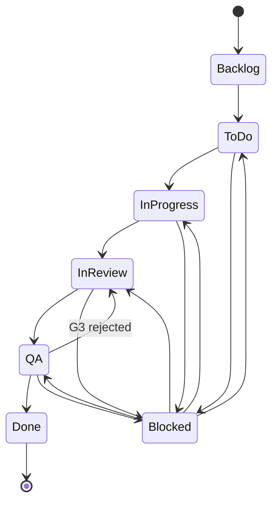

# TRACKING.md — Issue & PR Conventions

> Branch naming, commit messages, PR conventions, and issue states.
> Fill the config block for your project.

---

## Config Block

```yaml
# Copy this file to the project and fill every <fill>. Do NOT leave placeholders.

project:
  issue_prefix: "<PREFIX>"         # e.g. "PROJ" → PROJ-123

tracker:
  type: "<github | gitlab | jira>"
  base_url: "<tracker base url>"
  board_id: "<board id>"           # if the tracker uses boards

github:                            # or the equivalent block for your tracker
  owner: "<org or user>"
  repo: "<repo name>"
  base_branch: "<develop | main>"  # feature → PR base → PR main

ci:
  provider: "<github-actions | gitlab-ci | jenkins | other>"
  required_checks:
    - "<check 1>"                  # e.g. typecheck
    - "<check 2>"                  # e.g. lint
    - "<check 3>"                  # e.g. test
    - "<check 4>"                  # e.g. coverage ≥ 80%
    - "<check 5>"                  # e.g. sonar quality gate
  coverage_threshold: 80           # min % for the husky pre-commit gate AND CI (RULES R017)
```

> **Branch pattern:** `feature/<issue-key>-<slug>` (e.g. `feature/PROJ-123-payment-timer`).
> **Commit pattern:** Conventional Commits `<type>(<issue-key>): <message>` (e.g. `feat(PROJ-123): add payment timer`).

### Placeholder Guard

**RULE:** If any config value is still a placeholder (`<fill>`), the agent MUST stop and report:

> "Config block incomplete — cannot proceed. Missing values: [list of unfilled fields]"

**NEVER** use a placeholder as a literal value. A branch named `feature/<fill>-123-login` or a commit prefixed `<fill>-123` indicates a config error, not a valid ticket.

---

## Branch Naming

### Pattern
```
<type>/<issue-key>-<slug>
```

### Types
| Type | Use For |
|------|---------|
| `feature` | New functionality |
| `fix` | Bug fixes |
| `chore` | Maintenance, refactoring |
| `spike` | Research, investigation |
| `docs` | Documentation only |

### Examples
```
feature/PROJ-123-payment-timer
fix/PROJ-456-null-pointer-checkout
chore/PROJ-789-upgrade-dependencies
spike/PROJ-101-evaluate-caching
```

### Rules
- Issue key MUST be present
- Slug MUST be lowercase kebab-case
- Slug SHOULD be descriptive but short (3-5 words max)

---

## Commit Messages

### Pattern
```
<type>(<scope>): <issue-key> <description>
```

### Types
| Type | Use For |
|------|---------|
| `feat` | New feature |
| `fix` | Bug fix |
| `refactor` | Code change that neither fixes nor adds |
| `test` | Adding or updating tests |
| `docs` | Documentation only |
| `chore` | Maintenance tasks |
| `style` | Formatting, whitespace |
| `perf` | Performance improvement |

### Examples
```
feat(checkout): PROJ-123 add payment timer component
fix(auth): PROJ-456 handle null user in session check
refactor(api): PROJ-789 extract HTTP client to separate module
test(checkout): PROJ-123 add unit tests for payment timer
docs(readme): PROJ-101 update setup instructions
```

### Rules
- Issue key MUST be present
- Description MUST be imperative mood ("add", not "added" or "adds")
- Description SHOULD be lowercase (except proper nouns)
- Line length MAX 72 characters

---

## PR Conventions

### Title Pattern
```
[<issue-key>] <description>
```

### Examples
```
[PROJ-123] Add payment timer component
[PROJ-456] Fix null pointer in checkout flow
```

### PR Description Template

```markdown
## Summary
<!-- What does this PR do? -->

## Issue
<!-- Link to issue -->
Closes #<issue-number> or PROJ-123

## Changes
<!-- List of changes -->
- Added payment timer component
- Added unit tests
- Updated checkout flow to use timer

## AI Review Summary
<!-- Phase 3.5 review results -->
- **Iterations:** {1 | 2}
- **Findings resolved:** {list of issues fixed, or "none"}
- **Perspectives that raised issues:** {e.g., "architecture, edge-cases" or "none"}

## Testing
<!-- How was this tested? -->
- [ ] Unit tests pass
- [ ] Manual testing in dev environment
- [ ] E2E tests pass (if applicable)

## Screenshots
<!-- If UI changes, add before/after screenshots -->

## Checklist
- [ ] Code follows project style guidelines
- [ ] Self-review completed
- [ ] AI review passed (Phase 3.5)
- [ ] Tests added for new functionality
- [ ] Documentation updated (if needed)
- [ ] No secrets committed
```

### Rules
- Title MUST include issue key
- Description MUST link to issue
- PR MUST target the correct base branch
- CI MUST pass before requesting review

---

## Issue States

### State Machine



> `Blocked` is entered from any active state when a blocker is identified, and returns to the same state when it is resolved.

### State Definitions

| State | Meaning | Entry Criteria |
|-------|---------|----------------|
| `Backlog` | Identified but not prioritized | Issue created |
| `To Do` | Prioritized and ready to pick up | Decomposed in GENESIS Phase 3, or added ad-hoc (per-task spec/G1 not required to enter — it gates To Do → In Progress) |
| `In Progress` | Being actively worked on | Branch created, coding started, includes Phase 3.5 REVIEW |
| `In Review` | PR open, awaiting review | PR opened |
| `QA` | CI green, evidence attached, awaiting Gate G3 approval | Evidence attached |
| `Done` | Complete and verified | PR merged + evidence approved |
| `Blocked` | Cannot progress | Blocker identified |

### Transitions

```yaml
transitions:
  - from: Backlog
    to: To Do
    trigger: Prioritized (GENESIS Phase 3 decomposition, or sprint planning)
    
  - from: To Do
    to: In Progress
    trigger: Spec approved (Gate G1) + agent starts implementation
    
  - from: In Progress
    to: In Review
    trigger: PR opened
    
  - from: In Review
    to: QA
    trigger: CI green + evidence attached
    
  - from: QA
    to: Done
    trigger: G3 approved + PR merged
    
  - from: QA
    to: In Review
    trigger: G3 rejected (fixes needed)
    
  - from: [To Do, In Progress, In Review, QA]
    to: Blocked
    trigger: Blocker identified
    
  - from: Blocked
    to: [To Do, In Progress, In Review, QA]
    trigger: Blocker resolved
```

---

## Labels / Tags

### Priority
| Label | Meaning |
|-------|---------|
| `P0` | Blocker — must fix immediately |
| `P1` | Critical — must fix this sprint |
| `P2` | Important — should fix soon |
| `P3` | Nice to have — fix when possible |

### Type
| Label | Meaning |
|-------|---------|
| `story` | User-facing feature |
| `bug` | Defect |
| `spike` | Research/investigation |
| `chore` | Maintenance |
| `tech-debt` | Technical debt cleanup |

### Status
| Label | Meaning |
|-------|---------|
| `needs-spec` | Spec not yet written |
| `needs-review` | Waiting for human review |
| `blocked` | Cannot progress |
| `wontfix` | Decided not to fix |

---

## Linking

### In Commits
```
feat(checkout): PROJ-123 add payment timer
```
The issue key links the commit to the issue.

### In PRs
```markdown
Closes #123
Fixes PROJ-123
Related to PROJ-456
```

### In Code Comments
```typescript
// TODO(PROJ-123): Refactor this after payment API stabilizes
// FIXME(PROJ-456): Workaround for null user bug
```

---

## Automation Hooks

### On PR Open
- Transition issue to `In Review`
- Run CI pipeline
- Assign reviewers (if CODEOWNERS configured)

### On CI Green + Evidence Attached
- Transition issue to `QA`
- Notify human for Gate G3 review

### On PR Merge
- Transition issue to `Done`
- Delete branch (optional)
- Trigger CD pipeline

### On Issue State Change
- Notify relevant parties
- Update dashboards
