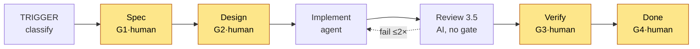
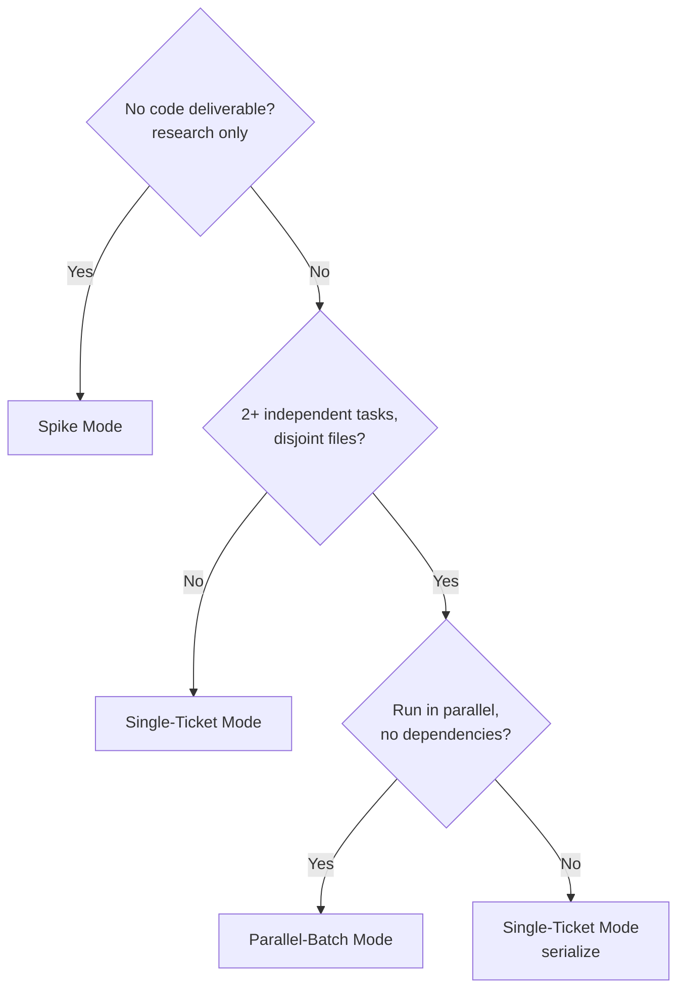
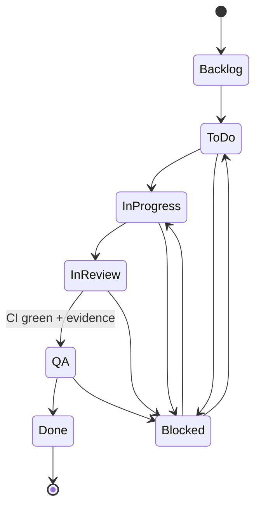

# WORKFLOW.md — Implementation Pipeline

> The execution workflow that runs after GENESIS completes.
> 5 numbered phases (1-5) + TRIGGER (Phase 0) + REVIEW (Phase 3.5), 4 human gates.
> TRIGGER is a classification step, not a build phase. Task-level implementation.

---

## When to Use

Use this workflow AFTER `GENESIS.md` completes:
- All documentation generated and verified
- All tasks decomposed and verified
- All skills identified
- Readiness checklist passed
- Human gave final Go approval

This workflow executes **one task at a time** (or parallel batches).

> **Exception — the setup wave (GENESIS → WORKFLOW handoff).** The first tasks
> (scaffold + local commit guard — e.g. `RBT-001`, `RBT-005a`; a project MAY defer
> the server CI/Sonar task, e.g. `RBT-005b`, to a later hardening step) run through
> THIS pipeline **before** GENESIS Gate **H6**. H6 does not precede WORKFLOW — it **brackets** the
> setup wave: it is GENESIS's verification that this first wave landed green. The
> sequence is **H5 GO → run the setup wave via WORKFLOW → H6 verifies → feature
> waves**. For those setup tasks, "commit guard / CI / Sonar already stood up" (the
> integration table below) does **not** yet hold — they are the tasks standing it up.

---

## Pipeline Overview



**TRIGGER** classifies the task — it is not a build phase and has no gate.
**REVIEW** is a multi-perspective AI pass after code is pushed but before the PR opens;
required fixes loop back to IMPLEMENT (no human gate).
**Gates (G1–G4) are human checkpoints.** Agent stops and reports. Human approves before proceeding.

---

## Phase 0: TRIGGER

**Input:** Next task from `06-TASK-ORDER.md` (GENESIS-prepared work) or an ad-hoc user request.

> For GENESIS-prepared work, take the next task from **`06-TASK-ORDER.md`** (the "Run Next" pointer / current wave) — the main run reference. Dispatch a whole wave in parallel when its tasks are file-disjoint (see Parallel-Batch Mode), else take the next eligible task top-down. A task is eligible only when every "Depends On" task is `Done`. Update Status/Delivered in TASK-ORDER.md as you progress; TASK-LIST.md holds the detail.

**Agent actions:**
1. Classify: `Story` | `Bug` | `Chore` | `Spike` | `Question`
2. If `Question` → answer directly, no implementation needed
3. If `Story` / `Bug` / `Chore` / `Spike` → proceed to Phase 1
4. Read relevant docs for the affected area (from GENESIS output)
5. **Skill check:** Identify domains → search for skills (see `SKILLS-PROTOCOL.md`)

**Output:** Classification + task key + skills loaded (if any)

---

## Phase 1: SPEC

**Input:** Classified task.

**Agent actions:**
1. Find or create issue in tracker
2. Check for blockers in `IMPLEMENTATION-READINESS.md`
3. Draft spec using `TEMPLATES.md §1` — but most spec content already exists from GENESIS
4. Reference the GENESIS docs (ARCHITECTURE.md, API-CONTRACT.md, etc.)
5. Attach spec to issue
6. Report to human

**Output:** Spec on issue (mostly cross-references to GENESIS docs)

### Gate 1 — Spec Approval

```yaml
gate: G1
type: human
question: "Is the spec approved?"
pass_criteria:
  - Acceptance criteria are observable and testable
  - Scope is bounded (in/out explicit)
  - No blockers unresolved
  - GENESIS doc(s) cited
fail_action: Revise or reject spec
```

**Agent behavior:** STOP. Report spec. Wait for approval.

---

## Phase 2: DESIGN

**Input:** Approved spec.

**Agent actions:**
1. Identify affected files (list explicitly)
2. Cite API contracts from `API-CONTRACT.md` with version
3. Cite architecture patterns from `ARCHITECTURE.md`
4. Document any additional design decisions
5. Write ADR note for non-trivial decisions
6. Report to human

**Output:** Design section on spec + ADR (if needed)

### Gate 2 — Design Approval

```yaml
gate: G2
type: human
question: "Is the design approved?"
pass_criteria:
  - Respects architecture from GENESIS
  - No new behavior invented beyond spec
  - Contracts cited with version
fail_action: Revise design
```

**Agent behavior:** STOP. Report design. Wait for approval.

---

## Phase 3: IMPLEMENT

**Input:** Approved spec + design.

**Agent actions:**
1. **Skill check:** Load skills for technologies in design (see `SKILLS-PROTOCOL.md`)
2. Transition issue → `In Progress`
3. Cut branch from base: `feature/<KEY>-slug`
4. Implement strictly against spec, inside listed files only
5. Write tests with real assertions alongside code
6. Follow project `RULES.md`
7. Micro-commits with issue key — each commit passes the **husky commit guard** (lint + type-check + related tests + **changed-code coverage ≥ 80%**); never `--no-verify` (R008/R009/R017)
8. Push branch (do NOT open PR yet — REVIEW comes first)

**Output:** Branch pushed + local tests passing + commit guard green + skills log

**No human gate here.** Agent has autonomy within the spec boundary.
If spec is ambiguous mid-implementation → STOP and escalate (see `RECOVERY.md §F001` for ambiguous spec, or `§F006` if implementation requires scope beyond spec).

---

## Phase 3.5: REVIEW

**Input:** Branch pushed, local tests passing.

**Agent actions:**
Multi-perspective AI review before PR opens. Check:

1. **Acceptance Criteria** — Does the code satisfy every AC in the spec?
2. **Architecture** — Are layer boundaries respected? No prohibited imports?
3. **Contract Conformance** — Do API calls match `API-CONTRACT.md`?
4. **Edge Cases** — Are relevant rows from `EDGE-CASES.md` handled?
5. **Security** — No secrets, no SQL injection, proper input validation?
6. **Test Coverage** — Are critical paths tested with real assertions?
7. **Style** — Does the code match project conventions from `RULES.md`?

**Review outcome:**
- **PASS** → Proceed to open PR
- **FAIL** → List required fixes, loop back to Phase 3 IMPLEMENT

```yaml
review_loop:
  max_iterations: 2
  on_pass: Open PR, transition issue → In Review, proceed to Phase 4
  on_fail_iteration_1: Fix issues, re-review (this is the second and final review)
  on_fail_iteration_2: Escalate to human with review findings (see RECOVERY.md §F011)
```

**Clarification:** "2 iterations" means 2 review passes total. First review may find issues → agent fixes → second review. If second review still fails, escalate. There is no third review.

**Note:** The review loop cap (max 2) is separate from the CI fix loop cap (max 3 — see Phase 4 and F003). Review fails when the code is *wrong* (correctness, architecture); CI fails when code is *broken* (doesn't compile, tests fail).

**Output:** Review passed + PR opened + issue in `In Review`

**No human gate.** This is an AI quality gate. Human review happens at Gate 3 (Evidence Approval).

---

## Phase 4: VERIFY

**Input:** PR opened (after REVIEW pass), CI running.

**Agent actions:**
1. Wait for CI
2. **If CI fails:**
   - **Skill check:** If error is unfamiliar, search for debugging skill
   - Enter fix loop (max 3 iterations)
   - Escalate if still failing → `RECOVERY.md §F003`
3. **If CI passes:**
   - Run security checklist from `SECURITY.md`
   - Capture live evidence for user-facing changes
   - Attach evidence to issue
   - Transition issue → `QA`
4. Report to human

**Output:** Green CI + evidence attached

### Gate 3 — Evidence Approval

```yaml
gate: G3
type: human
question: "Is the evidence acceptable?"
pass_criteria:
  - Evidence is from a live run (not stale)
  - All acceptance criteria verified
  - Security checklist passed
fail_action: Re-run evidence or fix issues
```

**Agent behavior:** STOP. Report evidence. Wait for approval.

---

## Phase 5: DONE

**Input:** Approved evidence (Gate G3 passed).

**Agent actions:**
1. Merge PR to base branch (feature → develop/base)
2. Transition issue → `Done`
3. Update any docs affected by this change

**Output:** Issue closed, code merged to base branch.

**Note:** Agent merges feature branches to base branch after G3 approval. The `base → main` merge (release) is a HUMAN action at Gate G4. Templates say "Do NOT merge" because workers should stop and let the conductor or human handle the merge.

### Gate 4 — Release Approval (base → main)

```yaml
gate: G4
type: human
question: "Is the release ready?"
pass_criteria:
  - All tasks for release complete
  - No blockers unresolved
  - Rollback plan exists (per CI-CD.md)
  - Go/no-go checklist passed
fail_action: Block release
```

**Agent behavior:** `base → main` is HUMAN action. Agent prepares, human merges.

---

## Execution Modes

### When to Use Which Mode



**Decision factors:**
| Factor | Single-Ticket | Parallel-Batch | Spike |
|--------|---------------|----------------|-------|
| Tasks | 1 | 2+ independent | 1 research |
| Files | Any | Must be disjoint | N/A |
| Dependencies | Any | None between tasks | N/A |
| Output | Code + PR | Multiple PRs | Findings + ADR |
| Merge | Agent merges after G3 | Agent merges each after G3 | No merge |

**Note:** Agent merges feature → base after G3 approval. Human merges base → main at G4.

### Single-Ticket Mode
One agent, one task, all phases.

### Parallel-Batch Mode
Conductor dispatches workers. Each worker owns one task with disjoint files.

```
Conductor:
  1. Confirm all tasks are To Do + file-disjoint
  2. Dispatch workers (one per task)
  3. Pass skill context to workers (don't re-search)
  4. Wait for all completions
  5. Verify + report consolidated status
  6. Do NOT merge PRs until G3 approval for each

Worker:
  1. Run Phase 3 (IMPLEMENT), Phase 3.5 (REVIEW), and Phase 4 (VERIFY) for assigned task
  2. Apply skills from conductor brief
  3. Report PR URL
  4. STOP (do NOT merge)
```

**Constraint:** Workers MUST NOT touch the same files.

### Spike Mode
Research only. No code. No PR.

```
1. Time-box defined
2. Research the question
3. Produce: findings + recommendation + ADR
4. Report and STOP
```

---

## State Machine



> `Blocked` is a side state entered from any active state when a hard dependency is unresolved, and returns to the state it came from. Full transition rules in `TRACKING.md`.

State transitions are defined in `TRACKING.md`.

---

## Timing (escalate if exceeded)

| Phase | Post-GENESIS | Ad-hoc | Max |
|-------|--------------|--------|-----|
| Spec | 5–10 min | 15–30 min | 2 hr |
| Design | 10–15 min | 15–30 min | 2 hr |
| Implement | 1–4 hr | 1–4 hr | 1 day |
| Review | 5–15 min | 5–15 min | 30 min |
| Verify (CI) | 5–30 min | 5–30 min | 2 hr |
| Evidence | 15–30 min | 15–30 min | 1 hr |

**Post-GENESIS:** Specs already exist from GENESIS docs; this phase is mostly cross-referencing.
**Ad-hoc:** Task comes from outside the GENESIS-prepared backlog; spec must be written fresh.

---

## Integration with GENESIS

GENESIS produces → WORKFLOW consumes:

| GENESIS Output | WORKFLOW Uses For |
|----------------|-------------------|
| `ARCHITECTURE.md` | Phase 2 design references |
| `API-CONTRACT.md` | Phase 2 contract citations |
| `FLOW-DIAGRAMS.md` | Phase 1 spec context |
| `SEQUENCE-DIAGRAMS.md` | Phase 2 technical flow references |
| `DESIGN-SYSTEM.md` | Phase 3 UI component implementation |
| `EDGE-CASES.md` | Phase 3 implementation, Phase 3.5 review |
| `TESTING-STRATEGY.md` | Phase 3 test writing |
| `INFRASTRUCTURE.md` | Phase 4 deployment verification |
| `CI-CD.md` | Phase 4 pipeline configuration |
| `SECURITY.md` | Phase 3.5 review, Phase 4 security checklist |
| `OBSERVABILITY.md` | Phase 3 logging/metrics, Phase 4 alerting |
| `TASK-ORDER.md` | Phase 0 task selection + parallel-wave dispatch (main run reference) |
| `TASK-LIST.md` | Phase 1 task detail / acceptance criteria |
| `RULES.md` | Phase 3 implementation rules |
| `AGENTS.md` | All phases — project manifest |
| `IMPLEMENTATION-READINESS.md` | Phase 1 blocker check |
| `PROJECT-SETUP.md` | Setup-wave tasks (RBT-001/005) IMPLEMENT it (Phase 3); all later tasks assume commit guard / CI / Sonar already stood up |
